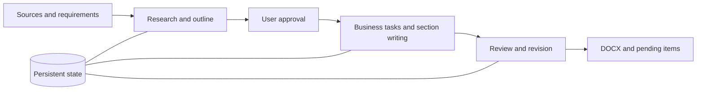

# Folio

**Research-first, resumable long-form document generation.**

From source materials to structured, traceable Word documents.

English | [简体中文](README.zh-CN.md)

Folio is an AI agent workspace for creating long-form documents from project materials. Upload your sources, describe the document, and approve an outline. Folio researches the originals, coordinates writing tasks, reviews the content, and produces an editable DOCX.

Built for technical proposals, RFP responses, requirements specifications, research reports, and other documents that need more than a single prompt.

## Why Folio

Folio manages research, writing, and review as a persistent process, with explicit responsibilities and saved progress across model calls.

- **Research before writing.** Agents navigate file structures, read relevant passages, and retain source references, research notes, and unresolved gaps. Optional search and sandboxed Python extend their research tools.
- **Coordinate long-form generation.** Business tasks own groups of sections. Dependency-aware scheduling, parallel writing, and versioned fact snapshots coordinate their work without requiring the entire project to fit in one model request.
- **Deliver editable Word documents.** Generate headings, tables, and optional diagrams, with support for user-provided DOCX templates and separate writing-style references.
- **Inspect and resume.** Persistent checkpoints, call records, section checks, and cross-section reviews make progress and outstanding issues inspectable. Continue interrupted work from saved state.
- **Separate generation from decisions.** An optional decision model handles intent classification and material relevance. The main LLM performs research, tool use, planning, writing, and review. Folio works without a separate decision model.

## Quick start

Requires **Python 3.11+, [uv](https://docs.astral.sh/uv/getting-started/installation/), Node.js 22.12+, and npm**.

```bash
git clone https://github.com/ChendongPang/Folio.git
cd Folio
uv sync --locked
npm --prefix frontend ci
npm --prefix frontend run build
uv run folio serve --port 8765
```

Open **[localhost:8765](http://127.0.0.1:8765)**. In model settings, enter an OpenAI-compatible **Base URL, API key, and model ID**, test the connection, and save. The model must support native tool calling. Base URLs exclude `/chat/completions`; input and output budgets should match the model's capacity.

Optional services are configured separately and must be tested and enabled:

| Service | Supported interfaces |
| --- | --- |
| Decision model | OpenAI-compatible Chat Completions or native Jev System One |
| Web search | Tavily or DeepSeek Search |

## Create a document

1. **Upload sources.** PDF, DOCX, XLSX, PPTX, Markdown, TXT, or common images. Optionally assign a DOCX template or a finished document as a style reference.
2. **Describe the outcome.** Specify the purpose, audience, language, and requirements.
3. **Review the outline.** Request changes, then approve it to start body generation.
4. **Review and download.** Inspect pending items, download the DOCX, and provide missing information for further revision.

> Using these procurement documents, draft an English proposal covering the technical response, implementation plan, and service commitments. Mark missing company qualifications and pricing for completion. Start with an outline for my approval.

The workspace supports English and Chinese interfaces, independent sessions, and task pause/resume.

## How it works



The main LLM chooses research actions through native tool calls. The engine runs tools, schedules dependent tasks, saves checkpoints, and validates outputs. Outline research passes to the relevant writing tasks; sections within the same business task reuse research memory. Cross-task coordination uses versioned fact snapshots.

**Optional Jev integration** provides typed intent and relevance decisions through System One. Configure the full endpoint `https://api.typesafe.ai/v1/systemone` and a supported model ID, such as `jev-latest`. See [model interactions](docs/model-interactions.md) for protocol and routing details.

Source checks and reviews help surface problems; they do not guarantee accuracy or consistency. Unresolved issues and model proposals remain marked for human review.

## Runtime and extensions

Basic DOCX output does not require Office. Additional capabilities have separate dependencies:

| Capability | Setup |
| --- | --- |
| Templates and style references | [Template guide](docs/templates.md) |
| Flowcharts and interface illustrations | [Renderer setup](docs/illustrations.md) |
| Sandboxed Python, Office conversion, and OCR | [Docker research environments](docker/research/README.md) |
| PDF and page previews | LibreOffice Writer, Python UNO, and `pdftoppm` |

Folio currently runs as a local, single-workspace application without built-in user authentication. The server binds to localhost by default; data is stored in `.folio/`. Configured remote model and search services receive the content needed for their requests.

## Documentation and development

[Documentation index](docs/README.md) · [Architecture](docs/architecture.md) · [Agent research and execution](docs/agent-research.md) · [Workspace migration](docs/workspace-migration.md) · [Examples](examples/acceptance_cases/README.md) · [Model configuration](examples/model.config.json)

Explore the CLI with `uv run folio --help` or the running server's [API documentation](http://127.0.0.1:8765/docs).

```bash
uv run playwright install chromium
uv run pytest
uv run ruff check src tests scripts
npm --prefix frontend run build
```

Bug reports, design discussions, and pull requests are welcome. Include reproduction steps and sanitized logs in [Issues](https://github.com/ChendongPang/Folio/issues); keep API keys and private source materials out of submissions.

## License

Folio is licensed under the [Apache License 2.0](LICENSE). Third-party dependencies retain their own licenses.
