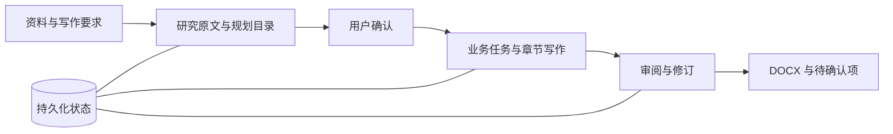

# Folio

**以自主研究为基础、可恢复执行的长文档生成引擎。**

从项目资料到结构清晰、来源可追溯的 Word 文档。

[English](README.md) | 简体中文

Folio 是一个面向长文档创作的 AI Agent 工作台。上传资料、说明写作要求、确认目录，Folio 会研究原文、协调写作任务、审阅内容，并生成可编辑的 DOCX。

适用于技术方案、投标响应、需求说明书、研究报告，以及其他需要整合资料、协调章节的长文档。

## 为什么使用 Folio

Folio 将研究、写作和审阅组织为可持久化的执行过程，在多次模型调用之间明确任务职责、保留工作进度。

- **先研究，再写作。** Agent 按文件结构导航、读取相关原文，保留来源引用、研究笔记和未解决的缺项。可选的联网搜索和隔离 Python 环境扩展研究能力。
- **分任务生成长文档。** 业务任务负责一组相关章节，通过依赖调度、并行写作和带版本的事实快照协调工作，无需把整个项目放进一次模型请求。
- **交付可编辑的 Word。** 支持标题、表格和可选配图，可使用用户提供的 DOCX 模板，以及独立的写作风格示例。
- **可检查、可恢复。** 持久化检查点、调用记录、章节检查和跨章节审阅，让进度与问题可查；中断后可从保存的状态继续。
- **生成与判断分工。** 可选判断模型负责意图识别和材料相关性判断，主 LLM 负责研究、工具使用、规划、写作和审阅。不配置独立判断模型也可使用核心流程。

## 快速开始

需要 **Python 3.11+、[uv](https://docs.astral.sh/uv/getting-started/installation/)、Node.js 22.12+ 和 npm**。

```bash
git clone https://github.com/ChendongPang/Folio.git
cd Folio
uv sync --locked
npm --prefix frontend ci
npm --prefix frontend run build
uv run folio serve --port 8765
```

打开 **[localhost:8765](http://127.0.0.1:8765)**，在模型设置中填写生成模型的 OpenAI 兼容 **Base URL、API Key 和模型名称**，测试通过后保存。模型须支持原生工具调用。Base URL 不含 `/chat/completions`；输入、输出预算应与模型容量匹配。

可选服务独立配置，测试通过后还需启用：

| 服务 | 支持的接口 |
| --- | --- |
| 判断模型 | OpenAI 兼容 Chat Completions 或 Jev 原生 System One |
| 网络搜索 | Tavily 或 DeepSeek Search |

## 生成一份文档

1. **上传资料。** 支持 PDF、DOCX、XLSX、PPTX、Markdown、TXT 和常见图片；可另外指定 DOCX 模板或成品文档作为风格示例。
2. **说明目标。** 指定文档用途、目标读者、语言和内容要求。
3. **确认目录。** 检查章节安排、提出修改，确认后开始生成正文。
4. **审阅并下载。** 查看待确认项，下载 DOCX；补充缺失信息后可继续修订。

> 根据这些采购资料，编写一份中文投标方案，覆盖技术响应、实施计划和服务保障。公司资质与报价缺项请标记待补充，先生成目录供我确认。

工作台支持中英文界面、独立会话，以及任务暂停和续跑。

## 如何工作



主 LLM 通过原生工具调用选择研究动作，执行引擎负责运行工具、调度任务依赖、保存检查点和校验输出。目录研究成果传递给相关正文任务，同一业务任务内的章节复用研究记忆，跨任务通过带版本的事实快照协调。

**可选 Jev 集成**通过 System One 协议完成类型化的意图和相关性判断。填写完整接口 `https://api.typesafe.ai/v1/systemone` 和服务支持的模型名称，例如 `jev-latest`。协议及路由细节见[模型交互流程](docs/model-interactions.zh-CN.md)。

来源校验和审阅用于发现问题，不保证内容绝对准确或一致。未解决的问题和模型建议保留标记，供人工确认。

## 运行环境与扩展

基础 DOCX 输出无需安装 Office；以下能力按需配置：

| 能力 | 配置说明 |
| --- | --- |
| 模板与风格参考 | [模板指南](docs/templates.zh-CN.md) |
| 流程图与界面示意图 | [渲染器配置](docs/illustrations.zh-CN.md) |
| 隔离 Python、Office 转换和 OCR | [Docker 研究环境](docker/research/README.zh-CN.md) |
| PDF 与页面预览 | LibreOffice Writer、Python UNO 和 `pdftoppm` |

当前版本面向本地单工作空间，未内置用户认证。服务默认只监听本机，数据保存在 `.folio/`。配置远程模型和搜索服务后，会向相应服务发送请求所需的内容。

## 文档与开发

[文档索引](docs/README.zh-CN.md) · [技术架构](docs/architecture.zh-CN.md) · [Agent 研究与执行](docs/agent-research.zh-CN.md) · [工作空间迁移](docs/workspace-migration.zh-CN.md) · [示例材料](examples/acceptance_cases/README.zh-CN.md) · [模型配置](examples/model.config.json)

CLI 用法见 `uv run folio --help`；服务运行后可访问 [API 文档](http://127.0.0.1:8765/docs)。

```bash
uv run playwright install chromium
uv run pytest
uv run ruff check src tests scripts
npm --prefix frontend run build
```

欢迎报告问题、讨论设计和提交 Pull Request。在 [Issues](https://github.com/ChendongPang/Folio/issues) 中附上复现步骤和脱敏日志，不要提交 API Key 或私人资料。

## 许可证

Folio 采用 [Apache License 2.0](LICENSE)。第三方依赖保留各自的许可证。
