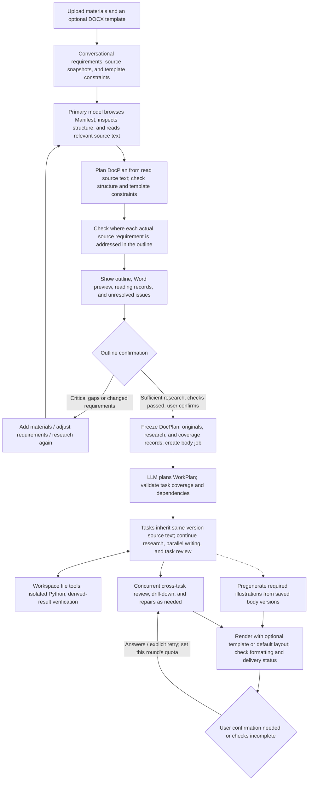
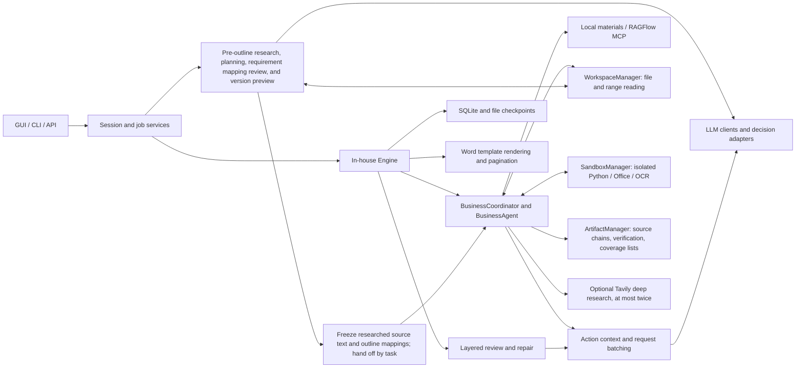

# Folio Technical Architecture

> 中文版: [中文版](architecture.zh-CN.md)

This document describes the current implementation and serves as the entry point to the technical architecture. For installation and operation, see [README](../README.md); for migrating existing data directories, see [Workspace Migration](workspace-migration.md).

## 1. Goals and Current Scope

The GUI accepts DOCX, Markdown, TXT, XLSX, PDF, PPTX, and common image files. Users describe the document they want in conversation, without separately selecting a document type. Files have three purposes: business materials `source`, an optional DOCX document template `template`, and style examples `style_reference`. Style examples are analyzed separately, and content from their previous projects is not treated as fact. The primary model first browses the Manifest, inspects relevant file structures, and reads source text, then plans the outline and checks where actual source requirements are addressed. Users can confirm the outline and start body generation only after sufficient research and successful checks. Business Agents inherit source evidence from the same version, continue research, run isolated Python or conversions as needed, and then generate, review, and export Word documents. The GUI has no Wiki/RAG configuration entry or placeholder for future integration. The CLI and underlying job API retain the independent ability to explicitly configure external RAGFlow; legacy mandatory template and outline parameters have been removed.

The system currently uses an in-house Agent engine. The LLM handles business understanding, outline and task planning, autonomous research strategies, script generation, writing, review, and local formatting suggestions. The application handles execution boundaries, dependency scheduling, source and version validation, persistence, and layout. Planning for the coordinating Agent is performed by the LLM, while the underlying `BusinessCoordinator` reliably executes validated task plans. Jev or luna-decisions continue to handle judgments such as intent classification and material selection; the primary model handles next actions, autonomous tool requests, and computational verification. Optional decision services must pass testing and be explicitly enabled. Final-page Jev scoring and automatic optimization have been removed from the generation workflow.

| Implemented | Not Currently Implemented |
| --- | --- |
| Batch material uploads, streaming conversations, model settings, outline and layout previews | User authentication, multi-tenant isolation |
| Progressive research before outline planning, checks on where actual source requirements are addressed, outline editing and version confirmation | Changes to task requirements during body generation |
| Code-coordinated business, review, illustration, and layout-review roles, with parallel execution once dependencies are ready | Unrestricted restructuring of the WorkPlan or outline during execution |
| Multi-round retrieval, gap suggestions, node writing, layered review | Automatic semantic restructuring of arbitrarily large individual tables or source texts |
| V2 autonomous file research, four Sandbox Profiles, controlled dependencies, and research artifact reuse | Arbitrary host commands, arbitrary network access, or unapproved dependency installation |
| Source chains for derived calculations, independent verification of calculation definitions, item-by-item coverage checks over explicit scopes | Automatically treating OCR as trusted project fact, automatic full coverage of all materials |
| Request batching, checkpoint recovery, resumption after answers to pending questions, Word downloads and reformatting | Unrestricted changes to the outline and business scope of running tasks |
| Default Word layout, structural constraints and formatting preservation for optional user templates | Wiki construction and new vector RAG indexes |

Supporting long documents is an architectural goal, not proof that every combination of page count, template, and model runs reliably. Business correctness and layout quality require acceptance testing with actual materials.

## 2. Core Principles

1. **A business task is not a single model request.** Tasks are organized around complete business problems and may span multiple outline nodes; model calls are organized around specific actions and may be further batched.
2. **Keep complete state in the backend and relevant materials in context.** Persist evidence, body content, work records, and review results without resending the entire history on every call.
3. **Research materials before generating the outline.** The model plans from source text and reviews where requirements are addressed; the application validates structure, real citations, optional template constraints, and confirmation versions. Fixed heading depths, synonym lists, or sample feature names do not determine the outline or task grouping.
4. **Suggestions differ from facts.** If gaps remain after at most three rounds of local research and two optional rounds of online corroboration, the model may add suggestions. The backend preserves their origin, and Word distinguishes them in red. They must not fabricate citations or be promoted to supported facts. Suggestions cannot clear the confirmation gate for critical reading gaps before outline planning.
5. **Each content node has exactly one owner responsible for writing.** Different business tasks run in parallel, node and task records are committed by ID, and global facts are derived from current records to avoid overwrites.
6. **Checks and artifacts must correspond to actual versions.** Failures preserve the previous outline or checkpoint; revisions invalidate related reviews. Download links appear only after files have been generated and registered.
7. **Document types provide writing guidance, not additional delivery gates.** The GUI receives document-type requirements through conversation, while the backend and CLI continue to support URD / SRS guides and legacy session snapshots. Guides influence writing perspective and focus; explicit user requirements take precedence. Guides are not converted into mandatory completion checklists, and failure to adopt every suggestion does not trigger additional reviews, retries, or delivery blocks.
8. **Autonomous research has explicit execution boundaries.** The Agent decides which materials to read, how to calculate, and whether to investigate further. The application fixes material versions, isolated directories, resource quotas, and tool submission protocols without hard-coding the research sequence.
9. **Successful execution does not establish evidence validity.** Calculation results first register their actual inputs and execution chain, then undergo independent checks of sources, calculations, and business definitions. Unverified OCR, invalidated artifacts, and unreviewed calculation results must not enter shared facts or be published.

### Design Trade-offs

| Concern | Current Approach | Boundaries |
| --- | --- | --- |
| Requirement consistency | Immutable requirement versions span sessions, outline confirmation, and job inputs; only explicit requirements enter requirement snapshots | Reject over-capacity inputs; classification failures remain pending, without inferring which requirements the user has withdrawn |
| Outline evidence | Manifest → on-demand navigation → bounded source research, followed by item-by-item checks of where actual requirements are addressed | Show a draft but disallow confirmation when critical evidence is insufficient or applicability is unclear; do not claim all materials are understood |
| Responsibilities and shared state | Separate BusinessAgent / ReviewAgent from the code coordinator, sharing the runtime and Store | No free-form conversational scheduling, multiple databases, or one Agent per action |
| Facts and issue state | A unified, versioned view of active issues retains raw Findings and per-fact Verdicts; content identity controls deduplication and false-positive dismissal | Dismissing a concern cannot supply missing factual support; hard validation cannot be waived, and over-capacity relationships remain pending confirmation |
| Revision consistency | Repair assignments validate ownership and versions, count actual targets, check read/write sets, and commit the entire batch transactionally | Research records may enter checkpoints independently; body content is committed only when the entire batch succeeds |
| Recovery and delivery | Request scheduling checks valid caches first; technical interruptions preserve drafts for answers or explicit retries | Incomplete bodies and application or storage errors still fail; resumption preserves the outline and uses an explicit new-round quota |
| Illustrations and layout | VisualAgent produces HTML/Mermaid illustrations; prefetch uses independent soft quotas and core reserves, canceling stale sources immediately | Required illustrations remain subject to the total job quota; formatting protection and pagination checks do not prove visual quality |
| Autonomous calculation and evidence | Business Agents control file tools and Python loops; signed manifests bind actual sources and execution chains, with independent verification of calculation definitions | Over-capacity inputs, unreadable intermediate results, and unverified inputs cannot be claimed as supported; no unrestricted replanning during execution |
| Complete-scope coverage | Enumerate a checklist from an explicit complete scope and check each item against current body citations | Retain unread scopes, missing items, and applicability decisions pending review; do not automatically turn all uploaded files into mandatory clauses |

This design retains the existing DocPlan, WorkPlan, evidence, red-text suggestions, budgets, checkpoints, and Word templates. Separating responsibilities makes inputs, delivery, and failure handling independently verifiable; Agent count alone does not imply higher quality or faster generation.

## 3. User Workflow and System Stages



Ordinary materials enter a unified Manifest, per-file structure, and body index. Templates are frozen separately and provide only fixed sections, filling instructions, extension points, required tables, and layout constraints; sample body content and data are not business evidence. Pre-outline research reuses Workspace file tools, and actual reading results retain source versions and locations. The body stage can still use LocalKnowledge, explicitly configured external knowledge bases, or optional public-web corroboration. A shared parsing cache is not a Wiki/vector index and does not mean the model has read all materials.

Outline edits use move/update/insert/remove operations with stable node IDs, recompute display numbering, and undergo full validation; failures preserve the original outline. Adding or removing materials, changing file purposes, updating writing guides through the API, or changing formal requirements revokes confirmation eligibility for the previous version. A body job can be created only when the current requirements, materials, template, and research checks are consistent, and it directly reuses the confirmed plan. The GUI allows explicit selection of one DOCX template from the material library, with no document-type selector, template recommendations, cover form, or separate outline-upload step. CLI `prepare` uses `--request`/`--request-file` and `--knowledge` to perform equivalent pre-outline research. CLI `generate` and `POST /jobs` also perform research and checks before body generation when local materials exist and no confirmed plan is provided, without an additional GUI-style manual confirmation step.

## 4. Architecture and Responsibilities



The local model client accesses the streaming Chat Completions interface over HTTP. Tool actions use native tools/tool_calls, are validated and executed by the application, and return real results through role=tool and tool_call_id; custom action JSON is no longer parsed from response text. Outline, body, and review results continue to use their respective data-model validation. Pre-outline `directory_research` is independent of body-job scheduling and reuses the existing Runtime, SourceIndex, and read-only file tools without creating a fictitious Job. Outline planning within existing jobs respects the total quota of `Engine.call`. Body V2 receives native calls through the existing `Engine.call`; `ResearchStep` stores only internal execution records and raw calls, while the backend dispatches file, computation, and artifact operations. Next-step selection, search requests, and supplemental reading for coverage review in the legacy workflow also use native calls. Generated code runs only in restricted containers, without arbitrary host Shell or file access. Workspace, Sandbox, and Artifact managers are internal project modules, not additional network microservices or an internal MCP layer. RAGFlow remains connected through an explicitly configured independent MCP SDK client; retrieval returns raw chunks, and Folio composes the answers. Configuring only remote materials does not establish completion of local outline research.

| Responsibility | LLM | Application |
| --- | --- | --- |
| Outline | Select materials from the Manifest, read structures and source text, propose supported requirements, generate the outline, and review requirement mappings | Parsing and pagination tools, reading records, budgets, real citations, hierarchy and template constraints, versions, and confirmation gates |
| Business tasks | Goals, node ownership, business questions, dependencies, and completion criteria | Single-owner enforcement, cycle validation, ready-task scheduling, and concurrency limits |
| Research | File exploration, reading ranges, query terms, Python, further-research strategy, and completion decisions | Fixed tool protocols, read-only input snapshots, Sandbox, complete execution records, call and time budgets |
| Computational evidence | Independently judge whether sources, calculations, and business definitions support conclusions | Validate source locations, signatures, and hash chains; prevent sharing or publishing unverified and invalidated results |
| Body | Writing, fact extraction, gap suggestions, and local revisions | Body structure, citation existence, template table headers, and atomic commits |
| Review | Support, conflicts, omissions, drill-down, and repair instructions | Related-item grouping, concurrency, coverage checks, and fact-key conflict indexes |
| Delivery | Provide business judgment results | Layout, check validity, version comparison, and real artifact registration |

Generation and decision services independently configure Base URL, API key and model ID using OpenAI-compatible Chat Completions; decision services additionally support native Jev at a complete `/v1/systemone` endpoint (model example: `jev-latest`). Search supports Tavily and DeepSeek Search. Optional services require a successful test of the exact current settings before enablement; secrets remain server-side.

`DecisionRouter` supports `intent` and material-selection judgments. `next_action` now uses native function calls from the primary LLM rather than the decision service. An intent Choice must belong to the candidate set and have confidence of at least 0.8. Uncertainty, insufficient capacity, or service failure can still fall back to the LLM; repeated service failures temporarily suspend attempts within that Runtime. Each chat message creates a new Runtime, so circuit-breaker state does not persist across messages. Autonomous pre-outline research, source-requirement mapping review, and detailed business review remain the responsibility of the primary model.

Material selection uses a separate fixed route in [MaterialSelector](../src/folio/decisions/selection.py): use only the decision model when it has been verified and enabled; otherwise use the LLM. Jev relevance probabilities must be strictly greater than 0.8; a value of 0.8 is not selected. Invalid scores or service failures produce explicit errors without falling back to the LLM. The main LLM paginates by complete-request token capacity without a fixed item-count limit. Independent decision services use a 600,000-character compatibility budget and at most 24 items per page, including state, questions and protocol overhead. Oversized individual items are split losslessly. Selection does not generate business facts, and the source text required for selected facts must be retained.

## 5. Materials and Core Data Objects

GUI file purposes are ordinary materials `source`, document templates `template`, and style examples `style_reference`. The default is ordinary materials, and only one DOCX template is allowed. Without a selected template, the internal default Word layout is used. When a template is selected, the application extracts and binds trusted template constraints, storing the template original separately from business materials. Style examples first undergo internal-structure and measurable-format extraction, followed by capacity-based batch analysis of all extractable text to generate an inspectable `style.md`. Analysis allows at most 128 requests by default; unread text and visual gaps are recorded separately. The outline, body, and final Word document share a frozen style profile. Explicit user requirements and the template take precedence, and business content from examples does not enter facts or evidence. The CLI uses writing requirements, local material directories, or explicit remote-knowledge configuration, while retaining `--reference` for factual materials and `--sample` for style examples; the latter reuses the same analysis workflow. The CLI/API have removed legacy `template_path` and `outline_path` inputs. The workbench's optional template is passed through the document plan without restoring the old mandatory workflow.

| Object | Problem Addressed | Content and Constraints |
| --- | --- | --- |
| `RequirementSnapshot` | How to keep multi-turn requirements consistent | Complete original user text and revision suggestions, content hash; outline confirmation and body generation use the same snapshot |
| `WritingGuide` | Which perspective and depth to use | URD / SRS configuration snapshot; purpose, audience, writing tendencies, focus areas, and suggested strategies, not business evidence |
| `DocumentPlan` (DocPlan) | What the final document looks like | Node IDs, titles, hierarchy, order, writing requirements; optional `TemplateContract` validated and bound by the application, with no legacy outline references |
| `TemplateContract` | Which hard constraints the user template imposes | Frozen DOCX hash, fixed sections and order, allowed extension points, required tables, and layout basis; template examples are not facts |
| Outline research and requirement-mapping records | Which actual source texts support the outline | File versions, reading ranges, source Evidence, supported requirements, target outline nodes, unresolved issues, and confirmation eligibility |
| `Section` | A locatable document node | Any supported heading level; `generate` writes body content, while `container` only organizes the outline |
| `WorkPlan / WorkTask` | How to complete the body by business problem | Task goals, assigned nodes, questions to answer, dependencies, completion criteria |
| `WorkState / BusinessRecord` | How far a business task's research has progressed | Evidence, query history, facts, terminology, conflicts, gaps, suggestions, review versions, and research rounds/quotas/coverage lists |
| `Evidence` | Where a supporting passage comes from | Original content, source-file hash, role, and location; derived evidence additionally binds a signed computation chain, while OCR retains an unverified marker |
| `ResearchStep / ResearchLedger` | How the model researches and whether tools actually completed | Bounded structured actions, real observations, persistent request identities, results, usage counts, and elapsed time |
| Artifact/Coverage records | How to recheck calculations and identify omissions in a complete scope | Actual scripts and intermediate results, environment versions, independent verification; enumerable items and their treatment locations in the current body |
| `SectionState` | What the current node contains | Body blocks, extracted facts, raw per-fact verification verdicts, evidence, local issues, and revision number |
| `Finding / DrillDown` | Whether an issue is real and how to handle it | Affected nodes, supporting evidence, repair instructions, or results pending confirmation |
| `Job` | The authoritative state of this execution | Input snapshots, plans, stages, call records, events, baselines, and artifacts |

For example, a “Transaction Approval” task may own “Input Information,” “Approval Workflow,” and “Exception Handling,” while another task owns “Transaction Reversal.” Tasks may span outline levels, but two tasks must not write the same content node. Global state is a derived view of node records, not a shared summary overwritten by multiple coroutines.

### Document Types and Optional Writing Guides

The [URD configuration](../src/folio/document_profiles/urd.yaml) focuses on business goals, scenarios, scope, and rules; the [SRS configuration](../src/folio/document_profiles/srs.yaml) focuses on system behavior, inputs and outputs, states, exceptions, data, and interface constraints. Both share the existing Agent workflow and template layout rather than using separate generation engines. The GUI has removed the document-type selector. New sessions attach no type guide, and users describe the required document type in conversation; older sessions retain their original snapshots. CLI `generate` / `prepare` still support the optional `--document-type urd|srs`; omitting it attaches no guide, and the backend retains the writing-guide API.

[guidance_context](../src/folio/document/guidance.py) deterministically selects configuration fields for the current action: planning and writing include expression style and focus areas, retrieval includes focus directions, illustrations include diagram suggestions, and review and action selection include only purpose and nonmandatory strategies, without suggested checklists. Guides are placed separately in `writing_guidance` and are not converted into mandatory conditions in `Section.instruction` or `completion_criteria`. No extra model calls are made to select guidance items. Both [Request Organization and Capacity Measurement](../src/folio/orchestration/requests.py) and [Outline Preview Planning](../src/folio/document/prepare.py) add the same context before measurement, keeping actual calls and measurement consistent.

Explicitly configured guides are saved as complete snapshots and passed along “session → outline draft → confirmed outline → `JobInput.writing_guide`.” Jobs also export `inputs/writing-guide.json`; recovery does not reread the current YAML. Outline confirmation checks the guide snapshot. Updating a guide through the API invalidates the old outline and requires replanning; updates are prohibited during body execution. Older sessions and jobs without this field continue using their original writing behavior, and configuration updates do not rewrite old bodies. Relevant entry points are [workspace](../src/folio/api/workspace.py), [directory_drafts](../src/folio/directory_drafts.py), and [Store.create](../src/folio/store.py).

## 6. How Materials and Requirements Become an Outline

The GUI reuses existing intent judgments to classify messages as formal requirements `active`, ordinary consultation `discussion`, clarification needed `clarification`, or judgment incomplete `pending`, while separately retaining UI-command markers. Only formal requirements and explicit outline-revision suggestions enter `RequirementSnapshot`. Both classifications and original wording remain available for audit, with no new independent model call; Jev / luna-decisions retain their existing decision routes. Consultations do not change the requirement version. Pending messages must be resent and classified before planning or confirmation. When older messages lack classification, existing constraints are conservatively retained rather than automatically deleting frozen requirements. Snapshots preserve complete original text chronologically, with later requirements taking precedence for explicit revisions, rather than relying on summaries of recent chat turns. Requirements exceeding 600,000 characters are explicitly rejected for planning. Changed requirements or old outlines without snapshots require replanning. Live requirement changes are prohibited during execution; answers provided after a pending-confirmation state follow a separate resumption contract.

The GUI uses [source_documents.py](../src/folio/source_documents.py) to freeze complete materials and generate a metadata manifest, rather than treating the first 8 headings and first 12,000 characters of each file as the basis for planning. Pre-outline [research_for_directory](../src/folio/research/planning.py) first supplies the Manifest, after which the primary model selects files and uses `fs.inspect` to inspect structure, `fs.search` to locate content, and `fs.read` to read source text in pages as needed. Structural browsing is a recommended navigation strategy, not a mandatory confirmation gate for every file. Once body content has been explicitly located and read, failure to run `fs.inspect` alone does not block a conclusion. The model chooses ranges according to the task; it need not read every attachment word for word. It may cite delivered page ranges without completing the entire queried reading range, while unread status and gaps affecting the outline remain recorded. Unused files require exclusion reasons. Structural navigation, search results, and successful parsing must not be presented as completed source reading.

This research loop allows at most three rounds, with 12 steps per round by default, for a total of at most 36 model actions and 600 seconds, also subject to call and context limits. It starts with local materials and may query public questions through an enabled search service, does not execute Python, and does not replace missing tender requirements with online sources or model-generated additions. The body stage retains the existing three local rounds, two optional online rounds, and suggestion-generation workflow. Every actual action and returned record is persisted, while gaps, unreadable ranges, insufficient budgets, and unresolved business scope remain `partial`. With no ordinary materials, the status is `no_sources`; planning relies only on user requirements and the optional template, without fabricated reading records.

Outline and body research share `ResearchMemory`, which stores application delivery records, model research notes, and source evidence in separate layers. The model appends notes with `evidence_ids` in its next native tool call, distinguishing source statements, inferences, and irrelevant scopes. `request_ids` are no longer required; the application reconstructs batch associations from actual delivery records. Omission does not clear existing notes, explicit revisions retain history, and retries are idempotent. Source text must be summarized before leaving context. When notes grow large, an index is retained and notes are read in pages as needed. Complete state is saved with reports or checkpoints, with `research.md` exported from the same source. History entries identify files and page ranges; rereading requires a specific verification reason, and repeated lack of progress triggers consolidation before bounded termination. Research notes do not automatically enter global facts, and existing snapshot, citation, and coverage validation remains unchanged. See [File Research and Execution Design](agent-research.md#shared-research-memory).

The primary model extracts outline requirements from actual source text. Each requirement in `finish.requirements` cites supporting Evidence IDs such as `E1`; reading uses files, nodes, or page numbers, and these two identifier types must not be mixed. The application derives `selected_ranges` from real evidence and reading records, so the model no longer fills it in separately. Unknown references, version or location mismatches, and references not actually delivered still cannot pass validation. Citing read page ranges does not change `complete=false` for the entire range to fully read. A complete `PlanProposal` is then output in one response, and the application checks node uniqueness, heading hierarchy, container purpose, and related constraints. Optional templates additionally require checks of fixed headings, order and parent-child relationships, open extension points, and required tables. `PlanProposal` contains no legacy outline references, template-field selection, or unused-field lists. Trusted template binding is performed by the application, and template sample body text and data do not enter planning facts.

`review_directory_research` compares each researched requirement, its complete corresponding source text, and the entire outline, requiring a clear mapping to the title or writing instructions of a node that actually generates body content. Results are `covered`, `not_applicable`, or `missing`. Exclusions require real evidence of applicability and cannot fill omissions with “research later.” The application validates real node and evidence IDs and exactly one result per requirement. Omissions trigger bounded outline repair and rereview. Confirmation is allowed only when research is `ready` (`no_sources` when there are no ordinary materials) and checks pass; `partial` displays only a draft. Older outlines without research records can still be previewed but require new research before confirmation. **This proves only that researched requirements have explicit writing destinations, not that the body is already correct or that every potential requirement has been discovered.**

The right-hand outline provides expandable material-research records: which files had their structures inspected, which sections or ranges were read, the number of source-text characters returned, and unresolved issues. Reading statistics do not indicate comprehension rates. Confirmation checks requirement, file-purpose, guide, and outline versions together, and the backend rejects attempts to bypass the UI to confirm outlines with incomplete research. After confirmation, source evidence and requirement mappings are frozen and inherited according to the nodes owned by each business task, without placing research summaries directly into global facts.

Complete outline proposals are not batched. Source reading and source-requirement review may be paginated/batched, with at most 12 review batches by default. Inputs exceeding protective budgets fail explicitly or remain incomplete, rather than silently truncating source text and claiming checks passed. For transport, editing, review, and confirmation contracts, see [LLM Outline Planning](outline-planning.md).

## 7. Body Agent Loop and Task Parallelism

Before execution, the LLM constructs a WorkPlan from content nodes, user requirements, and the material index. Grouping is based on business relationships, complexity, and material volume. The default maximum of 8 content nodes per task is a resource constraint, not “fixed splitting by third-level headings.” The plan remains stable after validation.

The application checks all pending tasks. Tasks whose dependencies are complete enter a bounded asynchronous queue, with a default maximum of 16; real dependencies still wait for upstream body generation and task review to complete. Each task executes:

```text
Fix task assignments, original-file versions, dependency conclusions, and the global fact snapshot
  → Validate and inherit same-version source evidence and writing requirements assigned to this task from outline research
  → Primary-model research_step decides whether to inspect files, search, read precise ranges, calculate, or register results
  → Application validates and executes tools, returning real results and errors to the next round
  → Calculation artifacts register source chains and become valid evidence after independent verify_derivation checks
  → Continue research based on findings; finish retains all unresolved issues
  → understand_work creates BusinessRecord and starts writing
  → Gaps found during writing return to autonomous research; unsupported suggestions remain red under existing rules
  → Write, extract, and validate pending nodes with up to eight concurrent paths
  → Review the task as a whole, check coverage, save versions, and release downstream dependencies
```

New GUI jobs and CLI `--runtime llm` enable `JobInput.research` by default. Historical jobs without this field and the default Demo retain the original `search / write / pending` loop, still constrained by three knowledge-base rounds and two optional rounds of online corroboration. V2 uses primary-model research actions and preserves existing decision-model routing; Python and complex tool parameters are not sent to Jev/luna classification interfaces.

The engine uses code-coordinated multi-Agent collaboration: `BusinessCoordinator` dispatches business tasks, `BusinessAgent` handles research and body content, `ReviewAgent` handles whole-task review, and `VisualAgent` handles illustrations. Final delivery performs formatting protection and pagination checks, with no Jev page scoring. They share the same call gateway, Store, and budget, without free-form chat or multiple state stores. Each business task still runs a bounded Agent loop; cross-section checks and drill-down are organized centrally by the engine. Once research is complete, all pending nodes enter writing directly with up to eight concurrent paths, rather than waiting for the first section. Further-research and supplemental-writing records are still merged under the task lock. The primary model permits up to 32 concurrent calls during business-task execution and 16 during later stages such as review, with a combined cross-stage limit of 32 for the primary service. Verified and enabled decision services share a separate limit of 16 concurrent calls per job. The combined main-model and decision-service limit is 48. Without an enabled decision model, selection also counts against primary-model slots.

Each new research version fixes its visible global facts. Writing reads them by node relevance and includes their original supporting evidence; parallel tasks do not read other tasks' uncommitted conclusions in real time. `IssueLedger` uniformly filters false positives dismissed for the current version while preserving raw issues for audit. Global facts accept only records with positive verification, valid citations, no model-suggestion status, and no current blockers. Dismissing a false positive does not itself establish a fact. Task results are saved separately, and conflicting values retain their sources. Downstream readiness requires completion of upstream body generation and task review; **it does not mean the upstream content has received business confirmation**. Nodes with known issues do not supply supported facts downstream; related suggestions and risks are passed separately.

The fact-snapshot strategy does not include fact subscriptions, cross-task real-time synchronization, or automatic full rewrites after fact changes. Explicit dependencies and final global review handle consistency checks, accepting possible local rework to control synchronization and model-call costs.

V2 local research allows at most three rounds, each with 12 bounded tool steps by default, using file tools and `fs.search(scope="knowledge")`. If evidence remains insufficient, the coordinator schedules at most two web-search rounds; remaining gaps then receive labeled LLM suggestions. Agents cannot use tool requests to bypass stage ordering. Rounds are persistently registered before calls, and ordinary repairs and recovery do not reset them. Knowledge-base access defaults to at most three times per task, and the tested, enabled search provider permits at most two web searches (Tavily uses `advanced`; DeepSeek Search uses its native search endpoint). Each public query is generated by the LLM for a specific gap. Returned web excerpts enter the existing understanding and judgment workflow as `metadata.role=public_web` evidence and cannot be promoted to internal project facts. `WorkState.web_searches` saves counts and status before requests; exceptions, restarts, dependency updates, and rework do not reset quotas. Search timeouts or unavailability leave explicit results and do not count as finding supporting evidence.

When materials remain missing, the LLM generates specific suggestions for the gaps, and the application validates each gap's ownership and coverage. Each section integrates only gaps raised in this attempt that remain unresolved after further research; further research for other sections in the same task does not transfer ownership of every gap. Relevant business additions are integrated into the body by the writing model and marked red, while writing guidance and missing metadata remain backend-only, with original gap records preserved. Supplemental writing ensures the content is addressed, not that the evidence has become sufficient. Failures of the core writing model, protocol, or validation still abort execution; success cannot be guaranteed for every task.

### 7.1 Workspace, Sandbox, and Derived Evidence

Upload validation, outline materials, LocalKnowledge, and Workspace share format readers. DOCX retains body and table locations; MD/TXT retain original line numbers; XLSX retains Sheet/cell ranges and formula-cache status; PDF/PPTX retain page/slide numbers and unread ranges; images retain format metadata and are processed through isolated OCR. Evidence IDs, source-file SHA-256 hashes, and exact character excerpts delivered to the model are generated by the backend. Finishing a search or pagination does not clear unread visual ranges in a file.

Each task research round has an independent persistent directory: `context/` stores read-only task and fact snapshots, `scratch/` stores temporary files, `artifacts/<execution>/` stores outputs from that execution, and `.research/` stores execution, script, and signature records that model code cannot write. Containers are allocated per operation, with networking disabled by default, a read-only root filesystem, a non-root user, and limits on CPU, memory, processes, time, and output. Originals, task context, and valid preceding artifacts are mounted read-only. Cancellation reclaims execution before releasing job ownership, and model scripts do not run in the host interpreter.

The four environments are `base`, `data`, `office`, and `ocr`. Operations staff can specify policies in `settings/research.json` or `FOLIO_RESEARCH_CONFIG`; executions save actual image digests and dependency locks. Dynamic dependency requests must match package names, fixed versions, wheel SHA-256 hashes, and dependency closures on the operations allowlist. Only the fixed installer can access the network, without business materials mounted. For configuration and build commands, see [Research Environment Deployment](../docker/research/README.md).

`artifact.save` first validates the file, script, and execution identity and registers the artifact, after which the primary model independently checks sources, calculations, and business definitions. Multi-step calculations must include actual preceding scripts and intermediate results; results remain unsupported if full verification is impossible. Backend signatures do not accept model-reported `verified` status. Subsequent shared facts, reviews, and publication recheck the hash chain; changes to any source, preceding calculation, or final result invalidate citations. Cross-task reuse requires prior verification and continued matching of current sources and environment versions at every step.

OCR evidence uses an `extracted:` identity and retains original-file versions, page numbers, and recognition-execution details. It may enter drafts but cannot become a shared fact or pass publication checks until independently verified against the original. Users can explicitly answer questions about critical source text, supplying new user evidence and revisions through the existing confirmation workflow. Native Excel reading does not calculate formulas, and cached values are not automatically trusted; Office recalculation and complex-format conversion still have compatibility limits.

For material scopes explicitly requiring complete coverage, CoverageManager directly enumerates the complete items, records body locations, reasons for pending confirmation, or non-applicability reasons, and rechecks against the final body version. Model summaries cannot replace unread ranges, truncated results, or missing items. Search hits do not constitute a complete checklist, nor do they automatically make every attachment subject to mandatory item-by-item coverage. Scope review can inspect outlines in pages, and unresolved scopes receive bounded rereview when new locations become available; completeness is checked only for selected pages/sections/Sheets. Independent visual verification binds the original file, extracted blocks, and original-image hashes. Verified OCR ranges can enter the checklist, while online sources and model suggestions cannot replace source coverage. For detailed interfaces and boundaries, see [Business Agent File Research and Execution Design](agent-research.md).

## 8. Request Context and Capacity

```text
Complete backend state → Materials needed for the current action → Valid-cache check → Capacity measurement and model request on cache miss → Validation and aggregation
```

Writing does not carry the complete bodies of other nodes. Fact extraction reads the current node and cited evidence; action selection reads business records, gaps, and evidence indexes; global review reads grouped summaries, facts, and suggestions, then reads relevant source text for drill-down when issues are found. Dependency materials are selected through the fixed routes described above, while the application preserves project sources that must be covered and validates citations. Drill-down reads directly when the complete request fits; material selection is used only when complete-request capacity is exceeded. Task completion criteria and complete explicitly cited source passages remain mandatory reading and are not sent through relevance filtering.

A model's **context window** and **maximum output allowance** are separate concepts. Services supporting token counting schedule requests under this condition:

```text
Actual input tokens + Output tokens reserved for this action + 512 tokens of headroom <= Model context window
```

Requests default to 600,000 input tokens and 128,000 output tokens. Local estimates apply when provider metering is unavailable; known smaller model windows take precedence. Outline planning also checks complete-request capacity.

Evidence reading, gap completion, fact extraction, local validation, and review can be batched according to their respective coverage contracts. Input limits and output truncation are handled separately; truncated JSON is not accepted as a result. Batching does not split business tasks, reset the three retrieval rounds, or lose sources. If the smallest safe unit is still too large, execution fails explicitly. See [Request Context and Capacity](context-and-capacity.md).

## 9. Layered Review and Bounded Repair

| Layer | Check Scope | Execution |
| --- | --- | --- |
| Node validation | Body content, facts, and applicable original evidence | Structural checks and LLM semantic checks, batched when necessary |
| Whole-task review | Cross-section responsibilities, continuity, and rules within the same scope | Reuse node evidence validation; when capacity is insufficient, first identify the actual questions to check, then read source text |
| Cross-task review | Adjacent windows, specific facts, shared topics, and real dependencies | 16 concurrent groups by default, each containing at most 6 sections by default; a separate fact-conflict index is retained |
| Issue drill-down and repair | Source text and evidence involved in candidate issues | Determine whether issues are real, repair affected nodes, and rereview |

Broad subjects are checked in bounded topic groups rather than through every pairwise combination of related sections. Model suggestions on both sides do not justify pairing. Distinct verbatim values with the same `scope / subject / predicate` are compared together using representatives within the group-width limit. Beyond that limit, they form one drill-down issue preserving all records and section ranges. Different values of supported single-valued facts are also reviewed as whole groups by fact key rather than expanded into all pairwise combinations. Groups that cannot be fully checked explicitly remain pending confirmation, preventing contradictions at opposite ends of a window from being mistakenly treated as passed. Candidate assertions also participate, but wording differences alone do not establish conflict. Relationships already covered by grouping are reused, and internal relationships within a task remain the responsibility of task review. Unextracted implicit relationships may still be missed; exhaustive coverage of all semantic relationships cannot be guaranteed.

Concerns are deduplicated only when type, location, citation set, and normalized description all match, with original records retained for audit. The same issue key with different descriptions remains separate concerns. Missing-citation allegations from local and task reviews must identify fact blocks; legitimate red-text additions are not flagged merely for lacking citations. Other valid concerns enter `drill_down` for comparison with source text, rather than automatically exempting mixed facts based on source labels or keywords. False positives are recorded by body version and cannot waive hard structural or citation validation.

`Finding.fingerprint` uses v2 content identity from issue creation, including type, rule, evidence category, body/evidence locations, normalized description, and comparison scope. Issues without locations also retain the original issue key for distinction. Individual reads, list reordering, deduplication, and restoration after saving all use the same identity, without temporarily rewriting the model's `key`. Legacy ledgers did not include descriptions in identity, making their waiver targets unsafe to identify. They therefore remain available for audit but are not automatically migrated into v2 waivers and require fresh drill-down.

Review first fixes versions and groups, then up to 16 worker coroutines claim top-level groups. Batched calls remain constrained by the total per-job slot limit to prevent unbounded concurrency growth. The GUI's “X/N groups completed” counts top-level groups; a group completes only after all its subrequests finish.

Repair orders specify the original owner and the versions of sections to be written. Repair budgets are checked only for nodes actually modified; reference nodes do not consume that budget. Independent repairs may be computed in parallel. After all complete, `save_sections_batch()` checks read/write versions and saves them in one transaction; any failure prevents the entire batch from committing. Repairs invalidate related task and dependency reviews. When the repair budget is reached, a business decision is needed, or drill-down cannot return a valid decision, issues are retained and a draft pending confirmation is delivered. Revisions do not continue indefinitely, and issues are not silently deleted.

Enabling a writing guide does not add review rounds. If an existing review returns `coverage` / `pending` suggestions based only on the guide, the model must explicitly mark them `basis=guidance`. The application saves them separately in `contexts/advisory_notes/`; they do not enter repair or delivery-status calculations and are not written into the Word body. Actual business conflicts, unsupported statements, and extraction errors follow the existing workflow and are not exempted because they carry a guidance label. For routing, see [advisory.py](../src/folio/orchestration/advisory.py) and [Engine.check_result](../src/folio/orchestration/engine.py).

## 10. Layout, Artifacts, and Recovery

Without a selected template, Word uses the internal default layout. With a template, rendering is based on the frozen original DOCX, preserving styles, fonts, fixed heading numbering, table layouts, pages and sections, headers and footers, and front matter; default rules fill only undefined elements. Template filling instructions and sample body content are replaced with actual content, and sample data does not automatically become project data. LibreOffice/UNO measures page numbers and generates previews, while the application fills Word field caches rather than resaving the DOCX through LibreOffice and replacing template styles. When this component is unavailable, updatable fields are retained with instructions to update page numbers in Word/WPS.

Once a section’s body text has been extracted, locally verified, and saved, [VisualPrefetch](../src/folio/orchestration/visual_prefetch.py) can pre-generate the required illustrations against the saved body version, overlapping with subsequent writing and review; nodes affected by issues outside the pending-confirmation category are not started yet. Pre-generation and final illustration generation share 4 workflow slots, with at most 2 concurrent browser renders and a separate limit of 2 concurrent pre-generation model calls. All requests remain subject to the main service’s total slot limit. Pre-generation may use at most `min(120, floor(max_calls/5))` calls and reserves `min(max_calls, max(12, ceil(max_calls/4)))` calls for core work. SQLite atomically checks and deducts the budget before every actual attempt and retry; cache hits incur no deduction. Insufficient soft quota only defers work and is not cached as an illustration failure; final illustration generation may use the remaining main budget. Changes to body-related sources, illustration removal, or substantive conflicts immediately cancel and clean up stale tasks. Only illustrations that pass both identity and file validation are reused in the final output; no partial manifest is published.

The current `formatting` stage first renders an unpaginated DOCX, locates body text and tables by WorkTask, and supplies local layout objects to the LLM in groups with at most 4 concurrent requests. The LLM returns only allowlisted formatting instructions. The program validates targets, alignment enum values, paragraph spacing, and font-size ranges relative to the template baseline, then applies the instructions and verifies that all text and protected formatting remain unchanged. Font families, red text, the cover, headings, numbering, and text and image content cannot be changed. Each group is limited to three calls and 25 seconds, with a total stage limit of 120 seconds. On failure, the template layout and operations already confirmed safe are retained without blocking delivery. Pagination is applied uniformly at the end. `formatting.json` stores formatting operations, and reformatting replays only operations that can be validated.

Jev’s per-page aesthetic scoring, LLM modifications triggered by low scores, and rescoring have been removed from `Engine.finish()`, and model settings no longer expose this toggle. `supports_image_input` still controls actual image input in source research, style analysis, and other stages. Normal generation does not initiate Jev image self-checks or page requests for final scoring, nor does it treat the absence of this scoring as an issue requiring confirmation. Formatting protection and template validation remain in place; successful export does not mean that visual aesthetics have passed review.

Historical page-scoring reports, screenshots, and approved patches remain available for reading or diagnostics. `reformat` can check and replay compatible patches using the existing signature, but does not call a scoring model or claim that the new file has undergone another visual inspection. Retaining standalone diagnostic modules does not mean that this capability remains enabled in the generation workflow. See [Illustrations and Historical Page Review](illustrations.md).

[DocPolish](https://github.com/ChendongPang/docpolish) is a standalone Word formatting project. It is not currently integrated into Folio’s generation and delivery pipeline, and Folio does not automatically submit documents to it.

The fixed sections, pages and section breaks, styles, and required tables in user templates are revalidated after rendering and formatting, and before delivery. Formatting adjustments cannot override specified fonts and formatting. Templates must use actual Word headings. Complex drawings, text boxes, content controls, unresolved tracked changes, nested tables, and merged data cells that cannot be safely populated in the body are explicitly rejected. Cover and header/footer graphics can be retained, but pixel-perfect fidelity for arbitrary Word files is not guaranteed. See [User Template Design](templates.md) and [Materials and Formatting](source-materials-and-layout.md).

Status and file relationships:

- `published`: Current checks have no blockers, artifacts are complete, and publication has been registered after comparison with the document baseline version; this is not business approval.
- `draft`: A draft has been generated, for example one containing model suggestions or using Demo.
- `needs_confirmation`: A downloadable draft is available, but issues requiring confirmation remain.
- `failed`: Execution did not complete; checkpoints and errors are retained, and nonexistent download files are not displayed.

If the model-call budget is exhausted, the model service returns an error, retries are exhausted, or execution times out after the complete body has been saved, new model requests stop. Existing concerns and a record that “checks are not yet complete” are retained, `review_passed=false` is set, and the document is exported as `needs_confirmation`. Valid illustrations may be reused, and unfinished illustrations are explicitly marked. If the body is incomplete, execution is still recorded as failed with checkpoints saved. A downloadable draft does not mean that full generation acceptance has passed. Cancellation, program exceptions, and storage errors do not use this fallback path.

`needs_confirmation` waits for the user to explicitly submit supplementary answers or request a recheck; it does not start automatically. The API validates the current issue version and the idempotent `request_id`, and archives the old draft, issues, and inputs. The additional budget for the current round defaults to 200 and can be set to 1–10000. The new call limit is the number of calls already used plus the current round’s budget; the cumulative count is not reset and must not exceed 100000. Business responses enter research and local revision by the original owner as user-provided evidence scoped to the specified sections, preserving the outline. Cover, page, and technical interruptions follow their existing dedicated workflows. Once the revision batch is committed, review, illustration generation, and delivery run again. The repair budget for this round uses the section versions before resumption as its baseline. Unanswered issues are not automatically approved; technical retries permit empty answers. See [Pending-Confirmation Answers and Resumption Design](confirmation-and-resume.md).

SQLite stores nodes, tasks, call and retrieval caches, decisions, and events. The file system stores material snapshots, outline versions, context, and artifacts. The Web interface isolates interactive requests by session. Body-generation jobs in different sessions are scheduled independently and do not share a single-job serialization lock. Body-generation jobs still use file locks keyed by job ID, so Web, CLI, and Worker cannot write to the same job simultaneously. The frontend retains running requests and their progress per session; switching sessions does not stop other requests. Publication uses baseline version comparison to prevent concurrent publications from silently overwriting each other.

Source preprocessing is performed in code during upload validation, outline planning, and entry into research, without adding an LLM Agent. A shared Manifest stores file types, sizes, content versions, and index references. Each source’s structure JSON and body JSON are stored separately and reused by business tasks. `fs.inspect` reads structure, while `fs.read` reads paginated content by section node (including subsections), Sheet, page number, or fragment. PDFs without actual bookmarks are explicitly organized by page. OCR supplements, research notes, and script outputs remain owned by their respective tasks; research conclusions do not rewrite the original-file cache. See [File Research and Execution Design](agent-research.md).

Outline research is stored separately under the outline version in `research/report.json` and `research/events/`. The mapping of outline requirements to their destinations is saved in `research-review.json` and individual review records. When Job creation is confirmed, these are copied to `inputs/directory-research/`, and the complete section content of the reviewed plan, original-file snapshots, and evidence identities are checked again. Reuse is not allowed even when the node ID is unchanged if the writing instructions have changed. Body tasks inherit only original-text references assigned to their own task nodes; changes to source versions or referenced content cause the handoff to be rejected. Global facts are still derived from records verified during body generation; outline research reports cannot be promoted directly to shared facts.

V2 research additionally uses `research/ledger.sqlite` under the job to record tool request identities, execution status, complete results, and budgets, without introducing a separate network service. By default, within one authorization, each business task is limited to 50 tool calls, 40 research model requests, and 600 seconds of cumulative script execution time. Local execution allows at most three rounds, with 12 tool steps per round by default and at most 60 steps for the current research version; each script execution is limited to 120 seconds. Model calls also count toward the existing overall ledger, with budget reserved for body generation and review. Routine follow-up checks, restarts, and repairs do not reset counters. Only resumption following explicit supplementary user answers establishes a new bounded authorization budget, while historical records remain retained.

Tools are registered before execution, and their results are committed only after the complete results have been saved. Recovery from interruption first checks committed records; completed results can be reused. Unfinished requests are cleaned up and marked as interrupted; success is not inferred from residual files. Cross-process recovery also depends on a fixed host signing key, stored by default at `~/.local/state/folio/artifact-signing.key` and configurable through `FOLIO_ARTIFACT_KEY_PATH`. This key must be retained during migration; otherwise, old derived records can no longer serve as trusted evidence.

`GET /jobs/{id}/research` returns research status, tool execution summaries, and registered artifacts. `GET /jobs/{id}/research/artifacts/{artifact_id}` downloads artifacts within the job scope and checks their signatures and file versions. The API distinguishes artifact states `registered / verified / rejected`; downloading does not mean that business validation has passed. The existing Word download and pending-confirmation archive APIs remain unchanged.

Successful calls can be reused. Recoverable model failures stop new dispatch and drain already-started business tasks. Non-isolatable exceptions or cancellation cancel and await sibling coroutines before releasing the lock. Browser disconnection does not cancel an already-created background body-generation job, and service restarts take over unfinished Web jobs. The CLI uses `resume` for recovery. External model calls may be resent after a failure; end-to-end “exactly once” execution is not guaranteed.

## 11. Implementation Entry Points

| What to Find | Code |
| --- | --- |
| GUI sessions, source binding, outline confirmation, and job startup | [api/workspace.py](../src/folio/api/workspace.py), [Vue workspace state](../frontend/src/composables/useWorkspace.ts), [Vue UI](../frontend/src/App.vue) |
| API, commands, and runtime assembly | [api/app.py](../src/folio/api/app.py), [cli.py](../src/folio/cli.py), [service.py](../src/folio/service.py) |
| URD / SRS configuration, action guidance, and suggestion routing | [document_profiles](../src/folio/document_profiles), [document/guidance.py](../src/folio/document/guidance.py), [orchestration/advisory.py](../src/folio/orchestration/advisory.py) |
| Outline planning, transport compression, and suggestion editing | [document/planner.py](../src/folio/document/planner.py), [planning_transport.py](../src/folio/document/planning_transport.py), [directory_revision.py](../src/folio/document/directory_revision.py) |
| Pre-outline research, review of source-requirement destinations, and body handoff | [research/planning.py](../src/folio/research/planning.py), [document/research_review.py](../src/folio/document/research_review.py), [research/planning_handoff.py](../src/folio/research/planning_handoff.py), [orchestration/directory_planning.py](../src/folio/orchestration/directory_planning.py) |
| Constraints, formatting, and delivery protection for optional user templates | [document/template_contract.py](../src/folio/document/template_contract.py), [template_layout.py](../src/folio/document/template_layout.py), [User Template Design](templates.md) |
| Main loop, body validation, and final delivery | [orchestration/engine.py](../src/folio/orchestration/engine.py) |
| Pending-confirmation answers, technical retries, and delivery archiving | [confirmations.py](../src/folio/confirmations.py), [api/confirmations.py](../src/folio/api/confirmations.py), [ConfirmationPanel.vue](../frontend/src/components/ConfirmationPanel.vue) |
| Business task scheduling, research, and intra-task review | [orchestration/agents.py](../src/folio/orchestration/agents.py), [business.py](../src/folio/orchestration/business.py), [work.py](../src/folio/orchestration/work.py) |
| V2 autonomous research protocol, loop, and persistent tool ledger | [research/contracts.py](../src/folio/research/contracts.py), [workflow.py](../src/folio/research/workflow.py), [ledger.py](../src/folio/research/ledger.py) |
| Shared Manifest, per-file structure, body cache, and progressive reading | [research/source_index.py](../src/folio/research/source_index.py), [structure.py](../src/folio/research/structure.py), [formats.py](../src/folio/research/formats.py), [workspace.py](../src/folio/research/workspace.py) |
| Isolated execution, Office/OCR, and controlled dependencies | [research/sandbox.py](../src/folio/research/sandbox.py), [sandbox_conversions.py](../src/folio/research/sandbox_conversions.py), [Deployment Instructions](../docker/research/README.md) |
| Derived-source lineage, complete coverage, and research downloads | [research/artifacts.py](../src/folio/research/artifacts.py), [artifact_coverage.py](../src/folio/research/artifact_coverage.py), [api/research.py](../src/folio/api/research.py) |
| Cross-task grouping and concurrency pools | [orchestration/review.py](../src/folio/orchestration/review.py) |
| Request selection, capacity-based batching, and state projection | [orchestration/requests.py](../src/folio/orchestration/requests.py), [context.py](../src/folio/orchestration/context.py), [state.py](../src/folio/orchestration/state.py) |
| Prompts, model protocol, capacity, and decision interfaces | [runtime/base.py](../src/folio/runtime/base.py), [llm.py](../src/folio/runtime/llm.py), [capacity.py](../src/folio/runtime/capacity.py), [decisions](../src/folio/decisions/__init__.py) |
| Knowledge-base integration | [knowledge/ragflow.py](../src/folio/knowledge/ragflow.py), [local.py](../src/folio/knowledge/local.py) |
| Word, fonts, and pagination | [document/word.py](../src/folio/document/word.py), [typography.py](../src/folio/document/typography.py), [pagination.py](../src/folio/document/pagination.py) |
| Complete requirements, active issues, and fact views | [requirements.py](../src/folio/requirements.py), [issues.py](../src/folio/orchestration/issues.py), [state.py](../src/folio/orchestration/state.py) |
| Illustrations, formatting protection, and page previews | [visuals/agent.py](../src/folio/visuals/agent.py), [formatting.py](../src/folio/orchestration/formatting.py), [page_preview.py](../src/folio/document/page_preview.py) |
| Pre-generation soft quota and reserved core calls | [runtime/call_budget.py](../src/folio/runtime/call_budget.py), [visual_prefetch.py](../src/folio/orchestration/visual_prefetch.py), [Store.begin_task](../src/folio/store.py) |
| Data contracts, checkpoints, and version publication | [models.py](../src/folio/models.py), [store.py](../src/folio/store.py) |

The GUI uses a unified source library, optional templates, and autonomous file research. Wiki/RAG entry points and pending-integration placeholders have been removed, and it does not connect to an internal knowledge base by default. The CLI/API retain the independent ability to explicitly configure a RAGFlow server. The GUI currently has no editor for initial task/review concurrency or general budgets, but pending-confirmation resumption provides an input for the current round’s call budget. Initial parameters still follow backend defaults.

## 12. Validation and Future Work

Validation should distinguish program constraints, execution integration, and real business quality. Program constraints include source isolation, task ownership, dependencies, budgets, version invalidation, failure recovery, and template protection. Integration checks should cover source reading, evidence freezing, per-task handoff, isolated calculation, and Word export. Outline research should include requirements late in source files, incomplete reading, source changes, and evidence isolation between tasks. See [Testing and Validation](testing.md) for methods.

Validation with actual materials should also assess outline semantics, business definitions, OCR accuracy, complex formula compatibility, cross-task conflicts, Word fonts and pagination, call counts, and end-to-end duration. Controlled-model or container tests establish the corresponding workflows and constraints; they cannot replace assessment of real-model business understanding and complete document delivery. Completing an outline alone does not establish completion of body generation, review, illustrations, and export.

Pending-confirmation answers and bounded resumption have been implemented. Future work focuses on quality and performance evaluation using representative business materials, handling complex user responses, and detecting actual font substitutions. Code-coordinated multi-Agent collaboration uses the global fact snapshot strategy; runtime replanning and meeting-minutes updates are not listed as delivered capabilities.

For detailed mechanisms, see [Custom Engine Design](execution-engine.md), [Business Task Execution](task-execution.md), and [V2 File Research and Execution](agent-research.md). For page states and APIs, see [GUI Design](web-workspace.md).
