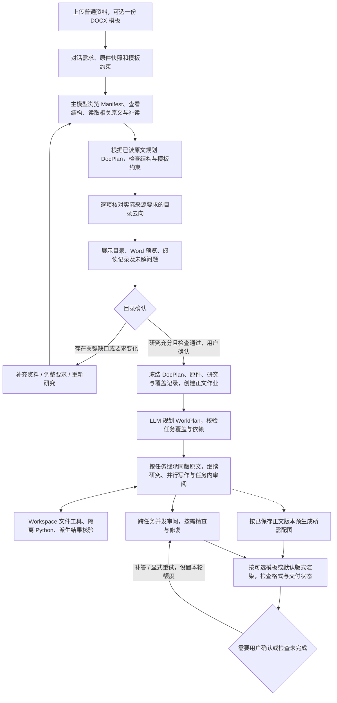
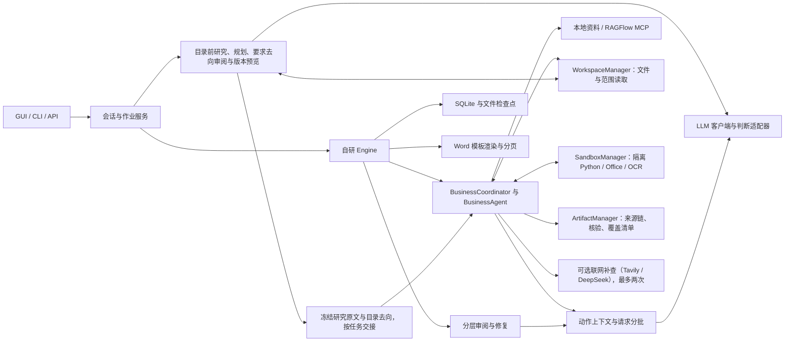

# Folio 技术架构

> English version: [English version](architecture.md)

本文描述当前代码实现，作为技术架构入口。安装与操作见 [README](../README.zh-CN.md)，已有数据目录的迁移见[工作空间迁移](workspace-migration.zh-CN.md)。

## 1. 目标与当前范围

GUI 接收 DOCX、Markdown、TXT、XLSX、PDF、PPTX 和常见图片资料，用户在对话中说明要生成的文档，无需额外选择文档类型。文件分为业务资料 `source`、可选 DOCX 文档模板 `template` 和风格示例 `style_reference` 三种用途；风格示例单独分析，不将其中旧项目内容作为事实。主模型先浏览 Manifest、查看相关文件结构并读取原文，再规划目录和检查实际资料要求的去向；研究充分、检查通过后，用户才能确认目录并启动正文。业务 Agent 继承同版原文证据，继续研究、按需执行隔离 Python 或转换，再生成、审阅并导出 Word。GUI 没有 Wiki／RAG 配置入口或待接入占位；CLI 和底层作业 API 保留显式配置外部 RAGFlow 的独立能力，旧版强制模板、大纲参数已删除。

当前采用自研 Agent 引擎。LLM 负责业务理解、目录与任务规划、自主研究策略、脚本生成、写作、审阅和局部格式建议；程序负责执行边界、依赖调度、来源与版本校验、持久化和排版。协调 Agent 的规划由 LLM 完成，底层 `BusinessCoordinator` 按校验通过的任务计划可靠执行。Jev 或 luna-decisions 继续承担意图分类、资料筛选等判断；下一步动作、自主工具请求与计算核验由主模型负责。可选判断服务需测试成功并勾选；最终页面 Jev 评分与自动优化已从生成流程移除。

| 已实现 | 当前未实现 |
| --- | --- |
| 批量资料上传、流式对话、模型设置、目录与版式预览 | 用户认证、多租户隔离 |
| 目录前渐进研究、实际来源要求去向检查、目录修改与版本确认 | 正文生成期间修改任务要求 |
| 代码协调的业务、审阅、配图、版式审校角色，依赖就绪后并行执行 | 执行中自由重组 WorkPlan 或目录 |
| 多轮检索、缺口建议、节点写作、分层审阅 | 对任意大单条表格或原文自动语义重构 |
| V2 自主文件研究、四种 Sandbox Profile、受控依赖和研究产物复用 | 任意宿主命令、任意网络访问或未批准的依赖安装 |
| 派生计算来源链、独立口径核验、明确范围的逐项覆盖检查 | OCR 自动成为可信项目事实、所有资料自动全覆盖 |
| 请求分批、检查点恢复、待确认补答续跑、Word 下载与重新排版 | 对运行中任务自由修改目录和业务范围 |
| 默认 Word 版式、可选用户模板的结构约束与格式保留 | Wiki 构建与新的向量 RAG 索引 |

支持长文档是架构目标，不代表已经证明任意页数、模板和模型组合都能稳定运行。业务正确性及版式质量需要实际材料验收。

## 2. 核心原则

1. **业务任务不是一次模型请求。** 任务围绕完整业务问题组织，可覆盖多个目录节点；模型调用围绕一个具体动作组织，可继续分批。
2. **完整状态在后台，相关资料进上下文。** 保存证据、正文、工作记录和审阅结果，不在每次调用重复传送全部历史。
3. **先研究资料，再生成目录。** 模型根据原文规划并审查要求去向，程序校验结构、真实引用、可选模板约束和确认版本；不用固定标题深度、同义词表或样例功能名决定目录和任务分组。
4. **建议与事实有区别。** 正文经过最多三轮本地研究和两轮可选联网补证后仍有缺口，可由模型补写建议；后台保留补写来源，Word 用红字区分，不能伪造引用或提升为已支持事实。目录前的关键阅读缺口不能靠补写建议解除确认门禁。
5. **每个内容节点只有一个写入负责人。** 不同业务任务并行执行，节点和任务记录按 ID 提交，全局事实由当前记录派生，避免覆盖。
6. **检查与产物必须对应真实版本。** 失败保留旧目录或检查点；修订后相关审阅失效。文件生成并登记后才能显示下载链接。
7. **文档类型提供写作指导，不增加交付门槛。** GUI 通过对话接收文档类型要求，后台与 CLI 仍支持 URD / SRS 指南及旧会话快照。指南影响写作视角和关注重点，用户明确要求优先；不把指南转成强制完成清单，也不因建议未全部采用而新增审阅、重试或阻断交付。
8. **自主研究有明确执行边界。** Agent 决定读哪些资料、如何计算以及是否继续补查；程序固定资料版本、隔离目录、资源额度和工具提交协议，不预先写死研究顺序。
9. **执行成功不等于证据成立。** 计算结果先登记实际输入与执行链，再独立核对来源、计算和业务口径；未核实 OCR、失效产物及未经审阅的计算结果不得进入共享事实或发布。

### 设计取舍

| 关注点 | 当前方案 | 边界 |
| --- | --- | --- |
| 需求一致性 | 不可变需求版本贯穿会话、目录确认和作业输入；只有明确要求进入需求快照 | 超容量明确拒绝；分类失败保留待处理，不推测用户已撤销哪些要求 |
| 目录依据 | Manifest → 按需导航 → 相关原文的有界研究，再逐项检查实际要求在目录中的去向 | 关键依据不足或适用范围未明确时展示初稿，不能确认；不声称全部资料已经理解 |
| 职责与共享状态 | BusinessAgent / ReviewAgent 与代码协调器分离，共用运行时和 Store | 不引入自由对话调度、多套数据库或每个动作一个 Agent |
| 事实与问题状态 | 统一版本化有效问题视图，保留原始 Findings 与逐事实 Verdict；按内容身份去重和排除误报 | 排除疑点不能补足事实依据，硬校验不可豁免；完整关系超容量时待确认 |
| 修订一致性 | 修复单验证归属和版本、只计实际目标、检查读写集并整批事务提交 | 研究记录可单独进检查点；正文只有整批成功才提交 |
| 恢复与交付 | 请求调度先核对有效缓存；技术中断保留草稿，用户可补答或显式重试 | 正文不齐、程序或存储错误仍失败；续跑保持目录并使用明确的新轮额度 |
| 配图与排版 | VisualAgent 制作 HTML/Mermaid 配图；预生成采用独立软额度和核心预留，来源过期立即取消 | 必需配图受作业总额度约束；格式保护与分页检查不能证明页面美观 |
| 自主计算与证据 | Business Agent 控制文件工具与 Python 循环；签名 manifest 绑定实际来源与执行链，计算口径独立核验 | 超容量、不可读中间结果或未核实输入不能宣称已支持；不增加执行中自由重规划 |
| 完整范围覆盖 | 从明确完整范围枚举清单，对照当前正文引用检查每一项 | 未读范围、缺项和不适用待审项保留，不把全部上传文件自动变为强制条款 |

本方案沿用已有 DocPlan、WorkPlan、证据、红字建议、预算、检查点和 Word 模板。拆分职责是为了让输入、交付和失败处理可以独立验证，不能单凭 Agent 数量推断质量更好或生成更快。

## 3. 用户流程与系统阶段



普通资料进入统一的 Manifest、逐文件结构和正文索引；模板单独冻结，仅提供固定章节、填写说明、扩展位置、必填表格和版式约束，示例正文和示例数据不作为业务依据。目录前研究复用 Workspace 文件工具，实际读取结果保存来源版本和定位。正文阶段仍可使用 LocalKnowledge、显式配置的外部知识库或可选公开联网补证；共享解析缓存不等于 Wiki／向量索引，也不等于模型已经读过全部资料。

目录修改使用稳定节点 ID 的 move/update/insert/remove 操作，重新计算展示编号并完整校验；失败保留原目录。增删资料、修改文件用途、经 API 更新写作指南或修改正式要求都会撤销旧版本的确认资格。只有当前需求、资料、模板与研究检查一致时才能创建正文作业，作业直接复用已确认计划。GUI 可在资料库显式选择一份 DOCX 模板，无文档类型选择器、模板推荐、封面表单和单独的大纲上传步骤。CLI `prepare` 使用 `--request`／`--request-file` 与 `--knowledge` 执行同类目录前研究；CLI `generate` 和 `POST /jobs` 在未提供已确认计划且存在本地资料时也先研究与检查再进入正文，没有额外的 GUI 人工确认步骤。

## 4. 架构与职责



本地模型客户端通过 HTTP 访问 Chat Completions 流式接口。工具动作使用原生 tools/tool_calls，应用校验后执行，并以 role=tool、tool_call_id 回传真实结果；不再从回复文本解析自定义动作 JSON。目录、正文及审阅结果继续使用各自的数据模型校验。目录前 `directory_research` 独立于正文作业调度，复用现有 Runtime、SourceIndex 和只读文件工具，不创建虚构 Job；已有作业中的目录规划适配 `Engine.call` 的总额度。正文 V2 通过现有 `Engine.call` 接收原生调用，`ResearchStep` 仅保存内部执行记录及原始调用，后端分派文件、计算和产物操作。旧流程下一步选择、搜索请求与覆盖审查补读也使用原生调用。生成代码只在受限容器运行，不获得任意宿主 Shell 或文件访问。Workspace、Sandbox、Artifact 管理器都是项目内部模块，没有增加网络微服务或内部 MCP 层。RAGFlow 仍由显式配置的独立 MCP SDK 客户端连接，检索返回原始切片，答案由 Folio 组织生成；仅配置远端资料时不宣称完成了本地目录研究。

| 职责 | LLM | 程序 |
| --- | --- | --- |
| 目录 | 根据 Manifest 选资料、读结构与原文、提出有依据的要求、生成目录并审查去向 | 解析与分页工具、读取记录、预算、真实引用、层级与模板约束、版本及确认门禁 |
| 业务任务 | 目标、节点归属、业务问题、依赖和完成条件 | 唯一负责人、无环校验、就绪调度和并发上限 |
| 研究 | 文件探索、读取范围、查询词、Python、补查策略与何时完成 | 固定工具协议、只读输入快照、Sandbox、完整执行记录、调用与时间预算 |
| 计算证据 | 独立判断来源、计算过程及业务口径是否支持结论 | 验证来源位置、签名与哈希链，未核验及失效结果不能共享或发布 |
| 正文 | 写作、事实抽取、缺口建议、局部修订 | 正文结构、引用存在性、模板表头和原子提交 |
| 审阅 | 支持性、冲突、遗漏、精查与修复指令 | 关联分组、并发、覆盖检查、事实键冲突索引 |
| 交付 | 提供业务判断结果 | 排版、检查有效性、版本比较、真实产物登记 |

生成模型和判断模型分别配置 Base URL、API Key、Model ID，生成服务使用 OpenAI 兼容的 Chat Completions；判断服务另支持完整 `/v1/systemone` 地址的 Jev 原生协议（模型如 `jev-latest`）。搜索支持 Tavily 与 DeepSeek Search。可选服务必须使用当前配置测试通过后才能启用，密钥仅保存在服务端。

`DecisionRouter` 支持 `intent` 和资料筛选判断；`next_action` 已改为主 LLM 原生函数调用，不再交给判断服务。意图 Choice 必须属于候选集合且置信度至少0.8；不确定、容量不足或服务失败时仍可回退 LLM，同一个 Runtime 内连续服务失败后暂不尝试该可选服务；每条聊天消息新建 Runtime，熔断状态不跨消息保留。目录前自主研究、来源要求去向审阅及详细业务审阅继续由主模型执行。

资料筛选由 [MaterialSelector](../src/folio/decisions/selection.py) 单独固定路由：已验证并启用判断模型时只用判断模型，否则用 LLM。Jev 相关概率必须严格大于0.8，等于0.8不选；无效评分或服务失败明确报错，不改用 LLM。主 LLM 按完整请求 Token 容量分页，不设固定候选项数；独立判断服务使用 600,000 字符兼容预算，每页最多 24 项。预算包含状态、问题和协议开销，超长单项无损分片。筛选不生成业务事实，所选事实对应的必要原文必须保留。

## 5. 材料与核心数据对象

GUI 文件用途为普通资料 `source`、文档模板 `template` 与风格示例 `style_reference`，默认普通资料，模板仅允许一份 DOCX。未选择模板时使用内部默认 Word 版式；选择后由程序提取和绑定可信模板约束，模板原件与业务资料分离保存。风格示例先提取内部结构和可测量格式，再按完整请求容量分批分析全部可提取文字，生成可查看的 `style.md`；默认最多 128 次分析请求，未读范围及视觉缺项单独记录。目录、正文和最终 Word 共用冻结的风格档案，用户明确要求和模板优先，示例业务内容不进入事实或证据。CLI 使用写作要求、本地资料目录或显式远端知识配置，另保留 `--reference` 事实材料和 `--sample` 风格示例，后者复用同一分析流程。CLI/API 已删除旧版 `template_path`、`outline_path` 输入，工作台的可选模板通过文档计划传递，不恢复旧强制流程。

| 对象 | 解决的问题 | 内容与约束 |
| --- | --- | --- |
| `RequirementSnapshot` | 多轮要求如何保持一致 | 完整用户原文与修改建议、内容哈希；目录确认与正文使用同一快照 |
| `WritingGuide` | 按什么视角和深度表达内容 | URD / SRS 配置快照；用途、读者、写作倾向、关注重点与建议策略，不是业务依据 |
| `DocumentPlan`（DocPlan） | 最终文档长什么样 | 节点 ID、标题、层级、顺序、写作要求；可选 `TemplateContract` 由程序校验并绑定，不含旧大纲引用 |
| `TemplateContract` | 用户模板有哪些硬约束 | 冻结 DOCX 哈希、固定章节与顺序、允许扩展位置、必填表格和排版依据；模板示例不是事实 |
| 目录研究与要求去向记录 | 目录依据了哪些实际原文 | 文件版本、读取范围、原文 Evidence、有依据的要求、目录节点去向、未解问题和确认资格 |
| `Section` | 一个可定位的文档节点 | 可为任意支持的标题级别；`generate` 写正文，`container` 只组织目录 |
| `WorkPlan / WorkTask` | 怎样按业务问题完成正文 | 任务目标、负责的节点、待回答问题、依赖、完成条件 |
| `WorkState / BusinessRecord` | 一个业务任务研究到了哪里 | 证据、查询历史、事实、术语、冲突、缺口、建议、审阅版本及研究轮次／额度／覆盖清单 |
| `Evidence` | 一段依据来自哪里 | 原始内容、源文件哈希、角色和定位；派生证据另绑定已签名计算链，OCR 保留未核实标记 |
| `ResearchStep / ResearchLedger` | 模型如何研究、工具是否真正完成 | 有界结构化动作、真实观察、持久请求身份、结果、使用次数与耗时 |
| Artifact／Coverage 记录 | 计算如何复查、完整范围是否有遗漏 | 实际脚本及中间结果、环境版本、独立核验；可枚举条目与当前正文处理位置 |
| `SectionState` | 当前节点写成了什么 | 正文块、抽取事实、逐事实原始核验结论、证据、局部问题与修订号 |
| `Finding / DrillDown` | 问题是否真实、如何处理 | 受影响节点、依据、修复指令或待确认结果 |
| `Job` | 本次执行的权威状态 | 输入快照、计划、阶段、调用记录、事件、基线和产物 |

例如，“交易审批”任务可同时负责“输入信息”“审批流程”“异常处理”，另一个任务负责“交易撤销”。任务可以跨目录层级，但同一个内容节点不得被两个任务写入。全局状态是节点记录的派生视图，不是让多个协程覆盖的整份共享摘要。

### 文档类型与可选写作指南

[URD 配置](../src/folio/document_profiles/urd.yaml) 侧重业务目标、场景、范围和规则；[SRS 配置](../src/folio/document_profiles/srs.yaml) 侧重系统行为、输入输出、状态、异常、数据和接口约束。两者共用现有 Agent 流程及模板排版，不另建生成引擎。GUI 已移除文档类型选择器，新会话不附加类型指南，所需文档类型在对话中说明；旧会话保留原快照。CLI `generate` / `prepare` 仍支持可选的 `--document-type urd|srs`，省略时不附加指南，后端也保留写作指南 API。

[guidance_context](../src/folio/document/guidance.py) 按当前动作确定性地选取配置字段：规划和写作带表达方式与关注重点，检索带关注方向，配图带图形建议，审阅和动作选择只带用途及非强制策略，不携带建议检查清单。指南独立放在 `writing_guidance`，不转换成 `Section.instruction` 或 `completion_criteria` 的必备条件；不为选择指导项额外调用模型。[请求组织与容量测量](../src/folio/orchestration/requests.py) 和 [目录预览规划](../src/folio/document/prepare.py) 都在测量前加入相同上下文，实际调用和计量一致。

显式配置指南后保存完整快照，沿“会话 → 目录草稿 → 已确认目录 → `JobInput.writing_guide`”传递；作业同时导出 `inputs/writing-guide.json`，恢复不重新读取当前 YAML。目录确认会核对指南快照，经 API 更新指南使旧目录失效，需要重新规划；正文执行中禁止更新。没有该字段的旧会话和旧作业继续按原有写法执行，配置更新不会重写旧正文。对应入口为 [workspace](../src/folio/api/workspace.py)、[directory_drafts](../src/folio/directory_drafts.py) 和 [Store.create](../src/folio/store.py)。

## 6. 资料与需求怎样形成目录

GUI 复用已有意图判断，把消息标为正式要求 `active`、普通咨询 `discussion`、待澄清 `clarification` 或判断未完成 `pending`，另保留界面命令标记。只有正式要求及明确目录修改建议进入 `RequirementSnapshot`，分类和原话均保留审计，不新增独立模型调用；Jev / luna-decisions 沿用原有判断路由。咨询不改变需求版本，待处理消息须重发完成判断后再规划或确认。旧消息缺少分类时保守保留已有约束，不自动删除已冻结要求。快照按时间保存完整原文，明确修订以较后要求为准，不依赖最近几轮聊天摘要。需求超过 600,000 字符明确拒绝规划；需求变化或旧目录缺少快照时须重新规划，运行中禁止热改需求，待确认后的补答走独立续跑契约。

GUI 使用 [source_documents.py](../src/folio/source_documents.py) 冻结完整资料并生成元数据清单，不再把每份文件的前 8 个标题、前 12,000 个字符当作规划依据。目录前的 [research_for_directory](../src/folio/research/planning.py) 先提供 Manifest，再由主模型选择文件，按需通过 `fs.inspect` 查看结构、`fs.search` 定位和 `fs.read` 分页读取原文。结构浏览是推荐导航策略，不是所有文件必经的确认门槛；明确定位并读取正文后，不会仅因未执行 `fs.inspect` 阻塞结论。模型按任务选择范围，不要求所有附件逐字通读；可以引用已发送的页段，不要求其所在读取查询范围全部读完，未读状态和影响目录的缺口仍保留。未使用的文件需要说明排除理由。结构导航、搜索结果和解析成功不能冒充原文已经读完。

该研究循环最多三轮，每轮默认 12 步，共最多 36 次模型动作和 600 秒，并受调用及上下文限制。它优先读取本地材料，可通过已启用的搜索服务查询公开问题，不执行 Python，也不使用联网或模型补写代替缺失的招标要求；正文阶段保留原有三轮本地、两轮可选联网和建议生成流程。每次实际动作及返回记录落盘，缺口、不可读范围、预算不足和未确定的业务范围保留为 `partial`。没有普通资料时记录 `no_sources`，仅依据用户要求与可选模板规划，不伪造阅读记录。

目录与正文研究共用 `ResearchMemory`，将程序交付记录、模型研究笔记及原文证据分层保存。模型在下一次原生工具调用中追加带 `evidence_ids` 的笔记，区分资料陈述、推断和无关范围；不再要求填写 `request_ids`，批次关联由程序根据实际交付记录恢复。省略不清空，显式修订留历史，重试幂等。原文退出上下文前须归纳，笔记较多时保留索引并按需分页读取；完整状态随报告或检查点保存，同源导出 `research.md`。历史入口标明文件与页段，复读须给出具体核实原因，连续无进展时先整理再有界结束。研究笔记不会自动进入全局事实，已有快照、引用及覆盖校验保持不变。详见[文件研究与执行设计](agent-research.zh-CN.md#共享研究记忆)。

主模型用实际原文提取目录要求，`finish.requirements` 中每项要求用 `E1` 等 Evidence 编号引用依据；读取时使用文件、节点或页码，两类编号不混用。`selected_ranges` 由程序依据真实证据与阅读记录推导，不再要求模型额外填写；未知、版本或位置不符、未实际发送的引用仍不能放行。引用已读页段不会将整个范围的 `complete=false` 改成已读完。随后一次输出完整 `PlanProposal`，程序检查节点唯一性、标题层级、容器用途等；可选模板另检查固定标题、顺序与父子关系、开放扩展位置及必填表格。`PlanProposal` 不含旧版大纲引用、模板栏目选择或未用栏目清单；可信模板绑定由程序完成，模板示例正文与数据不进入规划事实。

`review_directory_research` 将每项已研究要求、对应完整原文和整份目录对照，要求明确落到实际写正文的节点标题或写作说明。检查结果为 `covered`、`not_applicable` 或 `missing`；排除项需要真实适用范围依据，不能用“后续再研究”填补遗漏。程序核对真实节点及证据 ID、每项恰好一次；遗漏触发有界目录修复和重新审阅。研究为 `ready`（无普通资料时为 `no_sources`）且检查通过后才能确认，`partial` 只展示初稿。旧目录没有研究记录时仍可预览，但必须重新研究后才能确认。**这只证明已研究要求有明确写作去向，不证明正文已经正确，也不证明所有潜在要求均被发现。**

右侧目录提供可展开的资料研究记录：哪些文件查看过结构、读取了哪些章节或范围、返回的原文字数、尚待解决的问题。读取统计不表示理解率。确认入口同时核对需求、文件用途、指南和目录版本，后端拒绝绕过界面确认未完成研究的目录。确认后冻结原文证据与要求去向，按业务任务负责的节点继承，不把研究摘要直接放进全局事实。

完整目录提案不分批；原文读取和来源要求审阅可以分页／分批，审阅默认最多 12 批。输入超过保护预算时明确失败或保留未完成状态，不静默截断原文后宣称检查通过。具体传输、编辑、审阅与确认契约见 [LLM 目录规划](outline-planning.zh-CN.md)。

## 7. 正文 Agent loop 与任务并行

LLM 在执行前根据内容节点、用户要求和材料索引构建 WorkPlan。分组依据是业务关联、复杂度和材料量，默认单任务最多 8 个内容节点是资源约束，不是“固定按三级目录拆分”。计划通过检查后保持稳定。

程序检查所有待执行任务，依赖完成的任务进入有界异步队列，默认最多16个；真实依赖仍等待上游正文与任务审阅完成。每个任务执行：

```text
固定任务分工、原件版本、依赖结论与全局事实快照
  → 核验并继承目录研究中分配到本任务的同版原文证据与写作要求
  → 主模型 research_step 决定查看文件、搜索、精确读取、计算或登记结果
  → 程序校验并执行工具，将真实结果和错误交回下一轮
  → 计算产物登记来源链，经 verify_derivation 独立核验后进入有效证据
  → 根据发现继续研究；finish 保留全部未解问题
  → understand_work 形成 BusinessRecord，开始写作
  → 写作发现缺口时回到自主补查；仍无依据的建议继续按原有规则标红
  → 待写节点最多八路写作、抽取、校验
  → 任务整体审阅、覆盖检查，保存版本，释放下游依赖
```

新 GUI 作业及 CLI `--runtime llm` 默认启用 `JobInput.research`；历史未配置该字段的作业和默认 Demo 保留原先 `search / write / pending` 循环，仍受三轮知识库与两次可选联网补证约束。V2 使用主模型研究动作，已有判断模型路由保留，Python 和复杂工具参数不交给 Jev／luna 分类接口。

采用代码协调的多 Agent 协作：`BusinessCoordinator` 派发业务任务，`BusinessAgent` 负责研究与正文，`ReviewAgent` 负责任务整体审阅，`VisualAgent` 负责配图，最终交付执行格式保护与分页检查，不再执行 Jev 页面评分。共享同一调用网关、Store 和预算，不增加自由聊天或多套状态库。每个业务任务仍运行有界 Agent loop；跨章检查和精查由引擎统一组织。研究完成后全部待写节点直接进入最多八路编写，不再等待首节。补查和补写记录仍通过任务锁合并。业务任务执行期间主模型最多32路，后续审阅等阶段16路，跨阶段合计受主服务32路总上限保护；已验证并启用的判断服务统一使用独立16个并发名额，主模型与判断服务合计上限48路。未启用判断模型时筛选也计入主模型名额。

每个新研究版本固定可见全局事实，写作按节点相关性读取并携带原始依据；并行任务不会实时读取其他任务尚未提交的结论。`IssueLedger` 统一过滤当前版本已排除的误报，保留原始问题供审计。全局事实只接收有正向核验、有效引用、非模型建议且无当前阻塞的记录，排除误报本身不能证明事实。任务结果分别保存，冲突值保留来源。下游依赖就绪要求上游正文与任务审阅完成，**不表示上游已获业务确认**。已知有问题的节点不向下游输出已支持事实，相关建议和风险另行传递。

该事实快照策略不包含事实订阅、跨任务实时同步或事实变化后的自动全量重写。显式依赖与最终全局审阅承担一致性检查；接受可能的局部返工，控制同步和模型调用成本。

V2 本地研究最多三轮，每轮默认12个有界工具步骤，可选择文件工具和 `fs.search(scope="knowledge")`；仍不足时协调器安排最多两轮联网补查，再不足则由 LLM 生成标注建议。Agent 不能以工具请求提前绕过阶段顺序；轮次在调用前持久登记，普通修复和恢复不重置。知识库默认每任务最多三次，已测试并启用的搜索服务至多两次联网补查；Tavily 使用 `advanced` 搜索，DeepSeek Search 使用其原生搜索接口。每次公开查询由 LLM 按缺口生成，网页返回的摘录作为 `metadata.role=public_web` 证据进入原有理解与判断流程，不能升级为项目内部事实。`WorkState.web_searches` 在请求前保存次数和状态，异常、重启、依赖更新或返工不重置配额。搜索超时或不可用留下明确结果，不算查到了依据。

仍缺资料时，LLM 按缺口生成具体建议，程序验证每个缺口的归属与覆盖。每节只整合本次提出且补查后仍未解决的缺口，不能因同任务其他小节补查而接管全部缺口。相关业务补全由写作模型整合到正文并标红，编写指南和缺失元数据只留后台，原缺口记录保留；补写保证内容有交代，不等于证据变得充分。核心写作模型、协议或校验失败仍会中止，不能承诺每个任务必定成功。

### 7.1 Workspace、Sandbox 与派生证据

上传校验、目录材料、LocalKnowledge 与 Workspace 共用格式读取器。DOCX 保留正文和表格定位，MD／TXT 保留原始行号，XLSX 保留 Sheet／单元格范围和公式缓存状态，PDF／PPTX 保留页码／幻灯片及未读范围，图片保留格式元数据并通过隔离 OCR 处理。模型取得的 Evidence ID、源文件 SHA-256 和准确字符片段由后端生成。搜索或分页结束不能消除文件中尚未读取的视觉范围。

每个任务研究轮次拥有独立持久目录：`context/` 保存只读任务与事实快照，`scratch/` 保存临时文件，`artifacts/<execution>/` 保存本次输出，`.research/` 保存模型代码不可写的执行、脚本和签名记录。容器按操作分配，默认禁网、只读根文件系统、非 root 用户，并限制 CPU、内存、进程、时间及输出。原件、任务上下文和有效前序产物只读挂载；取消后先回收执行再释放作业所有权，不在宿主解释器执行模型脚本。

四种环境为 `base`、`data`、`office`、`ocr`。运维可在 `settings/research.json` 或 `FOLIO_RESEARCH_CONFIG` 指定策略，执行保存真实镜像摘要及依赖锁。申请动态依赖必须匹配运维白名单的包名、固定版本、wheel SHA-256 及依赖闭包；仅固定安装器可联网，且不挂载业务资料。配置和构建命令见[研究环境部署说明](../docker/research/README.zh-CN.md)。

`artifact.save` 先验证文件、脚本与执行身份并登记产物，再由主模型独立核对来源、计算和业务口径。多步计算必须包含前序实际脚本及中间结果；无法完整核验时保持未支持。后台签名不接受模型自报 `verified`，后续共享事实、审阅和发布重新检查哈希链；任何来源、前序计算或最终结果变化都会使引用失效。跨任务复用须已核验且当前来源与各步环境版本仍匹配。

OCR 证据以 `extracted:` 身份保留原件版本、页码及识别执行信息，可以进入草稿，但未与原文独立核实前不能成为共享事实或通过发布。用户可对关键原文明确补答，按既有确认流程提供新的用户依据并修订。Excel 原生读取不计算公式，缓存不自动可信；Office 重算和复杂格式转换仍有兼容性边界。

对于明确要求完整覆盖的资料范围，CoverageManager 直接枚举完整条目，记录正文位置、待确认原因或不适用理由，并按最终正文版本重新检查。未读范围、截断结果和缺项不能被模型摘要替代；搜索命中不构成完整清单，也不把全部附件自动设为强制逐项覆盖。范围审查可分页查目录，未定范围在新定位到来后有限重审；完整性只检查所选页／章节／Sheet。独立视觉核验绑定原文件、提取块和原图哈希，核验通过的 OCR 范围可纳入清单，联网和模型建议不能代替原文覆盖。详细接口和边界见[业务 Agent 文件研究与执行设计](agent-research.zh-CN.md)。

## 8. 请求上下文与容量

```text
完整后台状态 → 当前动作所需资料 → 有效缓存检查 → 未命中时测量容量与模型请求 → 校验并汇集
```

写作不携带其他节点整份正文；事实抽取读取当前节点及引用依据；动作选择读取业务记录、缺口与证据索引；全局审阅读取分组摘要、事实和建议，发现问题再读取相关原文精查。依赖资料沿上述固定路由筛选，程序保留必须覆盖的项目来源并校验引用。精查在完整请求可容纳时直接读取；只有完整请求超出实际容量才先筛选。任务完成条件及明确引用的完整原文作为必读约束保留，不送入相关性筛选。

模型的**上下文窗口**与**最大输出额度**是两件事。支持计数的服务按下面条件安排请求：

```text
实际输入 tokens + 本动作输出预留 tokens + 512 tokens 余量 <= 模型上下文窗口
```

请求默认输入预算为 600,000 Token、输出预算为 128,000 Token。缺少服务端计量时使用本地估算；已知模型窗口更小时服从实际容量。目录规划同样检查完整请求容量。

证据阅读、缺口补全、事实抽取、局部校验和审阅可以按各自覆盖契约分批。输入超限和输出截断分别处理；截断 JSON 不被接受为结果。分批不拆散业务任务、不重置三轮检索，也不丢失来源。最小安全单元仍过大时明确失败。详见 [请求上下文与容量](context-and-capacity.zh-CN.md)。

## 9. 分层审阅与有限修复

| 层次 | 检查范围 | 执行方式 |
| --- | --- | --- |
| 节点校验 | 正文、事实与适用原始依据 | 结构检查和 LLM 语义检查，必要时分批 |
| 任务整体审阅 | 跨小节分工、衔接和同范围规则 | 复用节点证据校验，容量不足时先确定实际检查问题，再读原文 |
| 跨任务审阅 | 相邻窗口、具体事实、共同主题及真实依赖 | 默认16组并发，每组默认最多6节；另保留事实冲突索引 |
| 问题精查与修复 | 候选问题涉及的原文与证据 | 判断真实问题，修复受影响节点，重新审阅 |

宽泛主体按有界主题组检查，不建立所有相关章节的两两组合；双方都有模型建议也不构成配对理由。相同 `scope / subject / predicate` 的不同原样取值在组宽内选代表共同比较，超过组宽时形成一个保留全部记录和章节范围的精查问题；已支持单值事实的不同取值也按事实键整组精查，不再展开全部两两组合。组无法完整核查时明确保留待确认，防止窗口两端的矛盾被漏当成通过；候选断言也参与，但文字不同不直接判定冲突。已有分组覆盖的关系复用，同一任务内部由任务审阅负责。未抽取出的隐含关系仍可能漏检，不能承诺穷举全部语义关系。

疑点只有类型、位置、引用集合和规范化描述完全相同才去重，原记录保留审计；相同问题键对应不同描述时保留为独立疑点。局部和任务审阅的缺引用指控必须定位事实块，合法红字补写不因无引用报错；其余有效疑点进入 `drill_down` 对照原文，不靠来源标签或关键词自动豁免混合事实。误报按正文版本记录，不能豁免结构和引用硬校验。

`Finding.fingerprint` 从问题产生时即采用 v2 内容身份，包含类型、规则、依据类别、正文/证据位置、规范化描述及比较范围；无定位的问题还保留原问题键区分。单独读取、列表重排、去重和保存后恢复都使用同一身份，不再临时改写模型的 `key`。旧台账没有把描述纳入身份，无法安全确认其豁免对象，故保留审计但不自动迁移为 v2 豁免，须重新精查。

审阅先固定版本和分组，最多 16 个工作协程领取顶层组。分批调用仍受单作业总槽约束，避免并发无界增长。GUI 的“已完成 X/N 组”统计顶层组，子请求全部完成后该组才算完成。

修复单明确原负责人和待写章节版本；只按真正修改的节点检查修复预算，作为参考的节点不消耗该预算。独立修复可并行计算，全部完成后用 `save_sections_batch()` 检查读写版本并在一个事务内保存，任一失败则整批不提交。修复会使相关任务及依赖审阅过期。达到修复预算、需要业务决定或精查无法返回有效决策时，保留问题并交付待确认草稿；不无限修改、不把问题静默删除。

启用写作指南不会增加审阅轮次。若已有审阅返回仅基于指南的 `coverage` / `pending` 建议，模型须明确标注 `basis=guidance`；程序将其单独保存到 `contexts/advisory_notes/`，不进入修复或交付状态计算，不写入 Word 正文。实际业务冲突、无依据陈述及抽取错误仍按原流程处理，不因带有指南标签而免检。分流见 [advisory.py](../src/folio/orchestration/advisory.py) 与 [Engine.check_result](../src/folio/orchestration/engine.py)。

## 10. 排版、产物与恢复

未选择模板时，Word 使用内部默认版式；选择模板时以冻结的原 DOCX 为基础，保留样式、字体、固定标题编号、表格布局、页面与分节、页眉页脚及前置页，默认规则只补足未定义部分。模板中的填写说明和示例正文被实际内容替换，示例数据不自动变为本项目数据。LibreOffice/UNO 负责测量页码与生成预览，程序回填 Word 域缓存，不用 LibreOffice 重存 DOCX 替换模板样式。缺少该组件时保留可更新域，说明需要在 Word/WPS 中更新页码。

单节正文完成提取、局部核验并保存后，可用 [VisualPrefetch](../src/folio/orchestration/visual_prefetch.py) 按已保存正文版本预生成所需配图，与后续写作和审阅重叠；非待确认类问题涉及的节点暂不启动。预生成与最终配图共用4个工作流名额，浏览器渲染最多2路，预生成模型调用另限2路，所有请求仍受主服务总槽约束。预生成最多使用 `min(120, floor(max_calls/5))` 次调用，并为核心工作保留 `min(max_calls, max(12, ceil(max_calls/4)))` 次；SQLite 在每次实际尝试及重试前原子校验和扣计，缓存命中不扣。软额度不足只延后，不缓存为图失败，最终配图可使用剩余主额度。正文相关来源变化、删图或实质冲突会立即取消过期任务并清理；最终仅复用身份与文件校验均通过的图，不发布局部清单。

当前 `formatting` 阶段：先渲染未分页的 DOCX，按 WorkTask 定位正文与表格，分组最多4路向 LLM 提供局部布局对象。LLM 只返回白名单格式指令，程序验证目标、对齐枚举、段距与模板基准字号范围，然后应用并校验全部文字与受保护格式未改变。字体家族、红字、封面、标题、编号和图文内容不可改；每组最多三次调用、25 秒，阶段总计最多120秒。失败保留模板版式及已确认安全的操作，不阻断交付。最后统一分页；`formatting.json` 保存格式操作，重新排版只重放可验证的操作。

Jev 逐页美观评分、低分后调用 LLM 修改及复评已退出 `Engine.finish()`，模型设置也不再提供该开关。`supports_image_input` 仍控制资料研究、风格分析等环节的真实图片输入。正常生成不会发起最终评分的 Jev 图片自检或页面请求，也不把缺少此评分视为待确认问题；格式保护和模板核验继续执行，完成导出不等于视觉审美通过。

历史页面评分报告、截图和已通过的补丁仍可用于读取或诊断；`reformat` 可按原有签名检查重放兼容补丁，但不调用评分模型，不宣称新文件重新接受了视觉检查。独立诊断模块保留不代表生成流程仍启用该能力，详见[配图与历史页面审校](illustrations.zh-CN.md)。

[DocPolish](https://github.com/ChendongPang/docpolish) 是独立的 Word 排版项目，目前未接入 Folio 的生成与交付链路，Folio 不会自动提交文档给它。

用户模板的固定章节、页面与分节、样式及必填表格在渲染、排版后和交付前再次核验，格式调整不能覆盖已指定的字体与格式。模板需要真实 Word 标题；正文中的复杂绘图、文本框、内容控件、未处理修订、嵌套表格及无法安全填充的合并数据单元格会明确拒绝。封面和页眉页脚图案可保留，不承诺任意 Word 文件的像素级保真。见 [用户模板设计](templates.zh-CN.md)与[材料与排版](source-materials-and-layout.zh-CN.md)。

状态与文件关系：

- `published`：当前检查无阻塞、产物完成，并通过文档基线版本比较后登记；不是业务审批。
- `draft`：已生成草稿，例如含模型建议或使用 Demo。
- `needs_confirmation`：有可下载草稿，但还存在待确认问题。
- `failed`：执行未完成，保留检查点与错误；不显示不存在的下载文件。

完整正文保存后若模型调用次数预算耗尽、模型服务报错、重试耗尽或执行超时，停止新增模型请求，保留原疑点及“检查尚未完成”记录，设 `review_passed=false`，导出 `needs_confirmation`。有效配图可复用，未完成配图明确标记；正文不齐仍按失败保存检查点。可下载草稿不代表完整生成验收通过。取消、程序异常和存储错误不走这条降级路径。

`needs_confirmation` 等待用户显式提交补答或重新检查，不自动启动。接口校验当前问题版本和幂等 `request_id`，归档旧草稿、问题和输入；本轮新增额度默认200，可设1～10000，新的调用上限为已用次数加本轮额度，累计次数不清零且不得超过100000。业务答复作为限定章节的用户依据进入原负责人研究和局部修订，保持目录；封面、页面和技术中断分别走既有专用流程。修订整批提交后重新审阅、配图和交付，本轮修复额度以续跑前章节版本为基线。未回答的问题不自动批准，技术重试允许空答案。详见[待确认补答与续跑设计](confirmation-and-resume.zh-CN.md)。

SQLite 保存节点、任务、调用与检索缓存、决策、事件；文件系统保存材料快照、目录版本、上下文及产物。Web 按会话隔离交互请求，不同会话的正文作业独立调度，不共用单作业串行锁；正文作业仍有按作业编号的文件锁，Web、CLI、Worker 不能同时写同一作业。前端按会话保留运行中的请求及其进度，切换会话不停止其他请求。发布使用基线版本比较，防止并发发布静默覆盖。

资料预处理由代码在上传校验、目录规划和研究入口完成，不新增 LLM Agent。共享 Manifest 保存文件类型、大小、内容版本和索引引用；每份资料的结构 JSON 与正文 JSON 分开保存，各业务任务复用。`fs.inspect` 读取结构，`fs.read` 按章节节点（含子章节）、Sheet、页码或片段分页读取；PDF 无真实书签时明确按页组织。OCR 补充、研究笔记和脚本产物仍属于各自任务，原件缓存不会被研究结论改写。详见[文件研究与执行设计](agent-research.zh-CN.md)。

目录研究单独保存在目录版本下的 `research/report.json`、`research/events/`，目录要求去向保存在 `research-review.json` 及各次审阅记录。确认创建 Job 时复制到 `inputs/directory-research/`，重新核对已审阅计划的完整章节内容、原件快照和证据身份；节点 ID 相同但写作说明已改变也不能复用。正文只继承分配到本任务节点的原文引用，来源版本或引用内容变化会拒绝交接。全局事实仍由正文核验后的记录派生，目录研究报告不能直接晋升为共享事实。

V2 研究额外使用作业下 `research/ledger.sqlite` 记录工具请求身份、执行状态、完整结果和预算，不另建网络服务。默认一次授权内每个业务任务最多50次工具、40次研究模型请求、累计600秒脚本时间；本地最多三轮、每轮默认12个工具步骤、当前研究版本最多60步，单次脚本最多120秒。模型调用同时计入原有总账，并为正文和审阅预留额度。普通补查、重启与修复不清零，用户显式补答续跑才建立新的有界授权额度，历史记录仍保留。

工具先登记后执行、完整结果保存后提交。中断恢复先核对已提交记录，完成结果可复用；未完成请求清理并标明中断，不从残留文件推断成功。跨进程恢复还依赖固定宿主签名密钥，默认 `~/.local/state/folio/artifact-signing.key`，可由 `FOLIO_ARTIFACT_KEY_PATH` 指定；迁移须保留该密钥，否则旧派生记录不能继续作为可信依据。

`GET /jobs/{id}/research` 返回研究状态、工具执行摘要及已登记产物；`GET /jobs/{id}/research/artifacts/{artifact_id}` 按作业下载并核对签名和文件版本。接口区分产物的 `registered / verified / rejected` 状态，下载不等于业务核验通过；现有 Word 下载和待确认归档接口不变。

成功调用可以复用；可恢复的模型失败停止新派发并等待已启动业务任务保存；不可隔离的异常或取消会取消并等待兄弟协程退出再释放锁。浏览器断开不取消已创建的后台正文作业，服务重启会接管未结束的 Web 作业；CLI 使用 `resume` 恢复。外部模型调用可能在故障后重发，不承诺端到端“恰好一次”。

## 11. 实现入口

| 查什么 | 代码 |
| --- | --- |
| GUI 会话、来源绑定、目录确认、作业启动 | [api/workspace.py](../src/folio/api/workspace.py)、[Vue 工作台状态](../frontend/src/composables/useWorkspace.ts)、[Vue 界面](../frontend/src/App.vue) |
| API、命令与运行时装配 | [api/app.py](../src/folio/api/app.py)、[cli.py](../src/folio/cli.py)、[service.py](../src/folio/service.py) |
| URD / SRS 配置、动作指导和建议分流 | [document_profiles](../src/folio/document_profiles)、[document/guidance.py](../src/folio/document/guidance.py)、[orchestration/advisory.py](../src/folio/orchestration/advisory.py) |
| 目录规划、传输压缩、建议编辑 | [document/planner.py](../src/folio/document/planner.py)、[planning_transport.py](../src/folio/document/planning_transport.py)、[directory_revision.py](../src/folio/document/directory_revision.py) |
| 目录前研究、来源要求去向审阅与正文交接 | [research/planning.py](../src/folio/research/planning.py)、[document/research_review.py](../src/folio/document/research_review.py)、[research/planning_handoff.py](../src/folio/research/planning_handoff.py)、[orchestration/directory_planning.py](../src/folio/orchestration/directory_planning.py) |
| 可选用户模板的约束、排版与交付保护 | [document/template_contract.py](../src/folio/document/template_contract.py)、[template_layout.py](../src/folio/document/template_layout.py)、[用户模板设计](templates.zh-CN.md) |
| 主循环、正文校验与最终交付 | [orchestration/engine.py](../src/folio/orchestration/engine.py) |
| 待确认补答、技术重试与交付归档 | [confirmations.py](../src/folio/confirmations.py)、[api/confirmations.py](../src/folio/api/confirmations.py)、[ConfirmationPanel.vue](../frontend/src/components/ConfirmationPanel.vue) |
| 业务任务调度、研究与任务内审阅 | [orchestration/agents.py](../src/folio/orchestration/agents.py)、[business.py](../src/folio/orchestration/business.py)、[work.py](../src/folio/orchestration/work.py) |
| V2 自主研究协议、循环和持久工具账本 | [research/contracts.py](../src/folio/research/contracts.py)、[workflow.py](../src/folio/research/workflow.py)、[ledger.py](../src/folio/research/ledger.py) |
| 共享 Manifest、逐文件结构、正文缓存及渐进读取 | [research/source_index.py](../src/folio/research/source_index.py)、[structure.py](../src/folio/research/structure.py)、[formats.py](../src/folio/research/formats.py)、[workspace.py](../src/folio/research/workspace.py) |
| 隔离执行、Office／OCR、受控依赖 | [research/sandbox.py](../src/folio/research/sandbox.py)、[sandbox_conversions.py](../src/folio/research/sandbox_conversions.py)、[部署说明](../docker/research/README.zh-CN.md) |
| 派生来源链、完整覆盖与研究下载 | [research/artifacts.py](../src/folio/research/artifacts.py)、[artifact_coverage.py](../src/folio/research/artifact_coverage.py)、[api/research.py](../src/folio/api/research.py) |
| 跨任务分组与并发池 | [orchestration/review.py](../src/folio/orchestration/review.py) |
| 请求选择、容量分批与状态投影 | [orchestration/requests.py](../src/folio/orchestration/requests.py)、[context.py](../src/folio/orchestration/context.py)、[state.py](../src/folio/orchestration/state.py) |
| 提示词、模型协议、容量与判断接口 | [runtime/base.py](../src/folio/runtime/base.py)、[llm.py](../src/folio/runtime/llm.py)、[capacity.py](../src/folio/runtime/capacity.py)、[decisions](../src/folio/decisions/__init__.py) |
| 知识库接入 | [knowledge/ragflow.py](../src/folio/knowledge/ragflow.py)、[local.py](../src/folio/knowledge/local.py) |
| Word、字体与分页 | [document/word.py](../src/folio/document/word.py)、[typography.py](../src/folio/document/typography.py)、[pagination.py](../src/folio/document/pagination.py) |
| 完整需求、有效问题及事实视图 | [requirements.py](../src/folio/requirements.py)、[issues.py](../src/folio/orchestration/issues.py)、[state.py](../src/folio/orchestration/state.py) |
| 配图、格式保护与页面预览 | [visuals/agent.py](../src/folio/visuals/agent.py)、[formatting.py](../src/folio/orchestration/formatting.py)、[page_preview.py](../src/folio/document/page_preview.py) |
| 预生成软额度与核心调用预留 | [runtime/call_budget.py](../src/folio/runtime/call_budget.py)、[visual_prefetch.py](../src/folio/orchestration/visual_prefetch.py)、[Store.begin_task](../src/folio/store.py) |
| 数据契约、检查点和版本发布 | [models.py](../src/folio/models.py)、[store.py](../src/folio/store.py) |

GUI 使用统一资料库、可选模板和自主文件研究，已移除 Wiki／RAG 入口及待接入占位，不默认连接内网知识库。CLI/API 保留显式配置 RAGFlow 服务器的独立能力。GUI 当前没有初始任务/审阅并发和通用预算编辑器，但待确认续跑提供本轮调用额度输入，初始参数仍遵守后端默认配置。

## 12. 验证与后续工作

验证应分为程序约束、执行集成和真实业务质量三个层次。程序约束包括来源隔离、任务归属、依赖、预算、版本失效、失败恢复和模板保护；执行集成应检查资料读取、证据冻结、按任务交接、隔离计算与 Word 导出。目录研究要包含关键要求位于资料后部的场景，以及读取不完整、来源变化和不同任务证据隔离的场景。测试方法见[测试与验证](testing.zh-CN.md)。

真实材料验证还应检查目录语义、业务口径、OCR 准确率、复杂公式兼容性、跨任务冲突、Word 字体与分页、调用量及端到端耗时。受控模型或容器测试只能验证相应流程和约束，不能替代真实模型的业务理解和完整文档交付验收；仅完成目录也不能代表正文、审阅、配图和导出全部完成。

待确认补答及有界续跑已经实现，后续重点是代表性业务材料上的质量与性能评估、复杂用户答复的处理效果及实际字体替换检测。代码协调的多 Agent 协作沿用全局事实快照策略；运行中重规划和会议纪要更新不列为已交付能力。

详细机制见 [自研引擎设计](execution-engine.zh-CN.md)、[业务任务执行](task-execution.zh-CN.md)、[V2 文件研究与执行](agent-research.zh-CN.md)；页面状态与接口见 [GUI 设计](web-workspace.zh-CN.md)。
