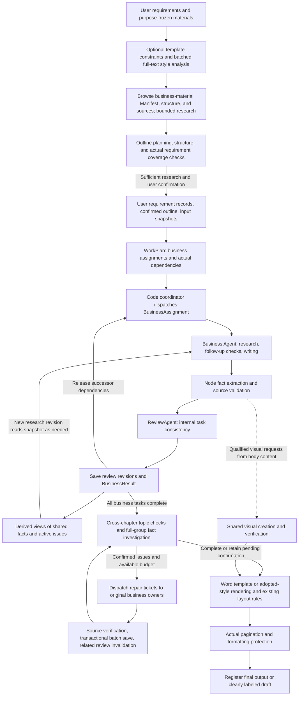

# In-House Document Agent Engine

> 中文版: [中文版](execution-engine.zh-CN.md)

This document describes the current runtime mechanisms. For product workflows and an architectural overview, see [Technical Architecture](architecture.md); for installation and configuration, see [README](../README.md).

## 1. What the Engine Is

Folio is a document execution engine with model-driven decisions, dependency scheduling, and persistent checkpoints. It calls LLMs directly without relying on an external Agent framework. The model handles semantic judgments and content; the program validates results, executes actions, controls budgets, and saves state. All tool calls use native Chat Completions tools/tool_calls: requests provide the permitted functions, the program validates and executes actual calls, and results are returned by tool_call_id. JSON in ordinary responses is not interpreted as a tool action; outlines, body content, and review results retain their respective data validation.

This is neither “letting the model freely use arbitrary tools” nor a pipeline that performs the same number of retrievals regardless of results. During task research, the model independently selects file reading, search, isolated Python, and artifact verification, and decides when to finish research, write, or report gaps. Issues found during review enter a focused investigation, repair, and re-review loop. The program controls outer task scheduling, concurrency, and resource limits.

The current implementation uses **multi-Agent collaboration with a coordinating Agent for planning and a code scheduler for execution**, still running within the same application process, job lock, and Store, without introducing an external Agent framework. Business work is divided by WorkTask, with exactly one owner for each node. Agents collaborate through versioned tasks, deliverables, and repair tickets, rather than modifying each other’s body content through free-form conversations. The decision layer continues to use `DecisionProvider` / `LLMDecisionProvider`; the optional decision service handles only the existing finite set of actions and does not add unrestricted runtime replanning.

| Role | Actual responsibilities | Code boundary |
| --- | --- | --- |
| Outline research and planning | Browse the Manifest, structure, and source text before planning; generate the outline, verify where actual requirements are addressed, and save reading records | `research/planning.py`, `document/prepare.py`, `document/research_review.py` |
| `BusinessCoordinator` | DAG ready queue, concurrency slots, receiving task deliverables, failure cancellation, and draining | `orchestration/agents.py` |
| `BusinessAgent` | Autonomous file research, Python analysis, supplementary drafting, node writing, and task delivery; reuse persistent research and budgets | `orchestration/agents.py`, `research/workflow.py` |
| `ReviewAgent` | Independent business-task review, current issue views, and review revision records | `orchestration/agents.py` |
| Cross-chapter review and focused investigation | Topic checks against fixed body snapshots, issue adjudication, and bounded repairs | `Engine`, `review.py`, `focused_review.py` |
| `VisualAgent` and formatting | Create and verify business illustrations; propose protected Word-property edits | `visuals/agent.py`, `orchestration/formatting.py`; see Section 9 |
| Shared code services | Model calls, hard validation, version and issue state, transactional persistence, and export | `Engine`, `Store`, `issues.py`, `state.py` |

`BusinessWorkflow` provides a compatibility service entry point; the objects above implement business research and execution, task review, and queues. Agents have no independent private factual memory; all formal evidence and deliverables can be recovered from the Store and audit archives. The engine organizes cross-chapter review; model actions are not individually wrapped as independent Agents.

[Model configuration](../src/folio/model_settings.py) uses OpenAI-compatible endpoints. Generation and decision models each have their own Base URL, API Key, and Model. Decision models may also use native Jev: supply the complete `/v1/systemone` endpoint and a provider model ID such as `jev-latest`. Search supports Tavily or DeepSeek Search. Optional services require a successful test of the current settings and explicit enablement; relevant changes invalidate the test. Keys are never returned to the frontend or persisted in browser storage.

## 2. Entry Points and Execution Lifecycle

[service.execute()](../src/folio/service.py) acquires the job file lock before constructing the model client. Ordinary repeat execution of jobs in `published`, `draft`, or `needs_confirmation` returns immediately without automatically starting new calls. Jobs awaiting confirmation can use dedicated supplemental-answer/retry endpoints to validate the issue version and explicit call allowance, atomically transition to `queued`, and resume. Other jobs load the runtime and then enter [Engine.run()](../src/folio/orchestration/engine.py).



Requirement records are independent of the chat truncation window. Outline proposals and background jobs carry the requirement version in effect at confirmation. When new requirements change the version, an old outline confirmation cannot silently start a different version of the body content. Execution does not independently change the user-confirmed outline.

The GUI accepts unified material uploads and conversational requirements. File purposes can be set to business material, document template, or style example. Users may specify a DOCX template or provide examples used only for writing style and layout, without going through the legacy template-library recommendation or cover-completion workflow. Before planning, originals in all three categories are frozen separately: business materials enter file research, templates produce fixed structural and formatting constraints, and style examples undergo programmatic measurement and bounded full-text analysis to generate `style.md` and executable parameters. Business content in examples cannot become global facts, and renamed copies with identical content are also isolated by hash.

A background body-generation job is created only after the user confirms the current outline revision. The job copies the materials, template, examples, and style instructions already frozen for that outline, and validates the example content hashes. Body writing, Word rendering, and recovery reuse the same adopted style. Template formatting is preserved when a template exists; otherwise, reliable style parameters are applied, with default layout filling unspecified parts. A service restart can take over unfinished Web jobs. CLI `generate` creates and executes a job; `--enqueue` only queues it. Jobs created through the underlying `POST /jobs` endpoint are executed by a Worker. All entry points share the same Store and job lock.

Outline generation, suggested revisions, and replanning are independent interactive requests, with revisions saved in `directory-drafts/`. Waiting for an outline model result does not mean a background body-generation job has been created; body generation starts only after the current outline is successfully confirmed.

## 3. Three Distinct Boundaries

| Boundary | Example | Determined by |
| --- | --- | --- |
| Document node `Section` | “Approval process,” “Input information” | LLM outline planning, confirmed by the user |
| Business task `WorkTask` | Transaction approval: complete the above nodes and exception handling together | LLM `work_plan`; program validates coverage and dependencies |
| Model request | Select evidence, write, extract facts, and validate in batches for “Approval process” | Current action contract, material selection, and capacity scheduling |

The number of nodes owned by a task does not directly determine how much body content a single request must carry. One node may also require multiple model calls. A `container` node only organizes the outline and is not assigned body writing; only `generate` nodes must belong to exactly one task.

The WorkPlan transport format uses a task list and a complete node-ownership map. The program restores long IDs and validates unique ownership, dependency existence, acyclicity, and the per-task node limit. When model planning fails, specific errors are provided for a bounded number of corrections; the program does not fabricate tasks on the fly.

## 4. Business Parallelism and Shared Facts

[BusinessCoordinator.run()](../src/folio/orchestration/agents.py) examines all unfinished tasks and starts them based on dependency readiness, with a default `max_parallel_tasks=16`. It uses `asyncio.wait(FIRST_COMPLETED)` to collect completed tasks, release capacity, and start newly ready tasks. Saved jobs continue to use their frozen execution configuration.

Within each task, research, node writing, and task review run sequentially. Once research finishes, all pending nodes enter writing directly, with up to eight concurrent writers. Different tasks can write different nodes at the same time. Downstream tasks must wait for both upstream body content and task review to finish; they cannot start merely because “the last node has been written.” The main model allows up to 32 concurrent calls during business-task execution and 16 during subsequent stages such as review, with a shared main-service cap of 32 across stages. Verified and enabled decision services share a separate limit of 16 concurrent calls per job. The combined main-model and decision-service limit is 48. Task counts and inner batching do not multiply into actual concurrency. When the decision model is disabled, selection also counts toward main-model slots. Intent recognition may fall back to the main model and still uses the main-model queue; next-action selection always uses native tool calls on the main LLM.

Fact overwrites are prevented as follows:

- Each new research revision fixes its visible `global_facts` snapshot, preventing the current context from changing with the completion order of other coroutines.
- Nodes are written in independent transactions keyed by `(job_id, section_id)`, and business state by `(job_id, task_id)`.
- Global facts are derived from current nodes, local per-claim verdicts, task review revisions, and active issues. Identical fact keys with different values retain their respective sources for consistency checking.
- Downstream tasks select only relevant, usable upstream conclusions. Model proposals are labeled separately; nodes with currently active issues cannot contribute supported facts. Mixed cross-task risk summaries are not copied to every task; each task’s original risk text and citations are restored according to ownership.

The unified entry points for the shared ledger are `BusinessWorkflow.shared_state()` and `effective_findings()`. `IssueLedger` remains compatible with the existing `adjudications.json`: dismissals apply only to the same issue and the body/task-review versions examined, while original `local_findings` and task findings remain available for audit. Local validation saves `claim_verdicts` and `validation_completed`. After a false positive is dismissed, only facts with an existing positive support verdict, valid body content, and source citations can become usable again; negative or incomplete verdicts do not become facts merely because an issue is dismissed. Valid supported records in older jobs remain compatible; old candidate records cannot be assumed to have passed.

`WorkState.review_revisions` records the node versions covered by each task review. Body content with incomplete review or mismatched versions does not enter shared facts. Each research revision’s `global_facts` is a fixed snapshot and does not update active writing requests in real time. The original Evidence corresponding to global facts is saved with the research context, even if the task providing that fact is not in the explicit dependency list. Subsequent cross-chapter checks detect differences not covered by parallel snapshots.

Explicit dependencies also provide complete saved upstream section content, including titles, versions, paragraphs, tables, source citations, and model-proposal markers, for downstream tasks such as conclusions to synthesize into a draft. Context selection preserves this content instead of compressing it again into a fact index; when capacity is insufficient, it uses the existing paginated reading entry point. Body content is a work product available for reference, not thereby promoted to a verified business fact. Adding body-display fields does not change the research identity of a task at the same version; resumed runs reuse existing notes and quotas. Body version changes still trigger the corresponding invalidation.

Here, `supported` means that the current semantic checks found evidential support; it does not mean the customer has approved it. Conflicts cannot be resolved by letting “the task that finishes later overwrite the one that finished earlier.”

Recoverable model failures stop new task dispatch while already-started tasks finish and save their results. Non-isolatable failures or cancellation cancel and await other worker coroutines before releasing the job lock. This prevents a resumed task from competing with old background writes.

## 5. Research Loop and Retrieval Budgets

[BusinessAgent.research_work()](../src/folio/orchestration/agents.py) enters V2 autonomous research when `JobInput.research` is enabled. New GUI and LLM CLI jobs enable it by default; historical jobs and offline demos retain the original path.

```text
research_step (main model) selects 1–16 native tool calls
  → fs.list / inspect / search / read / view: read locatable, versioned text or original page images
  → sandbox.exec: isolated Python, Office/OCR, requests for allowlisted dependencies
  → artifact.save: register and independently verify derived results, maintain a complete coverage inventory
  → Save observations, notes, evidence, and budget → next research_step
  → finish or reach the per-round step limit → understand_work checks remaining gaps
  → Up to 3 local rounds → up to 2 web-search rounds → generate labeled proposals if still insufficient
  → Existing writing, validation, and review
```

All decisions continue to go through `Engine.call`, with tool execution accounted for separately. Defaults per task are 50 tool calls, 40 research model calls, and 600 seconds of execution, with model allowance reserved for body writing/review. A shared `SourceIndex` first generates a Manifest, per-file structural indexes, and separate body caches from originals. Uploads, ordinary chat, outline planning, the local knowledge base, and business research reuse parsing of the same version. Each task’s context is read-only, originals are fixed by SHA-256, and Python does not run on the host. `fs.inspect` reads only lightweight structure; `fs.read(node_id=...)` can read entire chapters and subsections with pagination. PDFs use actual bookmarks or explicitly fall back to pages. OCR structure and recognized text are saved only within the owning task; approved artifacts of the same version can be reused. Containers are cleaned up on stop, and submitted outputs are checked on recovery. OCR and calculation results that have not been independently verified cannot enter shared facts or publication. OCR can select ranges by original page number. After independent image review passes, a signed receipt is saved, and accurate extractions can continue into coverage and fact checks. Outline-scope review supports progressive navigation and bounded re-review; unread file status is checked against the selected scope, and heading text does not conceal unread rules in images. Research history, evidence, and complete fixed context can be retrieved with pagination, with reading progress saved by code; oversized requests switch to a navigation view that supports later lookup. Material initialization runs in a thread under the task’s total timeout, with bounded reuse of validation and lexical indexes. For detailed formats, deployment, and recovery contracts, see [File Research and Execution Design](agent-research.md).

The compatibility path still saves task objectives, evidence, query history, business records, and gaps:

```text
understand_work: understand current evidence
  → next_action: select the next step based on business records, gaps, and available actions
      search → query → local/RAGFlow retrieval → save new chunks → understand again
      write  → generate by content node
      pending / remaining gaps → use remaining internal retrieval budget first
          → Internal budget exhausted and web search enabled: web_query → online evidence supplementation → understand again
          → All available retrieval budgets exhausted: complete_gaps → generate with red-text proposals
```

The native tools for `next_action` expose only currently executable functions. Once the internal retrieval budget `max_searches=3` is reached, `search` is no longer offered. If gaps remain and the search service has been tested and enabled, the program schedules up to two `advanced` online evidence-supplementation attempts, reassessing sufficiency after each result. Without web search, it follows the existing path of internal retrieval followed by supplementary drafting. Both budgets accumulate by business task and are not reset by retries, restarts, request batching, dependency changes, or repair instructions.

The model generates follow-up questions based on what is missing, previous queries, and current evidence; it is not required to mechanically repeat the same query each round. Retrieval results are saved unchanged. The model judges relevance, applicability, and sufficiency; the program checks whether citations actually exist.

When gaps remain after all available retrieval budgets are exhausted, `complete_gaps` outputs concrete proposals and target nodes for each gap, and the program validates that every `gap_id` is covered exactly once. Supplementary business content has `origin=model_proposal`, contains no fabricated citations, and does not enter supported facts. The writing model incorporates relevant content and removes duplication; Word marks it in red. Document metadata that cannot be inferred and internal working guidelines are `record_only` and are not written into the body. New gaps arising during writing must also use remaining internal and online budgets before proposals are consolidated and bounded revisions are performed. The current node is responsible only for gaps raised in this pass that remain unresolved after follow-up research; it does not inherit all remaining task gaps because another node performed follow-up research. Current gaps are reassessed against the evidence, historical evidence and proposals remain available for audit, and files containing proposals are ultimately drafts.

[Online evidence supplementation](../src/folio/orchestration/web_research.py) persists an attempt record before making an external request. Failed or interrupted attempts still consume allowance, and recovery does not automatically resend attempts already charged. Public sources retain URL, title, excerpt, retrieval time, and the `public_web` role, and support only public facts; they cannot confirm internal rules for this project. Converting public practices into a project plan still requires labeling them as proposals.

For the complete implementation and source boundaries, see [Business Task Execution](task-execution.md).

## 6. How Each Model Call Is Constructed

The call chain is approximately:

```text
Business action
  → RequestWorkflow.prepare_context() archives sources, selects dependencies, and constructs the action view
  → call_bounded() measures and batches according to the coverage contract
  → Engine._call() locks identical requests, validates successful cache entries first, then measures new-request capacity and charges the budget
  → LLMRuntime.complete() attempts enabled finite decision routing; otherwise calls the main LLM
  → Restore short references, parse structure, validate semantic contracts, and save results
```

Task-specific prompts are in [runtime/base.py](../src/folio/runtime/base.py). The optional decision service can handle `intent` and `select_context`. Intent recognition uses [DecisionRouter](../src/folio/decisions/routing.py), retaining fallback to the main LLM when confidence is insufficient, the input is inapplicable, or the service fails. `next_action` selects through native tool calls on the main LLM, with available functions constrained by remaining budgets. Material selection uses a separate fixed route: it always uses the decision model when verified and enabled, and otherwise uses the main LLM. Selection failures or limit overruns do not trigger fallback between the two.

Intent recognition uses a separate seven-class prompt: `chat` for ordinary conversation, `analyze` for material analysis, `analyze_style` for style analysis, `generate` for generation requests, `requirements` for explicit additions/modifications/retractions of requirements, `clarify` for cases requiring clarification, and `resume_generation` to continue an existing body-generation job. The output includes `intent`, `summary`, and style targets `style_source_ids`; targets are empty for non-style intents. Local parsing accepts legacy two-field responses, while the strict model Schema declares all fields. The main LLM uses the configured output allowance (128,000 tokens by default), without a separate 1024-token intent cap. It does not carry body blocks or evidence-writing rules. Jev / luna-decisions determines intent and targets in the same round, and the program validates target IDs and purposes; the model interprets filenames, historical references, and negation. `requirements` saves requirements without automatically generating an outline; `chat/analyze/analyze_style/clarify` does not enter formal requirements. The entry point corrects JSON/field-format errors only once, using the main LLM directly for correction while preserving the original user request; both calls share a 90-second deadline. Transport, authentication, and capacity errors are not retried unchanged at this entry point. Failed messages remain pending and must not be arbitrarily reclassified as generation. Outline revision confirmation and supplemental answers for pending confirmation are still validated by the workbench state machine.

The `analyze_style` route freezes the style examples selected by the user, reuses the existing bounded analyzer and source cache, and saves originals, style profiles, and audits to `conversation-styles/<revision>/`. It first publishes the saved results and an entry point to the explanation, then answers specific questions using a verified style summary of at most 6,000 characters; the full original examples do not enter ordinary chat. Analysis consultations leave requirement and outline revisions unchanged, and chat remains available when an outline already exists. Subsequent chat validates records against current attachment IDs, purposes, and full hashes, and may also read style profiles frozen for the current outline. Invalidated historical records are view-only and are not automatically treated as current inputs.

Structured requests retain a compact, complete transport Schema in model-readable messages, whether using prompt mode or `json_schema` mode. The latter also retains the API’s `response_format` constraint; required field descriptions cannot be omitted merely because an endpoint claims compatibility. After outline short-reference, table, and task-group transformations, the final transport structure is sent, and capacity measurement uses the same messages. Engine preflight and sending share `Engine.request_schema()`, including enumerations of valid IDs for current gaps, nodes, facts, and so on, plus output-count constraints. This prevents a base Schema from passing preflight while the final request exceeds capacity and misses batching.

| Action | What the model primarily sees |
| --- | --- |
| `work_plan` | Content nodes, user requirements, and material indexes |
| `select_context` | Current objective and a batch of candidate facts, proposals, risks, or evidence |
| `research_step` | Current task, fixed fact snapshot, tool catalog, bounded observations, notes, and remaining allowance |
| `verify_derivation` | Actual inputs, scripts, environment, and artifacts; independent verification of sources, calculations, and definitions |
| `understand_work` | Current task requirements, the current batch of raw evidence, and relevant dependencies |
| `next_action` / `query` | Business records, gaps, query history, and evidence indexes |
| `web_query` | Task objectives, current gaps, and previous public queries; generate public-knowledge queries |
| `complete_gaps` | Current gaps, target nodes, and relevant evidence |
| `generate` / `repair` | Current node, shared business records, selected complete evidence, and applicable proposals |
| `extract` / `validate` | Current body content, extracted facts or facts awaiting validation, and applicable original sources |
| `review_work` | Original content of relevant task nodes, common rules, and original evidence |
| `review` | Summaries, facts, fact-anchored complete body blocks, and model proposals for the current cross-task node group |
| `drill_down` | Body content and original evidence involved in candidate issues |
| `format_document` | Actual DOCX paragraph and table properties for the current business group, and permitted layout adjustments |
| `review_layout` (historical diagnostics, not called during normal generation) | Screenshots of at most two actual physical pages, locatable paragraph/table targets, and permitted formatting patches |

Regardless of available capacity, `generate` and `repair` first run `select_context` based on the current node’s business objects and writing requirements. Shared task materials cannot directly serve as evidence for every node. Selection cannot remove project sources that must be covered or the original text of selected facts, nor treat upstream review risks as facts. Summaries support navigation and location; body-support checks must read the original evidence.

Input capacity is calculated preferentially from the service’s actual Token count and context window, with a default of 600,000 Tokens. If the service does not support counting, an explicitly labeled local Token estimate is used. All LLM actions use the default output allowance of 128,000 Tokens; the outline has a separate override only when explicitly configured. Character fallback is used only for compatible Runtimes or independent decision services lacking Token metering. Batched actions validate coverage separately and merge results without dropping facts from earlier batches or replacing the entire record with the last batch. For the complete mechanism, see [Request Context and Capacity](context-and-capacity.md).

Selection measures the complete request when assembling pages, including Jev state and decision questions, LLM prompts, and Schema. The main LLM determines batching from the complete request’s Token capacity and is no longer constrained by 32,000 characters or 24 candidates. Independent decision services use a compatibility limit of 600,000 characters; all independent decision models use at most 24 judgments per page. Oversized individual items are split losslessly, rather than counting bare materials and excessively deducting capacity from every page. Jev relevance must be strictly greater than 0.8 for retention, while original text corresponding to selected facts and project sources requiring coverage are still preserved. Uncertain items are not all selected by default through a low threshold.

## 7. Review and Repair Loop

After node generation, candidate facts are extracted, and `validate` independently judges source support and issues not captured by extraction. After a task is written, `review_work` checks cross-node relationships across the entire business task. Splitting into multiple requests for capacity reasons does not change task ownership. When a main business table and an additional table completely duplicate data and sources, and their captions are identical or only one is nonempty, headers are restored, the tables are merged while preserving the caption, and visual references are updated. Distinct business content is not deduplicated through semantic guesswork.

Global `review` uses bounded grouping and deterministic indexes:

1. Summary windows have a default width of 6, with adjacent windows overlapping by 1 node.
2. Concrete facts with the same `scope / subject / predicate` are checked first, followed by cross-task groups organized around common topics. Broad entities appearing across many chapters use linked batches rather than all-pairs connections.
3. Explicit dependencies add checks of upstream/downstream handoffs. Relationships already covered by a group reuse that group; intersecting topics may be merged within capacity, and each group stays within the configured width.
4. Different verbatim values for the same fact key are placed in one representative group when within the width limit. Beyond that limit, the full group record is retained and one focused-investigation candidate is formed per fact key, without expanding value-pair combinations. Candidates and assertions not declared single-valued also enter broad-group checks. Supported single-valued facts continue to use the conflict index, and keys already covered by broad groups do not generate duplicate rule-based candidates. Wording differences alone do not establish a contradiction; if the whole group cannot be checked completely within safe focused-investigation capacity, it remains pending confirmation.

Only groups confined to the same task are skipped, to avoid repeating internal task review. Both sides having model proposals is not itself a reason to pair them. The model receives actual `review_topics` and relevant complete body blocks. Candidates must locate actual statements in two different sections and return structured `comparison_scope` and `incompatibility`; synonymous wording, omitted repetition, or differing conditions cannot alone prove a contradiction. If complete blocks exceed capacity, focused investigation is explicitly deferred; fact and proposal indexes and archived original text are not deleted. Candidates are not treated as confirmed conflicts before focused investigation. Implicit relationships without shared extracted names, adjacency, or dependencies may still be missed; bounded topic checks do not exhaustively compare every node pair.

[parallel_reviews()](../src/folio/orchestration/review.py) uses up to **16** coroutines by default to claim fixed groups, collecting results in the groups’ original order. Only duplicate concerns with the same type, rule, evidence category, location, citation set, comparison scope, and normalized description are deduplicated and archived. `Finding.fingerprint` computes a v2 content identity at creation, also including the original issue key when no location is available; deduplication does not rewrite `key`. If the model reuses a short key for different content, both items retain independent identities across separate reads, different batches, and restarts. Legacy exemptions lack sufficient identity information and remain audit-only; they are not automatically migrated or applied to v2 issues and require renewed focused investigation. Batching within each group remains subject to the job-wide model-call concurrency cap; 16-way concurrency does not imply that the service will necessarily run 16 times faster.

When candidate issues are found, `drill_down` reads relevant body content and evidence: false positives are dismissed by content version, actual issues receive local repairs, and unresolvable cases become pending confirmation. By default, each node allows at most 3 repairs. Body changes invalidate related task and dependency reviews; downstream tasks recheck existing content, and final review must match current versions.

Candidate issues use `rule / block_refs / evidence_ids` to identify the allegation type, body location, and relevant original sources. In local and task reviews, `citation_required` must locate a non-red factual block supplied in the current request, enforced jointly by the transport Schema and application validation. A concern cannot be added merely because supplementary drafting lacks citations. If red-text content fabricates personnel, current conditions, dates, or approval facts, it is still reported under the applicable fact or conflict rules. Deduplicated active concerns enter `drill_down`, where independent focused investigation determines false positives against original evidence; original concerns and conclusions remain in the logs. Structural and source hard validation cannot be waived, and supplementary drafting remains pending confirmation.

Focused investigation runs concurrently in read-only mode by issue, using the review concurrency limit (default 16), with progress displayed separately. After adjudicating the current snapshot, a mutually noninterfering revision batch is selected based on task ownership and transitive dependencies; revisions with overlapping reads and writes wait until the next round. `RepairAssignment` verifies the business owner, target nodes, and expected versions. Once all candidate body revisions are complete, `Store.save_sections_batch()` checks read snapshots, saves the entire node batch, and invalidates related task and downstream reviews in one SQLite transaction, leaving no partially saved body batch if an intermediate failure occurs. Repair budgets are evaluated against targets actually modified. Body content retains necessary adjacent context around target blocks and must include target citations and original evidence named in the allegation, rather than attaching every citation in the section. Material selection must still preserve counterexamples and negative conditions.

If relevant source text still exceeds capacity, it is split into at most 8 batches, with at most 4 concurrent batches per issue. Every batch retains the complete target body content, and fragments from the same source are not adjudicated separately. Results are merged only if all batches finish and agree. Conflicting conclusions, differing repair requirements, indivisible oversized materials, or failures all remain pending confirmation; summaries or omitted source text cannot be used to claim a pass. Inputs and results are stored in `contexts/issue_read_plans` and `contexts/issue_read_results`.

Local repairs first read saved business records, relevant evidence, and current body content; a changed repair instruction does not restart research for the entire business task. Only new gaps reported by repair results enter follow-up research or supplementary drafting. Existing pending-confirmation items remain and participate in validation, without regenerating supplementary content for the same gap. Knowledge-base and online retrieval allowances continue to accumulate against the original business task; repairs do not reset them.

A failed focused investigation cannot be treated as “no issues.” If bounded attempts still produce no valid instruction, the body content and issues are retained and a draft pending confirmation is exported.

## 8. Persistence, Caching, and Recovery

| Storage location | Data |
| --- | --- |
| SQLite `jobs / sections` | Authoritative job state, DocPlan, node body content, and versions |
| SQLite `work_plans / work_states` | Business-task assignments, dependencies, internal and online retrieval history, research and task-review checkpoints |
| SQLite `tasks / retrievals` | Model calls, usage, errors, and retrieval cache |
| SQLite `decisions / events` | Decision records and replayable progress events |
| `jobs/<id>/inputs/` | Input snapshots unaffected by subsequent changes to original files |
| `jobs/<id>/contexts/` | Agent task/delivery/repair contracts, source snapshots, action views, request measurements, review plans, and results |
| `jobs/<id>/adjudications.json` | False-positive dismissal reasons recorded by issue and body/review version |
| `directory-drafts/<revision>/` | Outline previews, proposals, edits, and validation records |

The call entry point first reads and revalidates successful cache entries for the same request. A cache hit does not access the capacity service; only a miss measures and sends a new request. Successful results are reused through a cache key based on request content, model identity, and related attributes. Identity includes the optional service’s enabled state, mode, and model; usage records retain the actual decision provider, model, or fallback reason. Identical requests are locked within the same engine to prevent duplicate calls or competing retry counts when two parent review groups split into the same child request. Parent requests already recorded as capacity/truncation failures can enter batching, with successful child requests reused independently.

Model output must terminate completely and pass structural, citation, and business-constraint checks. Truncated output, repeated long paragraphs, invalid Schema, or unknown actions cannot be pieced together into success. Ordinary errors receive bounded retries; capacity errors reduce request size or adjust output reservation according to type, rather than replaying unchanged indefinitely. Outline planning corrects only format and structural errors in returned results; timeouts, connection failures, and authentication failures are not misrepresented as validation errors and replayed. Timeout diagnostics record the reception stage, body character count, reasoning character count, and time to first body content, without saving reasoning text. On recovery, the last interrupted call with no result or error record is not counted as a completed failed retry; total call budgets and actual failure counts are retained, and reclamation is recorded idempotently by call event.

Model parameters are handled uniformly by `runtime/provider_parameters.py`, using configured temperature and explicit reasoning options without model-alias overrides. Connection tests and production requests share these parameters, which are included in runtime cache identity.

Material selection follows the same fixed route. The main LLM batches by complete-request Token capacity, while independent decision services use a compatibility pagination limit of 600,000 characters; capacity-aware fine selection does not hand tasks from an enabled decision model to the main LLM. Required project sources and the original evidence for selected facts are always preserved. Supplementary-content integration reads relevant constraints and necessary source text item by item. If capacity is still exceeded, it checks conflicts in batches, corrects them, and rechecks. If complete verification is impossible, it retains original text and pending-confirmation items without claiming successful integration.

Recovery does not restart the entire document: committed nodes, valid research and reviews, and identical successful calls can be reused. Changes to versions, dependencies, or call conditions invalidate corresponding results. External requests may still be resent if a crash occurs between the external call and database persistence; exactly-once external calls cannot be claimed.

## 9. Delivery and Observability

[visual_obligations.py](../src/folio/orchestration/visual_obligations.py) identifies required visual types only from explicit affirmative writing instructions. Generation/repair Schema requires nonempty visual requests, and local result validation checks each type; full body validation still runs. Titles, ordinary process/interface descriptions, negation, or optional examples do not create new mandatory visuals, and “choose either a flowchart or an interface diagram” is not converted into a requirement for both. Subsections may fulfill parent-section requirements, but final validation still examines actual visuals in the subtree. If no subsection fulfills a container’s requirement, it remains pending confirmation rather than repeatedly repairing an empty container.

`VisualAgent` reuses existing `build_visuals`, `VisualSession` caching, image identity, and validation capabilities, receiving `VisualRequest` objects from business body content. The business Agent determines content, sources, and insertion positions; the visual role cannot invent business rules. After a section’s body content has been extracted, locally validated, and saved, `VisualPrefetch` can generate visuals in the background when their sources have no substantive concerns, overlapping with remaining body writing. The entire job shares four concurrent visual workflows, two concurrent browser renderings, and three attempts per image identity. Background work does not publish partial manifests. `Engine.finish()` checks identities against the final body content, waits for valid prefetched work, cancels stale work, and then generates a unified image manifest. Job cancellation, timeout, or budget-based degradation first cancels background work and waits for cleanup.

Prefetch model requests have a separate concurrency limit of 2 and do not occupy the 16 or 32 body/review role slots, but still share the main-service total cap of 32. `runtime.call_budget` passes soft budgets to subtasks through `ContextVar`. In one transaction, `Store.begin_task()` checks the total allowance, core reservation, and `call_budgets` bucket and increments counts. Every retry counts; cache hits do not. The soft allowance is `min(120, floor(max_calls/5))`, and the core reservation is `min(max_calls, max(12, ceil(max_calls/4)))`. Exhaustion raises `VisualPrefetchDeferred`, which is not cached as an image failure and does not consume an unfinished image revision round; final required visuals may use the main allowance. Image identities are refreshed and stale tasks canceled immediately after body saves, conflicts found in task review, and batch revision commits. Related resources are released only after cancellation cleanup finishes.

After visuals are complete, `Engine.finish()` renders a temporary Word document with the built-in layout, then performs [bounded layout optimization](../src/folio/orchestration/formatting.py) by existing business group with up to 4 concurrent calls, and finally performs actual pagination and replaces the output with the final artifact. Formatting allows at most 3 calls and 25 seconds per group, with at most 120 seconds for the entire stage. Only allowlisted formatting adjustments are permitted, protecting all body content, order, cover, headings, and proposal red coloring. Timeouts or failures still deliver a safe result; failed protection validation discards adjustments, and pagination failure caused by adjustments restores the built-in layout. Demo skips this step.

`Engine.finish()` no longer performs Jev final-page scoring, automatic modification after low scores, or rescoring, and is no longer controlled by the old `layout_review_enabled` switch. Model image-input capabilities remain available for material research and style analysis, but do not trigger final Word scoring. Normal formatting, body protection, and template verification continue to run; completed export does not mean page-by-page visual acceptance has passed. DocPolish is a separate project and currently does not participate in this delivery pipeline.

The [historical page review module](../src/folio/orchestration/layout_review.py) and related standalone diagnostic code remain available. Old jobs’ `layout-review.json`, screenshots, and `layout-preview.pdf` can be read in their original state. `reformat` replays approved patches only when the complete DOCX source and target package signatures match, repaginating without reasserting visual approval. The presence of historical records and standalone modules does not mean current generation jobs still call the scoring service.

Table-of-contents page numbers use the target sections’ displayed page numbers (`display_pages`) calculated by the layout engine, according to the document’s actual page-number format. Physical page positions are diagnostic only and must not be written directly into the table of contents. When nested table-of-contents fields do not expose separate page-number fields, hidden references are used in memory to measure page numbers and verify that layout is unchanged, without modifying body content or document sections. The table-of-contents cache and final PDF are saved together after pagination converges.

The engine also exports `work-plan.json`, `work-records.json`, `trace.json`, `formatting.json`, and `layout.json`. Formatting records save the patches actually applied and unfinished scope. Outputs containing model proposals or using Demo are drafts; unresolved issues correspond to `needs_confirmation`. Formal publication additionally requires comparison against the document baseline version in the Store.

When all outline nodes have been saved but the model-call budget is exhausted, or checks are interrupted by supported service exceptions/timeouts, the engine stops issuing new model requests, retains existing concerns, adds a “checks not yet complete” record, sets `review_passed=false`, and exports as `needs_confirmation`. Valid visuals can be reused; unfinished visuals are marked pending confirmation in the body, and safe built-in formatting is used. Missing visuals or unperformed checks are not presented as passes. Incomplete body content still causes failure, with checkpoints retained. Cancellation/pause, storage failures, and programming errors do not use this degradation path; export failures are still reported accurately. Downloading such a draft does not mean full generation acceptance succeeded.

After entering pending confirmation, users may explicitly submit business answers or retry technical checks with an empty response. `confirmation_rounds` and the old Word document retain the previous delivery; issue-version tokens prevent stale pages from overwriting newer state, and `request_id` ensures idempotency. The current-round allowance defaults to 200 and permits 1–10000. The total call limit becomes calls already used plus the current-round allowance; cumulative usage is not reset and is capped at 100000. Business answers become project evidence limited to specified sections and directly revise only those sections. Repair allowance is counted against section versions at the start of the round, while preserving the outline and rerunning review and export. For details, see [Supplemental Answers and Resumption for Pending Confirmation](confirmation-and-resume.md).

SSE sends actual execution events, task names, retrieval and review counts, current processing state, and results. Internal model reasoning is not forwarded. Animation indicates waiting or processing and cannot serve as evidence of completion. Only registered downloadable artifacts can trigger file cards.

Debugging entry points: `folio status JOB_ID`, `GET /jobs/{id}/work`, SQLite call records, and audit files under `contexts/`. Total concurrent-review group counts and per-group results are saved in `review_plans/` and `review_results/`, respectively. The UI counts top-level groups; batching within a group does not increase that total.

## 10. Default Budgets and Boundaries

Execution defaults are defined by [Limits](../src/folio/models.py), and model input/output allowances by [Model Settings](../src/folio/model_settings.py):

| Parameter | Default | Purpose |
| --- | --- | --- |
| `max_parallel_tasks` | 16 | Concurrent business tasks within one job; actual dependencies still wait |
| `max_parallel_reviews` | 16 | Concurrent cross-task review groups in one round |
| `max_work_sections` | 8 | Maximum content nodes per business task |
| `max_searches` | 3 | Cumulative internal retrieval-round limit per business task |
| `max_repairs` | 3 | Node repair limit |
| `work_plan_attempts` / `call_attempts` | 3 / 2 | Attempt budgets for business planning and ordinary calls |
| `max_calls` | 2000 | Job model-call budget |
| `call_timeout_seconds` / `run_timeout_seconds` | 900 / 7200 | Call and single-run time limits in seconds; model streams use the call limit without an additional 180-second cutoff |
| `max_input_tokens` | 600000 | Complete-request input Token budget for all LLM actions |
| `max_tokens` | 128000 | Output Token allowance for all LLM actions; the outline inherits it by default and may explicitly override it |
| `max_prompt_chars` | 600000 | Body-request character fallback for compatible Runtimes without Token metering |
| `max_planning_prompt_chars` | 600000 | Outline-request character fallback for compatible Runtimes without Token metering |

When search is enabled, each task additionally allows at most two online evidence-supplementation attempts, controlled by the fixed allowance in the [online workflow](../src/folio/orchestration/web_research.py). Concurrency limits are managed per job, not as a global rate limiter for the entire model service. Multiple simultaneous jobs, model throughput, long outputs, and Office layout still affect elapsed time. The current implementation retains explicit failure exits rather than silently deleting materials or skipping validation to “always finish.”

Performance validation should use the same confirmed outline and frozen materials, create an independent Store and call/retrieval caches, and access the source job read-only. Record code and input digests, stage durations, model usage, visuals, and Word integrity, including failures and interruptions. Code changes during execution, reuse of existing body content or caches, pending confirmation caused by technical interruption, and missing required visuals cannot establish successful complete generation. Define performance targets for the materials, model, and environment, and record them separately from the runtime limit `run_timeout_seconds`. See [Testing and Validation](testing.md) for testing and replay methods.

Role separation and concurrency limits do not guarantee fewer actual model calls or shorter end-to-end duration. Validation should cover role handoffs, active issue state, fact provenance closure, deduplication, capacity, and recovery constraints, then assess quality and performance with actual materials. Resumption after supplemental answers uses persistent checkpoints; runtime task-graph replanning and meeting-minutes updates remain outside the current engine implementation. Global facts use research-stage snapshots without real-time subscriptions or automatic cascading rewrites. Future extensions should first define state and version contracts before integrating them into the workflow.
