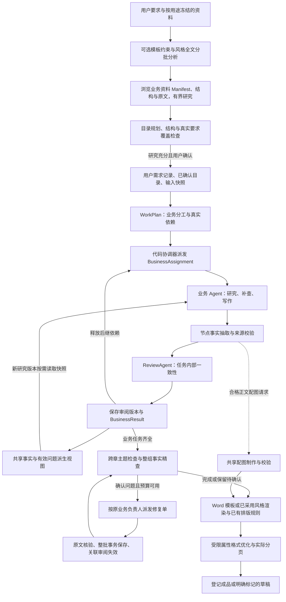

# 自研文档 Agent 引擎

> English version: [English version](execution-engine.md)

本文描述当前运行机制；产品流程和架构总览见[技术架构](architecture.zh-CN.md)，安装与配置见 [README](../README.zh-CN.md)。

## 1. 引擎是什么

Folio 是带模型决策、依赖调度和持久化检查点的文档执行引擎。它直接调用 LLM，不依赖外部 Agent 框架。模型负责语义判断和内容，程序负责验证结果、执行动作、控制预算及保存状态。 工具调用统一使用 Chat Completions 原生 tools/tool_calls：请求提供允许的函数，程序校验实际调用并执行，再按 tool_call_id 返回结果。普通回复中的 JSON 不会被解释为工具动作；目录、正文和审阅结果保留各自的数据校验。

这既不是“让模型自由使用任意工具”，也不是无论结果如何都执行相同次数检索的流水线。任务研究中模型自主选择文件读取、搜索、隔离 Python 和产物核验，并判断何时结束研究、写作或报告缺口；审阅发现问题后进入精查、修复、再审阅循环。外层任务调度、并发和资源限制由程序控制。

当前采用**协调 Agent 规划、代码调度器执行的多 Agent 协作**，仍在同一个应用进程、作业锁和 Store 中运行，不引入外部 Agent 框架。业务按 WorkTask 分工，每个节点保持唯一负责人；Agent 以版本化任务、交付结果和修复单协作，不通过自由会话互相修改正文。判断层继续使用 `DecisionProvider` / `LLMDecisionProvider`；可选判断服务只处理既有的有限动作，不增加运行中自由重规划。

| 角色 | 实际职责 | 代码边界 |
| --- | --- | --- |
| 目录研究与规划 | 规划前浏览 Manifest、结构和原文；生成目录并核对真实要求去向，保存阅读记录 | `research/planning.py`、`document/prepare.py`、`document/research_review.py` |
| `BusinessCoordinator` | DAG 就绪队列、并发名额、接收任务交付、失败取消及排空 | `orchestration/agents.py` |
| `BusinessAgent` | 自主文件研究、Python 分析、补写、节点编写与任务交付；复用持久研究和预算 | `orchestration/agents.py`、`research/workflow.py` |
| `ReviewAgent` | 独立的业务任务审阅、当前问题视图及审阅版本记录 | `orchestration/agents.py` |
| 跨章审阅与精查 | 固定正文快照的主题检查、问题裁决及有界修复 | `Engine`、`review.py`、`focused_review.py` |
| `VisualAgent` 与格式优化 | 制作和核验业务图；调整受保护的 Word 格式属性，不执行逐页视觉评分 | `visuals/agent.py`、`orchestration/formatting.py`，见第 9 节 |
| 公共代码服务 | 模型调用、硬校验、版本与问题状态、事务保存、导出 | `Engine`、`Store`、`issues.py`、`state.py` |

`BusinessWorkflow` 提供兼容服务入口，业务研究与执行、任务审阅和队列由上述对象实现。Agent 无独立的私有事实记忆，所有正式依据和交付结果都可从 Store 与审计档案恢复。跨章审阅由引擎组织；模型动作不各自包装为独立 Agent。

[模型配置](../src/folio/model_settings.py) 使用 OpenAI 兼容接口，生成模型和判断模型各自填写 Base URL、API Key 和 Model。判断服务也支持 Jev 原生协议：填写完整 `/v1/systemone` 地址及服务商提供的模型名（如 `jev-latest`）。网络搜索可选择 Tavily 或 DeepSeek Search。可选服务须当前配置测试成功并显式启用；修改相关配置会使测试失效。密钥不回传前端，也不存入浏览器持久存储。

## 2. 入口与执行生命周期

[service.execute()](../src/folio/service.py) 在构造模型客户端前取得作业文件锁。`published`、`draft`、`needs_confirmation` 的普通重复执行直接返回，不会自动启动新调用。待确认作业可由专门的补答/重试接口校验问题版本及显式调用额度，原子改为 `queued` 后恢复。其余作业加载运行时，再进入 [Engine.run()](../src/folio/orchestration/engine.py)。



需求记录独立于聊天截断窗口，目录提案与后台作业携带确认时的需求版本。新要求导致版本变化时，不能用旧目录确认结果悄悄启动另一版正文。执行阶段不自行改动用户已确认的目录。

GUI 接收统一资料上传和对话需求，文件用途可设为业务资料、文档模板或风格示例。用户可指定一份 DOCX 模板，也可提供只借鉴写法与排版的示例，不经过旧版模板库推荐或封面填写流程。规划前分别冻结三类原件：业务资料进入文件研究，模板生成固定结构与格式约束，风格示例经过程序测量和有界全文分批分析生成 `style.md` 与可执行参数。示例中的业务内容不能成为全局事实，同内容改名副本也按哈希隔离。

用户确认当前目录版本后才创建后台正文作业，作业复制该目录已冻结的资料、模板、示例和风格说明，并校验示例内容哈希。正文写作、Word 渲染及恢复流程复用同一份已采用风格；有模板时保留模板格式，无模板时采用可靠风格参数，未规定部分由默认版式补足。服务重启可接管未结束的 Web 作业。CLI `generate` 创建并执行，`--enqueue` 只入队；底层 `POST /jobs` 创建的任务由 Worker 执行。所有入口共用相同 Store 与作业锁。

目录生成、按建议修改及重新规划是独立交互请求，其版本保存在 `directory-drafts/`。等待目录模型结果不表示后台正文作业已经建立；当前目录确认通过后才启动正文。

## 3. 三个不同的边界

| 边界 | 示例 | 决定者 |
| --- | --- | --- |
| 文档节点 `Section` | “审批流程”“输入信息” | LLM 目录规划，用户确认 |
| 业务任务 `WorkTask` | 交易审批：同时完成上述节点及异常处理 | LLM `work_plan`，程序检查覆盖与依赖 |
| 模型请求 | 为“审批流程”挑选证据、写作、抽取事实、分批校验 | 当前动作契约、资料选择与容量调度 |

一个任务负责的节点数不会直接决定一次请求要携带多少正文。一个节点也可能需要多次模型调用。`container` 是只组织目录的节点，不安排正文写作；`generate` 才必须恰好归属一个任务。

WorkPlan 的传输格式使用任务列表和完整节点归属表，程序恢复长 ID，校验唯一负责人、依赖存在、无环与单任务节点上限。模型规划失败时提供具体错误有限修正，不由程序临时补造任务。

## 4. 业务并行与共享事实

[BusinessCoordinator.run()](../src/folio/orchestration/agents.py) 查看全部未完成任务，以依赖是否就绪决定启动，默认 `max_parallel_tasks=16`。使用 `asyncio.wait(FIRST_COMPLETED)` 回收完成任务、释放容量并启动新就绪任务；已保存作业仍沿用其冻结的执行配置。

每个任务内部依次完成研究、节点写作与任务审阅；研究完成后，全部待写节点直接进入最多八路编写。同一时刻不同任务可以写不同节点，下游必须等上游正文与任务审阅完成，不能只看到“最后一个节点写完”就启动。业务任务执行期间主模型最多32路，后续审阅等阶段16路，跨阶段合计受主服务32路总上限保护；已验证并启用的判断服务统一使用独立16个并发名额，主模型与判断服务合计上限48路，任务数与内层分批不相乘为实际并发。未启用判断模型时筛选也计入主模型名额。意图可能回退主模型，仍走主模型队列；下一步动作固定使用主 LLM 原生工具调用。

防止事实覆盖的方式：

- 新研究版本固定可见的 `global_facts` 快照，避免本次上下文随其他协程完成顺序变化。
- 节点以 `(job_id, section_id)`、业务状态以 `(job_id, task_id)` 独立事务写入。
- 全局事实从当前节点、局部逐事实判定、任务审阅版本和有效问题派生；相同事实键但不同值保留各自来源，交给一致性检查。
- 下游只选取相关且可用的上游结论。模型建议单独标识；存在当前有效问题的节点不能输出已支持事实。跨任务混合风险摘要不复制给每个任务，而是按所属任务恢复各自风险原文和引用。

共享台账的统一入口是 `BusinessWorkflow.shared_state()` 和 `effective_findings()`。`IssueLedger` 兼容已有 `adjudications.json`：排除只对同一问题及被检查的正文/任务审阅版本有效，原 `local_findings` 与任务 findings 保留审计。局部校验保存 `claim_verdicts` 与 `validation_completed`；排除误报后只有已有正向支持判定、合法正文与原文引用的事实才可恢复使用，负向或未完成的判定不会被“排除问题”变成事实。旧作业中合法的 supported 记录继续兼容，不能据旧 candidate 猜测已通过。

`WorkState.review_revisions` 记录任务审阅对应的节点版本；未完成审阅或版本不匹配的正文不进入共享事实。每个研究版本的 `global_facts` 是固定快照，不会实时更新正在执行的写作请求。全局事实对应的原始 Evidence 随研究上下文保存，即使提供该事实的任务不在显式依赖列表里。后续跨章检查负责发现并行快照未覆盖的差异。

显式依赖还提供上游已保存的完整章节正文，包括标题、版本、段落、表格、来源引用及模型建议标记，供结论等下游任务总结成稿。上下文选材保留这份正文，不把它再次压缩成事实索引；容量不足时使用原有分页读取入口。正文是可参考的工作成果，不会因此升级为已证实的业务事实。新增正文展示字段不改变同版本任务的研究身份，续跑沿用已有笔记和配额；正文版本变化仍会触发相应失效。

这里的 `supported` 表示经当前语义检查获得证据支持，不代表客户已经审批。冲突不能靠“后完成的任务覆盖先完成的任务”解决。

可恢复的模型失败会停止派发新任务，已启动的任务继续完成并保存；不可隔离的异常或取消会先取消并等待其他工作协程退出，再释放作业锁。这样恢复任务不会与旧的后台写入竞争。

## 5. 研究循环与检索预算

[BusinessAgent.research_work()](../src/folio/orchestration/agents.py) 在启用 `JobInput.research` 时进入 V2 自主研究。新 GUI 与 LLM CLI 作业默认启用；历史作业与离线演示保留原路径。

```text
research_step（主模型）返回一批原生工具调用，最多16个
  → fs.list / inspect / search / read / view：读取有定位和版本的文字或原页图像
  → sandbox.exec：隔离 Python、Office／OCR、申请白名单依赖
  → artifact.save：登记和独立核验派生结果、维护完整覆盖清单
  → 保存观察结果、笔记、证据和预算 → 下一次 research_step
  → finish 或达到每轮步骤上限 → understand_work 检查剩余缺口
  → 本地最多3轮 → 联网补查最多2轮 → 仍不足则生成标注建议
  → 原有写作、校验和审阅
```

所有决策继续通过 `Engine.call`，工具执行另外记账，默认每任务 50 次工具、40 次研究模型调用、600 秒执行，并为正文／审阅预留模型额度。原件先由共享 `SourceIndex` 生成 Manifest、逐文件结构索引和独立正文缓存，上传、普通聊天、目录规划、本地知识库及业务研究复用同版本解析；每个任务的上下文只读，原件按 SHA-256 固定，Python 不在宿主运行。`fs.inspect` 只读取轻量结构，`fs.read(node_id=...)` 可分页读取整章及子章节；PDF 使用真实书签或明确按页降级。OCR 结构和识别文字仅保存在所属任务，审核通过的同版本产物可复用，停止时清理容器，恢复核对已提交成果。未独立核验的 OCR 和计算结果不能进入共享事实或发布。OCR 可按原始页码选择范围，独立图像审阅通过后保存签名回执，准确提取可继续参与覆盖和事实检查。目录范围审查可渐进导航及有限重审；文件未读状态按选定范围检查，标题文字不掩盖图像中的未读规则。研究历史、证据和完整固定上下文可分页取回，读取进度由代码保存；超限请求改用可回查的导航视图。资料初始化在线程内执行并受任务总超时管理，校验及词法索引有界复用。详细格式、部署与恢复契约见[文件研究与执行设计](agent-research.zh-CN.md)。

兼容路径仍保存任务目标、证据、查询历史、业务记录和缺口：

```text
understand_work：理解当前证据
  → next_action：根据业务记录、缺口和可行动作选择下一步
      search → query → 本地/RAGFlow 检索 → 保存新增切片 → 再理解
      write  → 按内容节点生成
      pending / 仍有缺口 → 先用剩余内部检索预算
          → 内部预算用尽且 搜索服务已启用：web_query → 联网补证 → 再理解
          → 可用检索预算均用尽：complete_gaps → 红字建议后生成
```

`next_action` 的原生 tools 只提供当前可执行的函数。达到内部检索预算 `max_searches=3` 后不再提供 `search`；仍有缺口且 搜索服务已测试并启用时，程序安排最多两次联网补证（Tavily 使用 `advanced`，DeepSeek 使用其搜索协议），每次取得资料后重新判断是否充分。未启用搜索服务时沿用内部检索后补写的路径。两种预算都按业务任务累计，重试、重启、请求拆批、依赖变化和修复指令均不清零。

模型从缺少什么、已有查询及当前证据出发生成补查问题，不要求每轮机械重复同一查询。检索结果原样保存，相关性、适用性及是否充分由模型判断；引用是否真实存在由程序检查。

可用检索预算均用尽后仍有缺口时，`complete_gaps` 输出每个缺口的具体建议及目标节点，程序校验 `gap_id` 恰好覆盖一次。补写业务内容的 `origin=model_proposal`，无伪造引用，不进入已支持事实。写作模型吸收相关内容并去重，Word 标红；不可推测的文档元数据与内部工作指南为 `record_only`，不写进正文。写作产生的新缺口也须先用剩余内部与联网预算，再整理建议并有界修订；当前节点只负责本次提出且补查后仍未解决的缺口，不因其他节点补查而承接整个任务的剩余缺口。当前缺口随证据重新评估，历史依据和建议保留审计，含建议的文件最终是草稿。

[联网补证](../src/folio/orchestration/web_research.py) 在外部请求前持久化尝试记录，失败或中断仍占用额度，恢复不自动重发已占用尝试。公开来源保留 URL、标题、摘录、检索时间及 `public_web` 角色，只支持公开事实；不能据此确认本项目内部规则。公开惯例转为项目方案仍须标记为建议。

完整实现与来源边界见[业务任务执行](task-execution.zh-CN.md)。

## 6. 每次模型调用怎么构造

调用链大致为：

```text
业务动作
  → RequestWorkflow.prepare_context() 归档来源、选择依赖、构造动作视图
  → call_bounded() 测量并按覆盖契约分批
  → Engine._call() 同请求互斥、先校验成功缓存，再测量新请求容量与扣预算
  → LLMRuntime.complete() 尝试已启用的有限判断路由，否则调用主 LLM
  → 恢复短引用、解析结构、校验语义契约、保存结果
```

具体任务提示词在 [runtime/base.py](../src/folio/runtime/base.py)。可选判断服务可处理 `intent`、`select_context`。意图使用 [DecisionRouter](../src/folio/decisions/routing.py)，置信度不足、输入不适用或服务失败时沿用主 LLM 回退；`next_action` 通过主 LLM 原生工具调用选择，提供的函数由剩余预算限定。资料筛选采用独立固定路由：判断模型已验证且启用时始终使用判断模型，否则使用主 LLM；筛选失败或超限不会在两者之间回退。

意图识别使用独立的七分类提示词：`chat` 普通对话、`analyze` 材料分析、`analyze_style` 风格分析、`generate` 生成请求、`requirements` 明确新增/修改/撤销要求、`clarify` 需要澄清、`resume_generation` 继续当前会话已有正文任务。输出包含 `intent`、`summary` 和风格目标 `style_source_ids`；非风格意图的目标为空。本地解析兼容旧两字段返回，严格模型 Schema 声明全部字段。主 LLM 使用统一配置的输出额度（默认 128,000 Token），不另设 1024 Token 意图上限；不携带正文块和证据写作规则。Jev / luna-decisions 同轮判断意图与目标，程序核对目标ID及用途；文件名、历史指代及否定关系由模型解释。`requirements` 保存要求而不自动生成目录，`chat/analyze/analyze_style/clarify` 不加入正式需求。入口只对 JSON/字段格式错误纠正一次，纠错直接使用主 LLM，保留原用户要求；两次调用共用90秒期限。传输、认证和容量错误不在该入口原样重试，失败消息保留待处理，不能擅自改判为生成。目录版本确认和待确认补答仍由工作台状态机校验。

`analyze_style` 路由冻结用户选中的风格示例，复用既有有界分析器和源缓存，将原件、风格档案与审计保存到 `conversation-styles/<revision>/`。先发布已保存的结果和说明入口，再用最多6,000字符的已核对风格摘要回答具体问题；原示例全文不进入普通聊天。分析咨询保持需求与目录版本不变，已有目录时仍可聊天。后续聊天按当前附件ID、用途及完整哈希核对记录，也可读取当前目录冻结的风格档案；历史失效记录仅供查看，不自动作为现有输入。

结构化请求无论使用提示词模式还是 `json_schema` 模式，都在模型可读消息中保留紧凑的完整传输 Schema。后者同时保留 API 的 `response_format` 约束；不能因接口声称兼容就省略必需字段说明。目录短引用、表格和任务分组转换后，发送的是最终传输结构，容量测量使用同一份消息。引擎的预检和发送共用 `Engine.request_schema()`，将当前缺口、节点、事实等合法 ID 枚举及输出数量约束一并计入，避免基础 Schema 预检通过后，最终请求越界而错过分批处理。

| 动作 | 模型主要看到什么 |
| --- | --- |
| `work_plan` | 内容节点、用户要求和材料索引 |
| `select_context` | 当前目标与一批候选事实、建议、风险或证据 |
| `research_step` | 当前任务、固定事实快照、工具目录、有界观察、笔记及剩余额度 |
| `verify_derivation` | 真实输入、脚本、环境及产物，独立核验来源、计算和口径 |
| `understand_work` | 当前任务要求、当前批原始证据、相关依赖 |
| `next_action` / `query` | 业务记录、缺口、查询历史、证据索引 |
| `web_query` | 任务目标、当前缺口及此前公开查询；生成公开知识查询 |
| `complete_gaps` | 当前缺口、目标节点及相关依据 |
| `generate` / `repair` | 当前节点、共享业务记录、所选完整证据和适用建议 |
| `extract` / `validate` | 当前正文、抽取或待校验事实、适用原始来源 |
| `review_work` | 相关任务节点原文、共同规则和原始依据 |
| `review` | 当前跨任务节点组的摘要、事实、事实锚定的完整正文块及模型建议 |
| `drill_down` | 候选问题涉及的正文和原始证据 |
| `format_document` | 当前业务组的实际 DOCX 段落、表格属性及允许的排版调整 |
| `review_layout`（历史独立诊断，正常生成不调用） | 最多两张实际物理页截图、可定位的段落/表格目标及允许格式补丁 |

`generate`、`repair` 无论容量是否充足，都先按当前节点的业务对象和写作要求执行 `select_context`；共享任务材料不能直接充当每个节点的依据。选择不能删除必须覆盖的项目来源及所选事实原文，也不能把上游审阅风险当作事实。摘要用于导航和定位；正文支持性检查要读取原始依据。

输入容量优先根据服务实际 Token 计数与窗口计算，默认 600,000 Token；服务不支持计数时使用明确标记的本地 Token 估算。所有 LLM 动作统一沿用默认 128,000 Token 输出额度，目录仅在显式配置时单独覆盖。字符回退仅用于缺少 Token 计量能力的兼容 Runtime 或独立判断服务。分批动作分别校验覆盖并合并，不丢掉前一批事实，也不以最后一批结果覆盖整份记录。完整机制见[请求上下文与容量](context-and-capacity.zh-CN.md)。

选材在装页时计量完整请求，包含 Jev 状态和判断问题、LLM 提示词和 Schema。主 LLM 按完整请求的 Token 容量决定是否分批，不再受 32,000 字符或 24 项候选限制；独立判断服务使用 600,000 字符的兼容上限，所有独立判断模型统一每页最多 24 项判断。单条过长时无损分片，不以裸材料计数后给所有页面过度扣减。Jev 相关性必须严格大于 0.8 才保留，已选事实对应原文及必须覆盖的项目来源仍保留；不确定项不会因低阈值默认全选。

## 7. 审阅与修复循环

节点生成后抽取 candidate 事实，`validate` 独立判断原文支持性和未抽取的问题；任务写完后 `review_work` 检查整个业务的跨节点关系。容量不足时拆成多个请求，不意味着变更任务归属。业务主表与额外表完全重复数据和来源、表题相同或仅一方非空时，恢复表头后保留表题合并，并更新配图引用；不同业务内容不按语义猜测去重。

全局 `review` 使用有界分组和确定性索引：

1. 默认宽度 6、相邻窗口重叠 1 个节点的摘要窗口。
2. 优先核对相同 `scope / subject / predicate` 的具体事实，再按共同主题组织跨任务小组；宽泛实体出现于多章时采用相互衔接的批次，不做两两全连接。
3. 显式依赖补查上下游交接。已有组覆盖的关系复用原组，容量内可合并相交主题，每组不超过配置宽度。
4. 同一事实键的不同原样取值在宽度内放入同一代表组；超出宽度时，保留全组记录，按一个事实键形成一个精查候选，不展开值对组合。候选及未注明单值的断言也进入宽组检查；已支持的单值事实继续使用冲突索引，已由宽组覆盖的键不重复生成规则候选。文字不同本身不是矛盾结论；整组无法在精查的安全容量内完整核对时保留待确认。

只有同一任务的组会跳过，避免重复任务内部审阅；双方都有模型建议本身不构成配对理由。模型收到实际 `review_topics` 及相关完整正文块。候选需定位两个不同章节的真实陈述，结构化返回 `comparison_scope` 和 `incompatibility`；同义表述、未重复说明或条件不同不能单独证明矛盾。完整块超容量时明确延后精查，事实和建议索引及归档原文不删除；精查前不把候选当成已确认冲突。没有共享抽取名称、没有相邻或依赖关系的隐含关联仍可能漏检；有界主题检查不等于穷举所有节点对。

[parallel_reviews()](../src/folio/orchestration/review.py) 使用默认最多 **16** 个协程领取固定分组，结果按分组原顺序汇集。只对相同类型、规则、依据类别、位置、引用集合、比较范围和规范化描述的重复疑点去重并归档。`Finding.fingerprint` 在产生时即计算 v2 内容身份，无定位时还包含原问题键；去重不改写 `key`。模型复用短键指出不同内容时，两项在单独读取、不同批次和重启后仍拥有独立身份。旧豁免未记录足够身份信息，只保留审计，不自动迁移或套用到 v2 问题，须重新精查。每组内部拆批仍受单作业模型调用总名额约束，不能据16路并发推断服务一定达到16倍速度。

发现候选问题后，`drill_down` 读取相关正文和证据：误报按内容版本记录排除；真实问题局部修复；无法裁决转为待确认。默认每节点最多 3 次修复。正文变化使关联任务和依赖审阅过期，下游重新核对已有内容，最终审阅必须对应当前版本。

候选问题使用 `rule / block_refs / evidence_ids` 标明指控类型、正文位置和相关原始来源。局部及任务审阅的 `citation_required` 必须定位本次提供的非红字事实块，传输 Schema 和应用校验共同约束；不能只因补写缺引用就新增疑点。若标红内容伪造人员、现状、日期或批准事实，仍通过相应事实、冲突规则报告。去重后的有效疑点进入 `drill_down`，是否误报由独立精查对照原始依据判断，原疑点和结论保留日志；结构和来源硬校验不能豁免，补写仍保持待确认性质。

精查按问题只读并发，沿用审阅并发上限（默认16），进度独立显示。当前快照裁决后，按任务归属及传递依赖选择互不影响的一批修订；有读写交叉的修订留至下一轮。`RepairAssignment` 核对业务负责人、目标节点与预期版本。全部候选正文完成后，`Store.save_sections_batch()` 在一个 SQLite 事务里核对读快照、保存整批节点并使关联任务及下游审阅过期，中途失败不留下半批正文。修订预算按实际修改目标判断。正文按目标块保留必要邻接上下文，强制携带目标引用及指控中点名的原始证据，不再附加整节所有引用；选择材料仍需保留反例与否定条件。

若相关原文仍超过容量，最多分8批、每个问题最多4批并发。每批保留完整目标正文，同一来源的各片段不拆开裁决。只有各批都完成且结论一致才合并；结论冲突、修复要求不同、不可分材料过大或失败，均保留待确认，不用摘要或遗漏的原文宣称通过。输入及结果存入 `contexts/issue_read_plans`、`contexts/issue_read_results`。

局部修复先读取已保存的业务记录、相关证据和当前正文，不因修复指令变化就重做整项业务研究。修复结果报告的新缺口才进入补查或补写；原有待确认事项继续保留并参与校验，不重复生成同一缺口的补写内容。知识库和联网检索额度仍按原业务任务累计，修复不会重置额度。

精查失败不能被视为“没有问题”。经过有限尝试仍无有效指令时，保留正文和问题，输出待确认草稿。

## 8. 持久化、缓存与恢复

| 保存位置 | 数据 |
| --- | --- |
| SQLite `jobs / sections` | 作业权威状态、DocPlan、节点正文与版本 |
| SQLite `work_plans / work_states` | 业务任务分工、依赖、内部与联网检索历史、研究及任务审阅检查点 |
| SQLite `tasks / retrievals` | 模型调用、用量、错误和检索缓存 |
| SQLite `decisions / events` | 判断记录及可重放的进度事件 |
| `jobs/<id>/inputs/` | 不随原文件后续修改而变化的输入快照 |
| `jobs/<id>/contexts/` | Agent 任务/交付/修复契约、来源快照、动作视图、请求测量、审阅计划与结果 |
| `jobs/<id>/adjudications.json` | 按问题及正文/审阅版本记录的误报排除理由 |
| `directory-drafts/<revision>/` | 目录预览、提案、编辑与校验记录 |

调用入口先读取并重新校验同请求成功缓存，命中时不访问容量服务；只有未命中才测量并发送新请求。成功结果按请求内容与模型身份等构成的缓存键复用，身份包含可选服务的启用状态、模式与模型；用量记录保留实际判断提供方、模型或回退原因。同一引擎内相同请求加锁，避免两个审阅父组拆出相同子请求后重复调用或竞争重试次数。已经记录的容量/截断父请求可进入分批，成功子请求独立复用。

模型输出必须完整结束并通过结构、引用和业务约束检查。输出截断、重复长段落、无效 Schema 或未知动作不能拼凑成成功。普通错误有限重试；容量错误按类型减小请求或调整输出预留，不无限原样重放。目录规划仅对已返回结果的格式和结构错误进行纠正；超时、连接和认证失败不会冒充校验错误重放。超时诊断记录接收阶段、正文字符数、推理字符计数及首次正文耗时，不保存推理原文。恢复时，中断且尚无结果或错误记录的最后一次调用不计为已完成的失败重试；总调用预算和真实失败计数保留，回收操作按调用事件幂等记录。

模型参数由 `runtime/provider_parameters.py` 统一处理，使用用户配置的温度和显式推理开关，不按模型别名改写。连接测试和正式请求共用相同参数，实际参数纳入运行时缓存身份。

资料筛选遵守同一固定路由，主 LLM 依据完整请求 Token 容量分批，独立判断服务采用 600,000 字符的兼容分页上限；容量精筛不把已启用判断模型的任务转交主 LLM。项目必需来源和已选事实的原始依据始终保留。补写整合逐项读取相关约束与必要原文，仍超限时分批核对冲突、修正并重新复核；无法完整核对则保留原文与待确认项，不宣称整合成功。

恢复不是重启整份文档：已提交节点、有效研究与审阅以及相同成功调用可以复用。版本改变、依赖改变或调用条件改变会使对应结果过期。外部请求在崩溃与落库之间仍可能重发，不能宣称外部调用恰好一次。

## 9. 交付与可观察性

[visual_obligations.py](../src/folio/orchestration/visual_obligations.py) 只从明确正向写作指令识别必需图种，生成/修复 Schema 要求非空图请求，本地结果校验逐类核对；完整正文校验仍执行。不从标题、普通流程/界面描述、否定或按需示例新增强制图，“流程图或界面图任选”不转换为两种都必须有。子节可承担父节要求，最终仍看实际子树配图；容器无子节承担时留待确认，不以改写空容器反复修复。

`VisualAgent` 复用现有 `build_visuals`、`VisualSession` 缓存、图片身份和校验能力，接收业务正文里的 `VisualRequest`；业务 Agent 确定内容、来源和插入位置，配图角色不能自行补造业务规则。单节正文完成提取、局部核验并保存后，可由 `VisualPrefetch` 后台生成来源没有实质疑点的配图，与剩余正文写作重叠。全作业共享四路配图工作流、两路浏览器渲染及每个图片身份的三次尝试额度。后台不发布局部清单，`Engine.finish()` 按最终正文核对身份、等待有效预生成并取消过期工作后，统一生成图片清单；作业取消、超时或预算降级先取消并等待后台清理。

预生成模型请求单独最多2路，不占正文/审阅的16或32路角色名额，但仍共享主服务32路总上限。`runtime.call_budget` 通过 `ContextVar` 将软预算传入子任务，`Store.begin_task()` 在同一事务中核对总额度、核心预留和 `call_budgets` 桶并计数；每次重试计数，缓存命中不计。软额度为 `min(120, floor(max_calls/5))`，核心保留为 `min(max_calls, max(12, ceil(max_calls/4)))`。耗尽抛出 `VisualPrefetchDeferred`，不会缓存为图失败或消耗未完成的图片修订轮次，最终必需配图可使用主额度。保存正文后、任务审阅发现冲突及整批修订提交后立即刷新图片身份、取消过期任务；取消清理完成后才释放相关资源。

`Engine.finish()` 完成配图后按内置版式渲染临时 Word，再按现有业务组、最多4路执行[有界排版优化](../src/folio/orchestration/formatting.py)，最后真实分页并替换为最终产物。排版每组最多 3 次调用、25 秒，全阶段最多 120 秒；只允许白名单格式调整，保护全部正文、顺序、封面、标题和建议红色。超时或失败继续交付安全结果，保护校验失败丢弃调整，调整导致分页失败则恢复内置排版。Demo 跳过该步骤。

`Engine.finish()` 已移除 Jev 最终页面评分、低分后的自动修改与复评，不再受旧 `layout_review_enabled` 开关控制。模型图片输入能力仍可用于资料研究和风格分析，但不会触发最终 Word 评分。正常格式、正文保护和模板核验继续执行，导出完成不代表通过逐页视觉验收。DocPolish 是独立项目，当前不参与这条交付链路。

[历史页面审校模块](../src/folio/orchestration/layout_review.py) 与相关独立诊断代码仍保留，旧任务的 `layout-review.json`、截图和 `layout-preview.pdf` 可按原有状态读取。`reformat` 仅在完整 DOCX 源与目标包签名匹配时重放已通过补丁，重新分页但不重新声明视觉通过。历史记录及独立模块存在不表示当前生成任务仍会调用评分服务。

目录页码使用排版引擎计算的目标节显示页码（`display_pages`），按文档实际页码格式计算；物理页位置仅用于诊断，不能直接写入目录。嵌套目录域未暴露独立页码字段时，在内存中使用隐藏引用测量并核对布局未变化，不改正文或文档分节；目录缓存与最终 PDF 在分页收敛后一起保存。

同时导出 `work-plan.json`、`work-records.json`、`trace.json`、`formatting.json` 和 `layout.json`，其中排版记录保存实际应用的补丁与未完成范围。含模型建议或使用 Demo 时为草稿；未解决问题对应 `needs_confirmation`；正式发布还要在 Store 中比较文档基线版本。

当全部目录节点均已保存，但模型调用预算耗尽，或检查因受支持的服务异常/超时中断时，引擎停止新增模型请求，保留原疑点并增加“检查尚未完成”记录，设置 `review_passed=false`，导出 `needs_confirmation`。有效配图可复用，未完成配图在正文中标明待确认，使用安全内置排版；不会把缺图或未执行检查包装成通过。正文未齐全时仍失败并保留检查点。取消/暂停、存储故障和程序错误不使用该降级；导出自身失败仍准确报告。下载到这种草稿不代表完整生成验收成功。

待确认后可显式提交业务补答，或空答复重试技术检查。`confirmation_rounds` 和旧 Word 保留上一交付；问题版本令牌防止旧页覆盖，`request_id` 保证幂等。本轮额度默认200、允许1～10000，调用总上限改为已用次数加本轮额度，累计次数不重置且最多100000。业务答复作为限定章节的项目依据，仅直接修订相应章节，按本轮起始章节版本计修复额度，保持目录并重新审阅和导出。详见[待确认补答与续跑设计](confirmation-and-resume.zh-CN.md)。

SSE 发送真实执行事件、任务名、检索和审阅数量、当前处理状态及结果。模型内部思考过程不转发。动画表示正在等待或处理，不能充当完成依据。只有已登记的可下载产物才能触发文件卡片。

调试入口：`folio status JOB_ID`、`GET /jobs/{id}/work`、SQLite 调用记录和 `contexts/` 审计文件。并发审阅的总组数与逐组结果分别保存于 `review_plans/` 和 `review_results/`；界面统计顶层组，组内分批不增加该总数。

## 10. 默认预算与边界

执行默认值以 [Limits](../src/folio/models.py)、模型输入输出额度以[模型设置](../src/folio/model_settings.py)为准：

| 参数 | 默认值 | 作用 |
| --- | --- | --- |
| `max_parallel_tasks` | 16 | 同一作业并行业务任务数；真实依赖仍等待 |
| `max_parallel_reviews` | 16 | 同一轮跨任务审阅并发组数 |
| `max_work_sections` | 8 | 单业务任务最多内容节点数 |
| `max_searches` | 3 | 每个业务任务累计的内部检索轮次上限 |
| `max_repairs` | 3 | 节点修复上限 |
| `work_plan_attempts` / `call_attempts` | 3 / 2 | 业务规划与普通调用的尝试预算 |
| `max_calls` | 2000 | 作业模型调用预算 |
| `call_timeout_seconds` / `run_timeout_seconds` | 900 / 7200 | 调用与单次执行时限（秒）；模型流沿用调用时限，不另加 180 秒截断 |
| `max_input_tokens` | 600000 | 全部 LLM 动作的完整请求输入 Token 预算 |
| `max_tokens` | 128000 | 全部 LLM 动作的输出 Token 额度；目录默认继承，显式配置可覆盖 |
| `max_prompt_chars` | 600000 | 缺少 Token 计量能力的兼容 Runtime 的正文请求字符回退值 |
| `max_planning_prompt_chars` | 600000 | 缺少 Token 计量能力的兼容 Runtime 的目录请求字符回退值 |

已启用搜索服务时，每个任务另外最多两次联网补证，额度由[联网流程](../src/folio/orchestration/web_research.py)固定控制。并发上限按作业管理，不是整个模型服务的全局限流器。多作业同时运行、模型吞吐、长输出及 Office 排版仍会影响耗时。当前保留明确失败出口，不用静默删材料或跳过校验换取“永远完成”。

性能验证应使用相同的已确认目录和冻结资料，新建独立 Store 与调用／检索缓存，只读访问源任务。记录代码与输入摘要、阶段耗时、模型用量、配图和 Word 完整性；失败与中断也要计入完整记录。运行中改代码、依靠已有正文或缓存、技术中断待确认，以及缺少必需配图，都不能作为完整生成通过的依据。性能目标应按材料、模型和运行环境明确设定，与 `run_timeout_seconds` 的运行时限分别记录。测试与重放方法见[测试与验证](testing.zh-CN.md)。

角色分工与并发上限不保证减少实际模型调用量或缩短端到端耗时。验证应覆盖角色交接、问题有效状态、事实来源闭包、去重、容量和恢复约束，再用实际材料评估质量与性能。待确认补答续跑使用持久检查点；运行中任务图重规划和会议纪要更新仍不属于当前引擎实现。全局事实使用研究阶段快照，不提供实时订阅或自动级联重写。后续扩展应先明确状态与版本契约，再接入流程。
