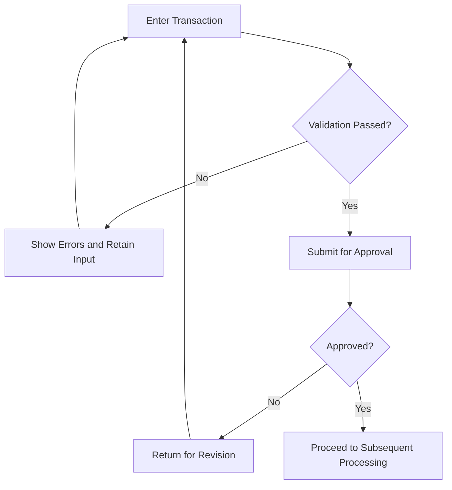

# Document Illustration Tools

> 中文版: [中文版](illustrations.zh-CN.md)

Folio's illustration tools run locally in the background, using the existing LLM to design diagram content and programmatic rendering to produce images. The renderers themselves do not call models or require an image service API Key. Source files are retained alongside the PNG files and can be edited and rendered again.

| Tool | Input source file | Implementation | Purpose |
| --- | --- | --- | --- |
| `render-ui` | UTF-8 HTML/CSS | Playwright + Chromium | Static UI prototypes, such as forms, dialogs, and list pages |
| `render-flowchart` | UTF-8 Mermaid definitions | Local Mermaid + Playwright Chromium | Business steps, conditions, and transitions |

UI prototypes explain requirements; they are not actual business systems: buttons, queries, submissions, and permission checks do not execute. Displayed data should be clearly identified as sample data. Flowcharts express business logic but do not execute the actions they describe.

## Install Runtime Dependencies

Run the following from the project root. Node.js 22.12 or later is recommended, matching the frontend requirements:

```bash
uv sync --locked
uv run python -m folio.visuals.install
```

The installer installs local Mermaid using version-locked npm dependencies and installs the Chromium version required by Playwright. The initial installation requires network access; normal rendering does not access a CDN. Linux hosts also need the system libraries required by Chromium; if libraries are missing, install the dependencies indicated in the Playwright installation output.

The following can be configured during deployment:

| Environment variable | Purpose |
| --- | --- |
| `FOLIO_CHROMIUM_EXECUTABLE` | Full path to an installed Chromium executable |
| `FOLIO_MERMAID_JS` | Full path to a local Mermaid JavaScript file |

These variables are server configuration and are not read from document content or user-provided source code.

## Render a UI Image Independently

Save the prototype as `screen.html`, using inline CSS and locally available fonts. Avoid external images, font links, or scripts. For example:

```html
<!doctype html>
<html lang="zh-CN">
<meta charset="utf-8">
<style>
  body { margin: 0; padding: 32px; font: 16px sans-serif; background: #f5f7fa; }
  main { width: 960px; padding: 24px; background: white; border: 1px solid #dbe2eb; }
  h1 { margin-top: 0; font-size: 22px; }
  label { display: block; margin: 20px 0; }
  input { padding: 8px; border: 1px solid #cbd5e1; }
  button { padding: 10px 24px; color: white; background: #165dbe; border: 0; }
</style>
<main>
  <h1>Transaction Entry</h1>
  <p>UI prototype · The data below is for illustration only</p>
  <label>Transaction ID <input value="DEMO-001"></label>
  <label>Transaction Amount <input value="100,000.00"></label>
  <button>Submit for Approval</button>
</main>
</html>
```

```bash
uv run folio render-ui screen.html --output-dir artifacts/ui-preview
```

## Render a Flowchart Independently

Save the flow as `approval.mmd`:



```bash
uv run folio render-flowchart approval.mmd --output-dir artifacts/flowchart-preview
```

Both commands output JSON containing `image_path`, `source_path`, `width`, and `height`. The paths point to the actual artifacts, and dimensions are in pixels. If the source file cannot be read, dependencies are missing, syntax is invalid, or rendering fails, the command exits with a nonzero status and writes the reason to standard error; it does not return a blank image as a successful artifact.

Mermaid text labels support line breaks using `<br>`, `<br/>`, and `<br />` without attributes; other HTML, scripts, interactive links, and external resources remain prohibited.

## Use During Document Generation

State the required illustrations, their purpose, and their scope in the writing instructions. For example: “The transaction cancellation feature requires a request UI image and a flowchart containing approval, rejection, and return-for-revision branches.” Ordinary mentions of a “flow” or “UI” do not automatically require illustrations. Conditions, on-demand wording, and examples retain their optional meaning, and “choose either a flowchart or a UI image” does not require both.

Business agents own the meaning, evidence, and insertion position of each illustration. They hand off `VisualRequest` entries in `SectionContent.visuals` to the shared [VisualAgent](../src/folio/visuals/agent.py). The illustration agent designs, renders, validates, and revises HTML/Mermaid assets without permission to write document content. Each node may have at most three illustrations; sections without illustration requirements continue to use text and tables.

The writing request's `figure_policy` specifies allowed, required, and delegated illustration types. A parent section can delegate an illustration to a subsection explicitly responsible for the same type, with final checks against the actual subtree. A standalone overview diagram must still meet its own requirements. [Review scope](../src/folio/orchestration/review_scope.py) passes node responsibilities, illustration rules, and child-diagram locations to generation and all review stages, so revisions use the same assignments. A child-diagram request does not establish that its business meaning is valid. Explicit global prohibitions take precedence; a chapter-specific prohibition does not extend to other chapters.

The generation workflow is:

1. Document content specifies the caption, type, supporting content blocks, and insertion position.
2. Once a section has been extracted, locally verified, and saved, and there are no substantive concerns about the illustration's source, background pregeneration can overlap with later writing. It reads only the selected text or tables, extracting constraints in batches for larger materials and retaining the complete source in the backend.
3. The LLM produces HTML/CSS or Mermaid source. The program performs static checks and local rendering, then the LLM checks fields, actions, and flow branches against the business constraints.
4. The same illustration identity has at most three actual generation or revision rounds: an initial draft and two revisions. Each revision includes localized issues. A job processes at most four illustrations concurrently, with at most two local browser renders.
5. Export inserts PNGs and sequential figure numbers at the requested positions. Images fit the available page dimensions, and captions inherit the built-in body font.

If an illustration fails, its source and issues are retained while other illustrations continue. Its position shows “Illustration pending confirmation,” and the document is exported as a draft pending confirmation. Images that fail validation are not inserted into the output.

## Evidence and Validation

Illustrations use document content as business evidence. Unspecified approval steps, permissions, or exception branches must not become confirmed facts. Missing information retains the document's pending-confirmation or proposed-design markers. A source that says only “review” does not imply approval, rejection, retry, or termination branches. Sample data must be labeled and cannot become new business evidence.

Design and review share the illustration's scope: flowcharts are checked for the agreed steps, sequence, and key branches, while UI images are checked for the agreed page's controls and states. Supporting content does not mean every sentence must appear in the image. Auxiliary capabilities such as query export or dialogs are checked only when explicitly in scope.

The program checks source syntax and visibility, rejecting blank prototypes with CSS but no body content or controls. For flowcharts, a local Mermaid parser also checks nodes, direct edges, reachable paths, and prohibited paths. Review issues must identify document content, verbatim quotations, and diagram elements. Semantic disputes and topology relationships such as branches, merges, and loops receive an independent review that requires coverage of actual relationships and source support for each edge. Unlocated issues, mismatched quotations, and incomplete parsing remain unresolved.

The program can check structure and quotations; the model still determines how business constraints apply. Source checks and model review do not replace manual inspection of the final image's business accuracy and appearance.

If any supporting content block contains model-added content, the caption appears in red and is marked “Proposed design.” This marker describes the basis for the business content, not whether the layout comes from a real system screenshot.

## Concurrency, Budget, and Recovery

Background pregeneration and final export share one `VisualSession` for concurrency, caching by source identity, and attempt limits. Pregeneration has an additional limit of two concurrent model requests, shares the service's total call allowance, and preserves role slots for writing and review.

For a total call allowance of `M`, the pregeneration soft allowance is `min(120, floor(M/5))`, and the core reserve is `min(M, max(12, ceil(M/4)))`. With the default of 2000 calls, these are 120 and 500. Actual model attempts and retries count; cache hits do not, and restarting does not reset usage. Reaching the soft allowance pauses pregeneration without counting budget deferral as a failure or revision attempt. Mandatory illustrations at final export may use the remaining total allowance.

Illustrations are stored in `.folio/jobs/<job_id>/visuals/`. `visuals.json` records the document version, insertion positions, paths, and checksums, plus missing-image positions and reasons with `status=unresolved`. Background pregeneration saves image assets; final export checks the current sources and publishes the complete manifest.

Resuming a job reuses intact images whose sources still match. Failure recovery reads the latest valid source and accumulated feedback for the same source material, continues targeted revision, and preserves earlier audit records. Changes to supporting content, deletion of an illustration, or substantive review conflicts cancel tasks under the old identity. New sources receive a new illustration identity without reusing old failed drafts. Cancellation follows task cancellation semantics.

`reformat` does not call the LLM. Missing-image placeholders are preserved. If an image recorded as successful is missing, corrupt, or inconsistent with the document version, reformatting reports an error and requires the job to be resumed first, preventing image loss or insertion of outdated images.

## Image Size and Word Export

Split overcrowded flowcharts into an overview and subflows. UI images should focus on the current node's business issue; a full-page system screenshot can become unreadable when fitted into Word.

If the initial flowchart layout exceeds the size limit, the renderer tries two tighter node-spacing settings within the same timeout. It preserves the source, nodes, edges, and 18px font. If the image is still too large, it reports failure for revision or splitting.

Word export retains an overview of the full flowchart. If fitting it to the page makes text too small, export adds enlarged pages with overlapping regions, targeting text of at least approximately 10pt. These pages reuse the same PNG through Word's native image viewport. At most 36 enlarged pages are allowed; larger diagrams must be split. Check the finished document for business accuracy and final page appearance.

## Rendering Boundaries

- HTML input is limited to 200 KB; Mermaid input is limited to 40 KB.
- A render has a 30-second limit, excluding time spent waiting for a rendering slot.
- Maximum dimensions are 2400 × 3600 pixels, with no more than 6 million pixels total.
- A PNG is limited to 12 MB.
- UI prototypes use static HTML/CSS without executing user scripts, requesting remote resources, or reading local files.
- Word uses PNG; source files remain in the backend for review, editing, and rerendering.

## Word Format Checks

Normal document generation does not perform per-page visual scoring. After content and illustrations are complete, Word applies built-in or template-defined rules for fonts, headings, numbering, lists, table headers, and source markers, followed by constrained formatting-property optimization, content protection, template verification, and final pagination.

Formatting optimization reads paragraph and table properties and does not establish acceptance of page aesthetics. LibreOffice/UNO handles pagination and PDF previews, and Poppler can generate page images. `supports_image_input` controls image input for tasks such as material research and style analysis.
