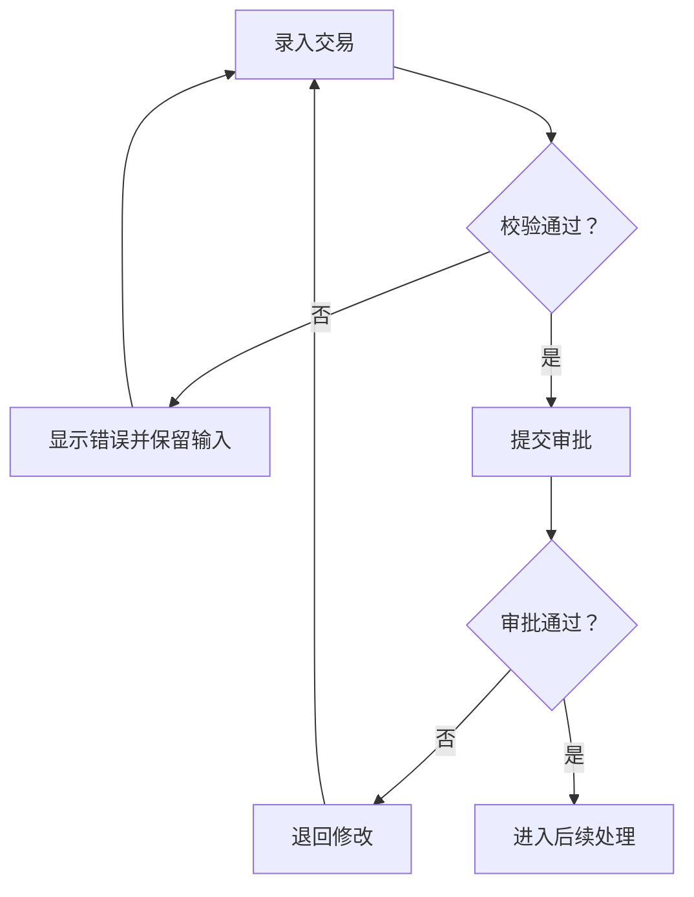

# 文档配图工具

> English version: [English version](illustrations.md)

Folio 的配图工具在后台本地运行，使用现有 LLM 设计图的内容，再由程序渲染图片。渲染工具本身不调用模型，也不需要图片服务 API Key。源文件随 PNG 一起保留，修改后可以重新渲染。

| 工具 | 输入源文件 | 实现 | 用途 |
| --- | --- | --- | --- |
| `render-ui` | UTF-8 HTML/CSS | Playwright + Chromium | 表单、弹窗、列表页等静态界面原型 |
| `render-flowchart` | UTF-8 Mermaid 定义 | 本地 Mermaid + Playwright Chromium | 业务步骤、条件和流转关系 |

界面原型用于解释需求，不是真实业务系统：按钮、查询、提交和权限校验不会执行。展示数据应明确是示例数据。流程图表达业务逻辑，也不会执行流程中的动作。

## 安装运行依赖

在项目根目录执行，建议与前端统一使用 Node.js 22.12 或更新版本：

```bash
uv sync --locked
uv run python -m folio.visuals.install
```

安装入口使用版本锁定的 npm 依赖安装本地 Mermaid，并安装 Playwright 对应的 Chromium。首次安装需要网络，正常渲染不访问 CDN。Linux 主机还需要 Chromium 所需的系统库；缺库时按 Playwright 安装输出补齐依赖。

部署时可设置：

| 环境变量 | 用途 |
| --- | --- |
| `FOLIO_CHROMIUM_EXECUTABLE` | 指定已安装的 Chromium 可执行文件完整路径 |
| `FOLIO_MERMAID_JS` | 指定本地 Mermaid JavaScript 文件完整路径 |

这些变量属于服务器配置，不从文档内容或用户提供的源代码读取。

## 独立渲染界面图

将原型保存为 `screen.html`，使用内嵌 CSS 和本地可用的字体，避免外部图片、字体链接或脚本。例如：

```html
<!doctype html>
<html lang="zh-CN">
<meta charset="utf-8">
<style>
  body { margin: 0; padding: 32px; font: 16px sans-serif; background: #f5f7fa; }
  main { width: 960px; padding: 24px; background: white; border: 1px solid #dbe2eb; }
  h1 { margin-top: 0; font-size: 22px; }
  label { display: block; margin: 20px 0; }
  input { padding: 8px; border: 1px solid #cbd5e1; }
  button { padding: 10px 24px; color: white; background: #165dbe; border: 0; }
</style>
<main>
  <h1>交易录入</h1>
  <p>界面原型 · 下列数据仅为示例</p>
  <label>交易编号 <input value="DEMO-001"></label>
  <label>交易金额 <input value="100,000.00"></label>
  <button>提交审批</button>
</main>
</html>
```

```bash
uv run folio render-ui screen.html --output-dir artifacts/ui-preview
```

## 独立渲染流程图

将流程保存为 `approval.mmd`：



```bash
uv run folio render-flowchart approval.mmd --output-dir artifacts/flowchart-preview
```

两个命令均输出 JSON，包含 `image_path`、`source_path`、`width` 和 `height`。路径指向实际产物，宽高单位为像素。源文件读取失败、依赖未安装、语法不合法或渲染失败时，命令以非零状态退出，原因写入标准错误；不会用空白图片充当成功产物。

Mermaid 文本标签支持无属性的 `<br>`、`<br/>` 和 `<br />` 换行；其他 HTML、脚本、交互链接及外部资源仍不允许。

## 文档生成时的使用方式

在写作要求中说明需要的图、用途和范围，例如“交易撤销功能需要申请界面图，以及包含通过、拒绝和退回修改分支的流程图”。普通的“流程”或“界面”描述不自动要求配图；条件、按需和举例保留其可选含义，“流程图或界面图二选一”也不会变成两类都必需。

业务 agent 负责图的业务含义、依据和插入位置，通过 `SectionContent.visuals` 中的 `VisualRequest` 交给共享的 [VisualAgent](../src/folio/visuals/agent.py)。配图 agent 负责 HTML/Mermaid 设计、渲染、校验和局部修订，没有正文写入权限。每个节点最多三张图，无配图要求的章节继续使用文字和表格。

写作请求的 `figure_policy` 指定允许、必需和已委派的图类型。父节可把同类型配图委派给明确承担该要求的子节，最终按实际子树核对；独立总览图仍需满足自身要求。[审阅范围](../src/folio/orchestration/review_scope.py)把节点职责、配图规则及子图位置传给生成和各层审阅，修订按同一分工处理。子图请求存在不代表其业务语义已验证。明确的全局禁图要求优先，章节内禁图不扩展到其他章节。

生成流程如下：

1. 正文提出图题、类型、支撑正文块和插入位置。
2. 单节正文完成提取、局部核验并保存，配图来源没有实质疑点后，可在后台预生成，与后续正文写作并行。配图只读取选中的正文或表格，较大的材料分批提取约束，完整来源保留在后台。
3. LLM 生成 HTML/CSS 或 Mermaid 源码；程序进行静态检查和本地渲染，再由 LLM 对照业务约束检查字段、动作和流程分支。
4. 同一配图身份最多三轮实际生成或修订：初稿加两次修订。每次修订携带已定位的问题。整个作业最多四张图并行处理，本地浏览器渲染最多两路。
5. 导出时按指定位置插入 PNG 和连续图号，图片适配页面可用宽高，图题继承内置正文字体。

单张图失败时保留源码和问题，其他图继续。对应位置显示“配图待确认”，整份文档作为待确认草稿导出；未通过校验的图片不插入成品。

## 内容依据与校验

配图以正文为业务依据。没有提供的审批步骤、权限或异常分支不能补成已确认事实；缺失信息沿用正文的待确认或拟议设计标记。来源只说明“审核”时，不自动扩展成通过、拒绝、重试或终止分支。示例数据须标明示例，不能成为新的业务证据。

设计和审阅共用配图范围：流程图检查约定的步骤、顺序和关键分支，界面图检查约定页面的控件与状态。作为依据的正文不等于每句话都要画入图中；查询导出、弹窗等辅助能力，只有明确属于该图范围时才检查。

程序检查源码语法和可见性，拒绝只有 CSS、没有正文或控件的空白原型。流程图还使用本地 Mermaid 解析器检查节点、直接连线、可达路径和禁止路径。审阅问题需要定位到正文、逐字引文和图中元素；存在语义争议或分支、合并、回路等拓扑关系时，独立复核要求覆盖实际关系并提供逐边来源依据。不能定位、引用不符或解析不完整的问题保留未决。

程序可以核对结构和引用，业务约束如何适用仍由模型判断。源码检查和模型审阅不能替代人工核对最终图片的业务准确性与观感。

只要支撑图的正文块包含模型补写内容，图题就用红字并标注“拟议设计”。该标记说明业务内容的依据，不表示页面布局来自真实系统截图。

## 并发、预算与恢复

后台预生成与最终导出共享同一个 `VisualSession` 的并发名额、按来源身份缓存的图片和尝试额度。后台预生成额外限制为两路模型请求，共享主服务总额度，同时保留正文与审阅的角色名额。

设总调用额度为 `M`，预生成软额度为 `min(120, floor(M/5))`，核心保留为 `min(M, max(12, ceil(M/4)))`；默认 2000 次时分别为 120 和 500。每次实际模型尝试及重试都计入额度，缓存命中不计，重启不清零。达到软额度后暂停预生成，不把预算延后记为配图失败或修订尝试；最终必需配图可使用剩余总额度继续。

配图保存在 `.folio/jobs/<job_id>/visuals/`。`visuals.json` 记录正文版本、插入位置、文件路径和校验值，以及 `status=unresolved` 的缺图位置和原因。后台预生成只保存图片资产，最终导出核对当前来源后统一发布完整清单。

恢复作业会复用来源匹配且文件完整的图片。失败恢复读取同一来源的最近有效源码和累计反馈，继续局部修订，保留之前的审计记录。正文相关来源改变、删图或审阅发现实质冲突后，旧身份的任务会被取消；新来源使用新的配图身份，不复用旧失败稿。取消遵循任务取消语义。

`reformat` 不调用 LLM。缺图占位会保留；已记录为成功的图片若缺失、损坏或与正文版本不一致，则报错并要求先恢复作业，避免丢图或插入旧图。

## 图的尺寸与 Word 导出

流程图过于拥挤时，应拆成总览和子流程图。界面图应聚焦当前节点的业务问题，避免整页系统截图缩入 Word 后文字无法阅读。

流程图第一次排版超过尺寸上限时，渲染器在同一次限时内尝试两档更紧凑的节点间距。它保留源码、节点、连线和 18px 字体；仍超限则报告失败，交由修订或拆图处理。

Word 导出保留整张流程图总览。如果适配页面后文字过小，会追加带重叠区域的放大页，使放大页文字至少约 10pt。放大页复用同一 PNG，通过 Word 原生图片视窗展示局部；最多 36 张，超过则要求拆分业务图。实际业务准确性和最终页面观感仍需核对成品。

## 渲染边界

- HTML 输入最多 200 KB；Mermaid 输入最多 40 KB。
- 单张图片最长渲染时间为 30 秒，不含等待渲染名额的时间。
- 图片最大宽高为 2400 × 3600 像素，总像素不超过 600 万。
- 单个 PNG 最大 12 MB。
- UI 原型使用静态 HTML/CSS，不执行用户脚本，不请求远程资源或读取本地文件。
- Word 使用 PNG；源文件保留在后台，供审查、修改和重新渲染。

## Word 格式检查

正常文档生成流程不进行逐页视觉评分。正文和配图完成后，Word 应用内置或模板指定的字体、标题、编号、列表、表头和来源标记规则，并进行受限属性格式优化、内容保护、模板核验及最终分页。

格式优化读取段落和表格属性，不能据此认定页面美观已通过验收。LibreOffice/UNO 用于分页和 PDF 预览，Poppler 可用于生成页面图片。`supports_image_input` 控制资料研究、风格分析等任务中的图片输入。
