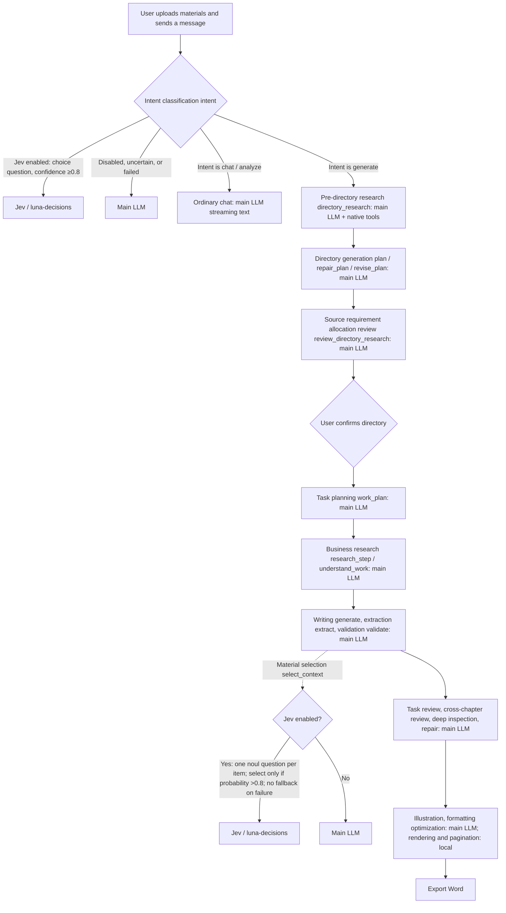
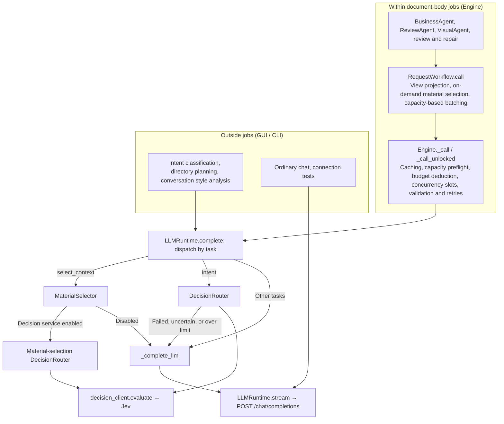
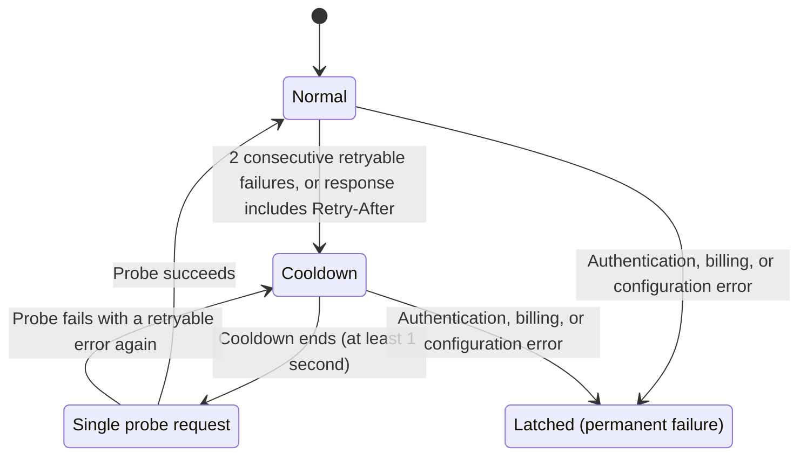
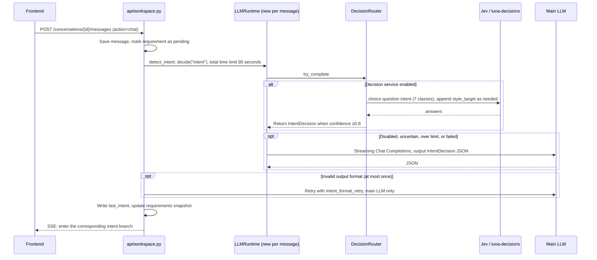
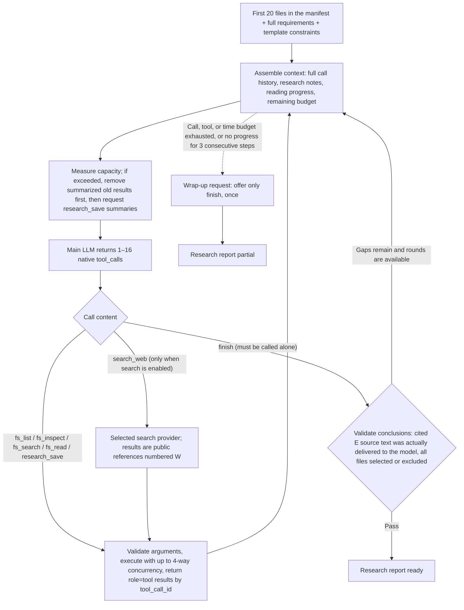
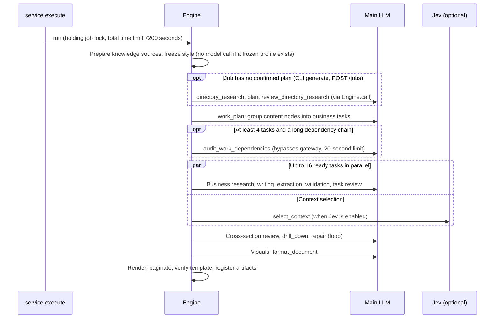
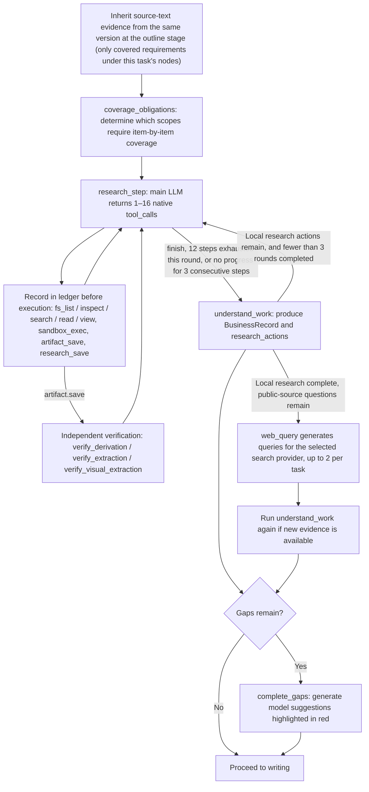
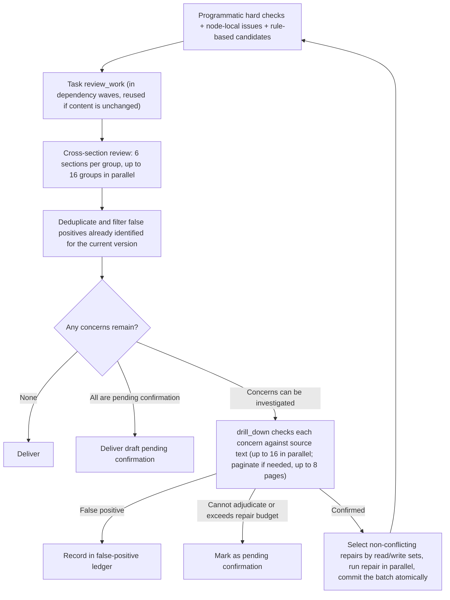

# LLM–Jev Interaction Flow

> 中文版: [中文版](model-interactions.zh-CN.md)

This document describes model calls, protocols, budgets, and concurrency from conversation to Word delivery against the current code. See [Folio Technical Architecture](architecture.md) for design principles. Code links use files and function names.

## 1. Key Takeaways

- **The main LLM handles almost all model work**: pre-directory research, directory planning and review, task planning, business research, writing, extraction, validation, review, deep inspection, repair, illustration, formatting optimization, style analysis, and ordinary chat. All use OpenAI-compatible streaming Chat Completions, with [llm.py](../src/folio/runtime/llm.py) as the sole HTTP egress point.
- **Jev performs only bounded, typed decisions**. Only two task types are routed to it (`ROUTABLE_TASKS = {"intent", "select_context"}`, [routing.py](../src/folio/decisions/routing.py)):
  - `intent`: intent classification at the conversation entry point. If Jev is uncertain, exceeds a limit, or fails, it **falls back to the main LLM**.
  - `select_context`: material relevance filtering within document-body jobs. When enabled, it **uses only Jev, raises an error on failure, and does not fall back to the main LLM**; the relevance probability must be **strictly greater than 0.8** for an item to be selected.
- Jev is an **optional service**: the current configuration must pass a test in model settings, then be enabled and saved; its configuration fingerprint is also checked at runtime. When it is not enabled, the main LLM handles both decision types above.
- The decision HTTP transport is `decision_client.py`. Standard base URLs use OpenAI-compatible `/chat/completions`; an explicit `/systemone` endpoint uses native Jev `state` and `questions` without changing its URL.
- Action selection for `next_action`, directory research, business research, and similar tasks **does not go through Jev**; it is determined by the main LLM's native tool_calls. The code for Jev's per-page visual scoring task, `score_layout`, remains, but **there are no longer any callers in the production workflow**.



Material selection is not limited to the writing stage: dependency organization, gap filling, deep inspection, and issue-focused review can also trigger it. See [4.5](#45-material-filtering-select_context).

## 2. External Services and Egress Points

| Service | Code egress point | Protocol | Use cases | Counts toward the job call budget |
| --- | --- | --- | --- | --- |
| Main LLM | [llm.py](../src/folio/runtime/llm.py) `_stream_http` | `POST {base_url}/chat/completions`, SSE streaming | All generation, research, and review tasks; ordinary chat; connection tests | Yes, per HTTP request (within jobs only) |
| LLM auxiliary APIs | [capacity.py](../src/folio/runtime/capacity.py) | `GET {base_url}/models`, `POST {base}/tokenize` | Measuring token capacity before requests | No |
| Jev / decision service | [decision_client.py](../src/folio/decision_client.py) `evaluate` | Non-streaming JSON `POST`, `{model, state, questions[, assets]}` | `intent`, `select_context`, settings tests; retired `score_layout` | Yes, per HTTP request (within jobs only) |
| Tavily | [tavily.py](../src/folio/knowledge/tavily.py) | `POST https://api.tavily.com/search`, `search_depth=advanced` | `search_web` during pre-directory research, supplementary web evidence for business research, settings tests | No |
| DeepSeek Search | [search.py](../src/folio/knowledge/search.py) | `POST https://api.deepseek.com/v1/tools/search`, `query`, `count`, `need_content` | Outline and business research; settings tests | No |
| RAGFlow | [ragflow.py](../src/folio/knowledge/ragflow.py) | MCP tool `ragflow_retrieval` | Only when explicitly configured through the CLI / job API | No |

Search-provider limits: DeepSeek Search accepts 1–128 Unicode characters per query and 1–50 results. Queries outside the limit are rejected rather than silently truncated. These are provider-specific bounds, independent of the LLM context budget.

## 3. Call Layers: From Business Code to HTTP



- Almost all calls **within jobs** go through `Engine._call`, gaining persistent caching, two-level call budgets, concurrency slots, and unified retries. The only exception is `audit_work_dependencies`, which calls `runtime.complete` directly ([dependency_audit.py](../src/folio/orchestration/dependency_audit.py)).
- Calls **outside jobs** use `LLMRuntime` directly. Directory planning and conversation style analysis use `DirectoryRuntimeBudget` for in-memory counting ([prepare.py](../src/folio/document/prepare.py)). None of these calls run within `interaction_scope`; they do not write `provider_started` / `provider_completed` events or consume any job's call budget.
- When a job has no confirmed plan (CLI `generate`, `POST /jobs`), directory planning within the job is routed back to `Engine.call` through `JobPlanningRuntime` ([directory_planning.py](../src/folio/orchestration/directory_planning.py)); when on-the-fly style analysis is needed, it is routed back through `JobStyleRuntime` ([style_processing.py](../src/folio/orchestration/style_processing.py)).

### 3.1 Dispatch in `LLMRuntime.complete`

[llm.py](../src/folio/runtime/llm.py)

| Order | Condition | Destination | On failure |
| --- | --- | --- | --- |
| 1 | `task == "score_layout"` | Jev image scoring (an image capability probe runs first on initial use) | Raises an error; no fallback. No longer called in production |
| 2 | `task == "select_context"` | `MaterialSelector.complete`, choosing either the decision service or the main LLM | The decision-service path raises an error directly; no fallback |
| 3 | `task` belongs to `NATIVE_TOOL_TASKS` | Main LLM + native tools | — |
| 4 | `intent` with `intent_format_retry` | Main LLM (format correction does not ask Jev again) | — |
| 5 | All others | `DecisionRouter.try_complete`, effective only for `intent` when the decision service is enabled | Returns `(None, reason)`, falls back to the main LLM, and records the reason in `usage.decision_fallback` |

`NATIVE_TOOL_TASKS = {directory_research, research_step, next_action, query, web_query, coverage_obligations}` ([native_tools.py](../src/folio/research/native_tools.py)).

Another easily confused set is `DECISION_TASKS` ([decisions/__init__.py](../src/folio/decisions/__init__.py)): `plan`, `work_plan`, `next_action`, `understand_work`, `review_work`, `validate`, `review`, `drill_down`, `intent`, and `select_context`. It only means that an additional copy of the result is written to the `decisions` table; **it does not mean the task uses Jev**. These tasks still call the same `runtime.complete` through `LLMDecisionProvider.decide`; only `intent` and `select_context` can actually reach Jev.

### 3.2 How Main LLM Requests Are Assembled

`request_parts` ([llm.py](../src/folio/runtime/llm.py)) generates messages by task family:

| Task family | system | user | Output constraints |
| --- | --- | --- | --- |
| Native tool tasks | Research component description + task instructions + batch-call rules + language rules ([transport.py](../src/folio/research/transport.py)) | Research context rendered as Markdown; historical batches are replayed as `assistant.tool_calls` plus individual `role=tool` messages (matched by `tool_call_id`) | `tools` + `tool_choice="required"`; only `directory_research` and `research_step` allow parallel calls, with at most 16 per batch; all others require exactly 1 |
| Planning tasks `plan`, `repair_plan`, `revise_plan` | Planning instructions + language rules + writing guidelines + examples + compact Schema ([base.py](../src/folio/runtime/base.py)) | `planning_payload` as compact JSON | JSON; `repair_plan` uses a typed sparse-repair format |
| `style_analysis` | Style analysis instructions + language rules ([style_profile.py](../src/folio/document/style_profile.py)) | Batches of Markdown source text | JSON |
| Other structured tasks | `prompt_for(task, {}, schema)`: framework + `INSTRUCTIONS[task]` + language rules + JSON Schema ([base.py](../src/folio/runtime/base.py)) | Compact JSON context, compressed as needed: long IDs replaced with `sfrefN`, homogeneous arrays packed as `$columns/$rows`, WorkPlan nodes replaced with `n1..nN`, and short keys used for extraction fields | JSON |

The request body ([llm.py](../src/folio/runtime/llm.py)) includes `model`, `messages`, `max_tokens`, `temperature`, `stream=true`, `stream_options.include_usage=true`, and provider-specific parameters ([provider_parameters.py](../src/folio/runtime/provider_parameters.py)). When tools are present, it adds `tools`, `tool_choice`, and `parallel_tool_calls`; when there are no tools and `structured_output="json_schema"`, it adds a strict `response_format`. The default `"prompt"` mode does not send `response_format`; it only includes the Schema in the system prompt. Tasks that need to inspect images (`verify_extraction`, `verify_visual_extraction`, and `research_step` or `style_analysis` with page images) convert PNGs to `image_url` data URIs, with at most 2 images per request ([image_inputs.py](../src/folio/runtime/image_inputs.py)).

Prompts are in English; document output follows the user's requirements (explicit language requests take precedence), while process titles and explanations follow `ui_language` ([language.py](../src/folio/runtime/language.py)).

For native tool requests, an explicit HTTP 400 rejection of forced `tool_choice` triggers one retry with `tool_choice="auto"`; the discovered mode is reused within that Runtime. Valid native calls are still required. The application does not force thinking on or off: explicit `enable_thinking` is passed through, otherwise the provider default applies. Connection tests and production use the same path.

### 3.3 Stream Reception and Validation

`_stream_http` ([llm.py](../src/folio/runtime/llm.py)):

- The response must be `text/event-stream`. It parses `data:` line by line and stops at `[DONE]`; legacy `function_call`, text or tool fragments appearing after completion, and invalid JSON are treated as protocol errors.
- Incremental `tool_calls` are assembled by index using `ToolCallStream`. At completion, it requires `finish_reason="tool_calls"`, unique IDs, function names from the list supplied for this request, and arguments that are JSON objects ([tool_calls.py](../src/folio/runtime/tool_calls.py)).
- Text tasks require `finish_reason="stop"` and nonempty content; `length` is classified as `length_limit`.
- `reasoning_content` is not shown in the UI. For native-tool responses, it is retained with private call history and passed back in the corresponding assistant message when continuing the tool conversation. Text-only reasoning is not treated as an answer.
- `generate` / `repair` detect repeated paragraphs in the stream. When trailing whitespace in structured output reaches 512 characters, the stream ends early if the output is already complete, valid JSON; otherwise it is classified as `stalled_output` ([llm.py](../src/folio/runtime/llm.py)).
- The runtime only performs transport-level decoding, such as restoring short references, short keys, WorkPlan aliases, and master tables ([llm.py](../src/folio/runtime/llm.py)). The caller handles `parse_json`, pydantic validation, and business validation through `check_result`.

### 3.4 Who Handles Retries

This is the easiest point to misunderstand: **the LLM client itself performs almost no retries**. Retries are distributed across different layers.

| Layer | What it retries | Attempts and method |
| --- | --- | --- |
| `LLMRuntime.stream` ([llm.py](../src/folio/runtime/llm.py)) | Only context overflow (HTTP 400 `context_length_exceeded`) | At most 3 capacity attempts; forced-tool compatibility retries may add HTTP requests, so this is not a universal HTTP-attempt limit. Each resend reduces `max_tokens` to the smaller of 3/4 of its previous value and the remaining window, with a minimum of 512 ([errors.py](../src/folio/runtime/errors.py)). Disabled for `select_context` and supplementary integration tasks |
| `Capacity.request` ([capacity.py](../src/folio/runtime/capacity.py)) | 429, 5xx (excluding 501), and HTTP client errors such as connection and read errors for `/models` and `/tokenize` | At most 4 attempts, with 2/4/8-second intervals and a total limit of 30 seconds; raises `capacity_unavailable` if still unsuccessful |
| `Engine._call_unlocked` ([engine.py](../src/folio/orchestration/engine.py)) | Validation failures, protocol errors, timeouts, 429/5xx, etc. | Default `call_attempts=2`; 3 attempts for `work_plan`; 1 attempt for `format_document` and supplementary conflict checks. Retries include `format_feedback`; native tasks use `native_retry_context` to backfill failed tool results, with **no backoff**. Authentication, billing, configuration, unsupported Schema, and `context_limit` errors are not retried |
| `RequestWorkflow.call_bounded` ([requests.py](../src/folio/orchestration/requests.py)) | Input over capacity or truncated output | Does not resend the same request; instead, changes request boundaries: bisects evidence or gaps, paginates facts and body text, reviews pairs, and paginates deep inspection; fails explicitly if even the smallest unit cannot fit |
| `DecisionRouter` ([routing.py](../src/folio/decisions/routing.py)) | Jev 429, 408/425/5xx, timeouts, and connection errors | At most 3 HTTP requests per page, with a 20-second limit for the entire decision and a circuit breaker (see [4.3](#43-decisionrouter-bounded-recovery-and-circuit-breaking)) |

Calls outside jobs (intent, chat, GUI directory planning) have no `Engine` layer, so a 429 or 5xx from the main LLM directly fails the operation. If the outer wait for pre-directory research times out, a `partial` research report is saved, and a directory draft with gap notices can still be generated; users can resume research from the interruption point. See [5.3.1](#531-how-to-resume-after-outline-research-times-out). Intent classification has one additional "format correction" retry, but only for output-format issues.

### 3.5 Capacity Measurement

Requests that miss the cache are measured using the complete request before sending ([capacity.py](../src/folio/runtime/capacity.py)):

```text
 Input tokens (including tool definitions) <= max_input_tokens (default: 600,000)
 Input tokens + reserved output tokens for this action + 512 <= model context window
```

- On its first measurement, each `LLMRuntime` reads `max_model_len` through `GET /models` and takes the smaller of that value and the configured `context_window`; once the window is known, it counts tokens using `POST /tokenize`, falling back to local tiktoken estimation (default `o200k_base`) if the service does not support it.
- The default `max_tokens` is 128,000. `generate`, `repair`, `validate`, `review_work`, and `review` may reduce the output budget based on the remaining window, retaining at least 4096 for `generate` / `repair` and at least 2048 for the others ([capacity.py](../src/folio/runtime/capacity.py)).
- Character limits such as `max_prompt_chars` apply only to runtimes without token measurement (such as Demo).

## 4. OpenAI-compatible and native Jev decision services

### 4.1 Configuration

Configure `decision_base_url`, `decision_api_key` and `decision_model` independently of generation. Ordinary decision base URLs append `/chat/completions`; an explicit `/systemone` endpoint is used as-is with the native Jev protocol. Model names come from the provider; no alias whitelist or shared-key assumption is imposed. Test the decision connection before enabling it. Batches use at most 24 questions and 16 concurrent requests.

### 4.2 Request and response

The transport sends standard `messages`, `tools`, and `tool_choice`, requiring one `submit_decisions` function call. The question-specific schema describes each choice, score or probability. The response is read from `choices[0].message.tool_calls`, its arguments are parsed and all answers validated. Token usage comes from the standard response `usage` object. Plain text or incomplete decisions are protocol failures; HTTP authentication, timeout and retry handling remain explicit.

Native Jev sends `{model, state, questions}` and reads typed results directly from `answers`. Both protocols use the same answer validation and HTTP accounting.

### 4.3 `DecisionRouter`: Bounded Recovery and Circuit Breaking

Flow of `try_complete` ([routing.py](../src/folio/decisions/routing.py)):

1. If the task is not in `ROUTABLE_TASKS`, or the decision service is not enabled, returns `(None, None)` and the caller uses the main LLM directly.
2. If the serialized `state` or `{state, questions}` exceeds 600,000 characters, returns `(None, "decision_context_too_large")` ([batching.py](../src/folio/decisions/batching.py)).
3. Builds questions and paginates them according to the per-page limit; wraps the entire decision in `asyncio.timeout(20)` and calls `_evaluate_page` page by page.
4. Reconstructs the business result using `build(answers)` and validates it against the target Schema.
5. Converts any exception into `(None, reason)`. Only job call budget exhaustion (`ModelCallBudgetExceeded`) is re-raised unchanged, preventing fallback from bypassing the budget.

`_evaluate_page` ([routing.py](../src/folio/decisions/routing.py)) makes at most 3 HTTP requests per page. All calls on the same router instance share a circuit breaker:



- If the remaining cooldown is no more than 2 seconds, the call waits in place; if it exceeds 2 seconds (including a longer `Retry-After`), the call fails directly without sending HTTP.
- After cooldown ends, only one probe request is allowed through; other calls wait for the probe result.
- Only HTTP-layer failures count toward circuit breaking; semantic failures such as insufficient confidence or invalid answers do not.
- The **latched state** persists for the entire lifetime of that router instance, and every subsequent decision fails directly. Material selection within jobs uses the router built into `MaterialSelector` on the job runtime (independent of the router used for intent), so once latched, material selection fails for the rest of the job's execution.
- Worst case: 2 outer Engine attempts × 3 HTTP requests per page, for a total of 6 HTTP requests and approximately 40 seconds.

### 4.4 Intent Classification `intent`



- Entry point: [workspace.py](../src/folio/api/workspace.py) calls `detect_intent` ([workspace.py](../src/folio/api/workspace.py)).
- `state` contains the latest user message, all valid history, and a condensed workspace state: files, directory status, next step, writing guidelines, style analysis availability, and active jobs.
- There are 7 candidate intent classes ([routing.py](../src/folio/decisions/routing.py)): `generate`, `resume_generation`, `requirements`, `analyze`, `analyze_style`, `clarify`, and `chat`. When style examples are available, a `style_target` choice question is appended to select the file to analyze.
- Jev's `choice` confidence must be **≥0.8** ([routing.py](../src/folio/decisions/routing.py)); otherwise, the call falls back to the main LLM. Note that this differs from the material-selection threshold, which requires **strictly greater than** 0.8. The result must also pass `validate_style_intent` checks for file IDs and intended use.
- The intent result updates the requirements snapshot ([requirements.py](../src/folio/requirements.py)): `generate` and `requirements` are recorded as formal requirements, `active`; `clarify` as `clarification`; `resume_generation` as `command`; and all others as `discussion`. If classification fails, the message remains `pending`, blocking directory generation, directory confirmation, and resumption until the message is resent and successfully classified.
- Intent classification occurs outside jobs: it consumes no job's call budget and writes no provider events. `detect_intent` discards the `usage` and HTTP attempt records returned by Jev. Because each message creates a new `LLMRuntime`, circuit-breaker state does not persist across messages.

### 4.5 Material Filtering `select_context`

**When it is triggered**: within document-body jobs, when materials relevant to the current action must be selected from candidates. The entry point is `select_reads` ([requests.py](../src/folio/orchestration/requests.py)):

| Caller | Scenario |
| --- | --- |
| `select_writing_materials` | Selects materials by node before every `generate` / `repair`, regardless of whether the context fits |
| `prepare_context` | Filters facts, recommendations, and risks from upstream dependencies when the projected context does not fit |
| `select_gap_materials` | When the context for `complete_gaps` does not fit |
| `select_evidence` | `call_bounded` filters evidence by relevance as its final step |
| `prepare_issue_context` | When the complete materials for `drill_down` do not fit |
| `review_focus` | Selects materials for each checkpoint after a task review exceeds capacity |

Required materials bypass filtering and are retained directly, such as source text already cited in the current section, `required_project_evidence_ids`, source text cited by selected facts, and evidence explicitly named in deep inspection ([requests.py](../src/folio/orchestration/requests.py), [focused_review.py](../src/folio/orchestration/focused_review.py)).

**How Jev is queried** ([routing.py](../src/folio/decisions/routing.py)): each item in the candidate catalog corresponds to a `noul` question asking whether it is directly relevant to the current objective. The program accepts only items with a probability **strictly greater than 0.8**; items equal to 0.8 are not selected. The source text of selected risk items is concatenated into `risk_summary`; if it exceeds 1200 characters, source-text labels are used instead. The returned result is `ContextSelection{selected_refs, risk_refs, risk_summary}`.

**Pagination** ([selection.py](../src/folio/decisions/selection.py), [batching.py](../src/folio/decisions/batching.py)):

- Decision-service path: each page's `{state, questions}` is limited to 600,000 characters, with at most 24 items per page for all models. An oversized individual item is split losslessly into multiple fragments; if any fragment is relevant, the complete source text is retained.
- Main LLM path: pages are split according to the token capacity of the complete request, without an item-count limit; server rejections trigger bisection and rereading, to a maximum depth of 3 levels and at most 15 attempts per page.

**Mutually exclusive routing** ([selection.py](../src/folio/decisions/selection.py)): when the decision service is enabled, only that service is used. As soon as `try_complete` returns `None`, it raises `ModelCallFailed` (with error code `decision_unavailable` or a safety error code). **It neither switches to the main LLM nor treats failure as "irrelevant."**

**Concurrency and counting**: a single `select_reads` call processes at most 4 pages concurrently. When the decision service is enabled, material selection uses only dedicated decision-service slots (16 concurrent calls for all models), without consuming main-model slots. Each logical attempt counts toward `jobs.calls`, and each HTTP request additionally counts toward the HTTP-level budget. Results are written to `tasks.usage` (including each item's relevance probability, `decision_relevance`) and the `decisions` table.

### 4.6 Retired: Jev Page Scoring

The `runtime.complete("score_layout")` branch is still retained ([llm.py](../src/folio/runtime/llm.py), [decisions/layout_scoring.py](../src/folio/decisions/layout_scoring.py)): it first uses a four-color-block image probe to confirm that Jev can actually process images, then sends a single-page PNG and a 10-level `score` question. However, its only caller, `review_rendered_document` ([layout_review.py](../src/folio/orchestration/layout_review.py)), has no callers in `src/`, and `Engine.finish` now calls `format_document` instead; model settings discard the old `layout_review_enabled` switch ([model_settings.py](../src/folio/model_settings.py)). For usage of the standalone diagnostic script, see [Local Testing of Jev Image Capabilities](model-vision-checks.md).

## 5. End-to-End Flow

### 5.1 Model Settings and Connection Tests

| Test | Request | Pass condition |
| --- | --- | --- |
| LLM ([model_settings.py](../src/folio/model_settings.py)) | Streaming Chat Completions + a single `confirm_connection` tool, `tool_choice=required`, 45 seconds | Returns exactly one tool_call with arguments `{ok: true}`, confirming that the service supports native tool calling |
| Decision service ([model_settings.py](../src/folio/model_settings.py)) | One `noul` question, 45 seconds | Returns a structurally valid result |
| Tavily ([model_settings.py](../src/folio/model_settings.py)) | `search_depth=basic`, `max_results=1`, 25 seconds | HTTP 200 and `results` is a list |

### 5.2 How a Message Is Routed

`POST /conversations/{id}/messages` ([workspace.py](../src/folio/api/workspace.py)) first saves the message and performs preflight checks under the conversation lock, then returns an SSE stream. For `action=chat`, it first classifies intent ([4.4](#44-intent-classification-intent)), then branches by intent ([workspace.py](../src/folio/api/workspace.py)):

| Intent | Handling | Model calls |
| --- | --- | --- |
| `chat` / `analyze` | Regular chat ([workspace.py](../src/folio/api/workspace.py)) | Main LLM streams free-form text. The system prompt includes source excerpts and workspace state, without tools or a Schema |
| `analyze_style` | Performs style analysis, then explains the results through regular chat | `style_analysis` (up to 128 calls) + a streamed response from the main LLM |
| `requirements` | Records requirements and returns a fixed response | None |
| `clarify` | Returns a fixed clarification response | None |
| `generate` | Enters outline planning (5.3, 5.4) | See below |
| `resume_generation` | Resumes a failed job in the same SSE stream | Calls within the job |

Explicit actions sent by UI buttons (`confirm_directory`, `regenerate_directory`, `revise_directory`, `resume_directory_research`) skip intent classification. `resume_directory_research` resumes only pre-outline research; it and `resume_generation` for body-generation jobs are separate entry points.

### 5.3 Pre-Outline Research `directory_research`

`research_for_directory` ([research/planning.py](../src/folio/research/planning.py)) is a bounded main-LLM tool loop:



- Budgets ([planning.py](../src/folio/research/planning.py)): up to 3 rounds of 12 steps each, totaling 36 model calls, 120 tool calls, and 600 seconds. When source text has already been delivered, 1 call is reserved for wrap-up.
- Evidence is numbered programmatically: source text read is assigned `E1`, `E2`, …, and files are assigned `F1`, …. `finish.requirements` may cite only `E` source text actually delivered to the model; the program checks delivery records verbatim ([planning.py](../src/folio/research/planning.py)).
- Tool errors and format errors are not resent unchanged; instead, they are provided as feedback in the next step through `native_retry_context`. Model timeouts end with `partial`; other model-service errors cause this outline-generation attempt to fail, with no outer retry in the GUI path.
- The entire process uses only the main LLM, without calling Jev or using `select_context`.
- Each step's request, response, delivery record, and tool results are written to `directory-drafts/<revision>/research/events/`, and `research.md` is exported.

#### 5.3.1 How to Resume After Outline Research Times Out

When research for an outline draft is incomplete because of `model_timeout` or `time_limit`, the UI offers “Resume research from where it stopped.” This button sends `resume_directory_research`; it neither adds the button text to the writing requirements nor starts body generation.

1. **First verify that the inputs are unchanged.** The backend checks the current outline version, file list and purposes, writing guidelines, and requirements version; the replayer also checks the full requirements text, template constraints, and source-content snapshots used by the research. If they differ, resumption is rejected and the outline must be regenerated. This timeout-resumption entry point is not used when call or round budgets are exhausted, context capacity is exceeded, or research is already complete.
2. **The recorded research process is restored.** `DirectoryDrafts.create(resume_from=...)` creates a new draft directory while retaining the old draft. `DirectoryResearchReplay` reads saved model responses in their original order, then runs the same local tools against the frozen materials to rebuild reading records, notes, evidence, and tool history. During this process, old progress updates are not displayed as current work, and the old report's `ready` state is not copied directly as a new conclusion.
3. **Model results are reused only when requests match.** Each step compares the saved request with the reconstructed context; the research session ID and remaining seconds are excluded from comparison. The first request with a missing response or different context becomes a real model call, after which model results are no longer replayed. Saved, matching web queries reuse the original search results, timestamps, and `W` references without searching again; missing or mismatched queries execute normally. Legacy `finish` requests used solely for wrap-up are not replayed.
4. **Counters distinguish steps from new requests.** Replayed steps still consume the research round budget, the 36-step budget, and the 120-tool-call budget; resuming does not grant a complete additional set of steps. Only actual new model calls consume the current run's `DirectoryRuntimeBudget`. The new execution starts a fresh 600-second time limit, including the local restoration process. After restoration, research conclusions are checked under the original rules before the outline is generated and reviewed.

The new report's `resume` field records the source directory, reuse count, and the request where actual resumption began; response files include `replayed_from`, and corresponding `usage` entries include `replayed: true`. When counting new LLM requests, exclude replayed entries; the number of research steps cannot be treated directly as the number of new HTTP requests sent in this run.

Implementation entry points: [planning_replay.py](../src/folio/research/planning_replay.py), [DirectoryDrafts.create](../src/folio/directory_drafts.py), [prepare_with_model](../src/folio/document/prepare.py), [research_for_directory](../src/folio/research/planning.py).

### 5.4 Outline Generation, Repair, Revision, and Coverage Review

Orchestrated by `prepare_with_model` ([document/prepare.py](../src/folio/document/prepare.py)):

1. **`plan`**: Sends the complete outline request in one call, without batching; exceeding capacity immediately raises `PlanningContextTooLarge`. Inputs are the full requirements snapshot, a metadata-only source inventory, research conclusions and delivered source text, template constraints, the style view, and writing guidelines. The output is a `PlanProposal`; the program uses `build_plan` to check node uniqueness, hierarchy without skipped levels, writing instructions for generated nodes, fixed template sections, and other constraints ([planner.py](../src/folio/document/planner.py)).
2. **`repair_plan`**: When the proposal conforms to the Schema but has structural errors that can be located at specific paths, modifies only those paths (JSON Pointer replacement).
3. **`revise_plan`**: When the user submits revision suggestions, outputs `move`, `update`, `insert`, and `remove` operations using stable node IDs ([directory_revision.py](../src/folio/document/directory_revision.py)). In the current code, every GUI revision first reruns the complete pre-outline research process ([prepare.py](../src/folio/document/prepare.py)).
4. **`review_directory_research`**: Compares each requirement identified by research and its corresponding source text against the entire outline, classifying it as `covered`, `not_applicable`, or `missing` ([research_review.py](../src/folio/document/research_review.py)). Batches are sized dynamically according to capacity, with up to 12 batches; if `missing` occurs and research is `ready`, reruns a complete `plan` once, including the rejected proposal.

The number of attempts is `min(call_attempts, max_calls)`, defaulting to 2; 1 additional attempt is granted when repair actually reduces errors. If output is truncated, `planning_max_tokens` is increased before retrying ([llm.py](../src/folio/runtime/llm.py)). The outline can be confirmed only when research is `ready` (or `no_sources` when there are no ordinary source materials) and the review passes. This entire stage uses the main LLM.

### 5.5 Confirming the Outline and Creating a Job

`confirm_directory` ([workspace.py](../src/folio/api/workspace.py)) checks, in order, the outline version, files and purposes, writing guidelines, whether research is eligible for confirmation, and the requirements version. `Store.create` then freezes the requirements, source materials, plan, research evidence, and style profile ([store.py](../src/folio/store.py), [planning_handoff.py](../src/folio/research/planning_handoff.py)), enabling V2 research by default (`research=ResearchConfig()`). Finally, `start_job` runs `service.execute → Engine.run` in the background ([service.py](../src/folio/service.py)). This step makes no model calls.

### 5.6 Job Startup and Task Planning



- `work_plan` ([business.py](../src/folio/orchestration/business.py)): takes a node list (writing instructions truncated to 600 characters), source index, and execution budget, and outputs a `WorkPlan`. The program checks that each node has exactly one owner, dependencies are acyclic, and each task has at most 8 nodes; up to 3 attempts are allowed. If coverage is incomplete, existing groupings are fixed and the model is asked only to add the missing nodes.
- `audit_work_dependencies` ([dependency_audit.py](../src/folio/orchestration/dependency_audit.py)): when there are at least 4 tasks, the longest dependency chain has at least 3 levels, and there are 1 to 16 candidate edges, asks the model which dependency edges can be removed; on failure, retains the original dependency graph. It calls `runtime.complete` directly, counts only logical calls, bypasses HTTP-level budget checks, and does not write provider events.
- `BusinessCoordinator` ([agents.py](../src/folio/orchestration/agents.py)) runs up to 16 tasks concurrently as their dependencies become ready. On a recoverable model failure, it stops dispatching new tasks but allows already-started tasks to finish.

### 5.7 Business Tasks: V2 Autonomous Research

GUI jobs use V2 by default (`JobInput.research.enabled`, [agents.py](../src/folio/orchestration/agents.py)), executed by `research_business` ([research/workflow.py](../src/folio/research/workflow.py)):



- Budgets ([contracts.py](../src/folio/research/contracts.py)): 12 steps per round, up to 3 rounds. Each business task (recalculated for each resumption authorization) allows up to 50 tool calls and 40 research model calls, with 600 seconds of cumulative script runtime and 120 seconds per execution. `research_step`, `coverage_obligations`, and all verification calls count toward these 40 calls; when fewer than 40 calls (the default reserve) remain in the total budget, research requests are deferred to reserve calls for body generation and review. `understand_work`, `web_query`, and `complete_gaps` count only toward the document-wide total budget.
- Tool results are returned with `role=tool` and `tool_call_id`. Computed artifacts must undergo independent verification and signing before they can be used as evidence ([artifacts.py](../src/folio/research/artifacts.py)).
- This layer does not call Jev directly. Jev may be used indirectly through `select_context` only when `understand_work` or `complete_gaps` enters context selection because its context exceeds capacity.
- The legacy path, used for historical jobs without V2 enabled and for Demo, loops through `understand_work → next_action → query → knowledge-base retrieval`: if gaps remain after 3 retrievals, it uses `web_query` plus the selected search provider to obtain additional evidence (up to 2 times); any remaining gaps go to `complete_gaps` ([agents.py](../src/folio/orchestration/agents.py)). For `next_action`, the main LLM selects one of the native tools `search`, `write`, or `pending`; this is **not delegated to Jev**.

### 5.8 Writing, Extraction, and Local Validation

After research is complete for each task, unsaved nodes are written with up to 8-way concurrency ([agents.py](../src/folio/orchestration/agents.py)):

1. **`generate`** ([engine.py](../src/folio/orchestration/engine.py)): first selects context for each node (`select_context`), then writes, producing `SectionContent` (body blocks, items pending confirmation, and visual requests). If gaps are found after writing (items pending confirmation, an empty body, blocks without citations, etc.), it first returns to research for additional investigation under the task lock; unresolved gaps go to `complete_gaps` for suggestions, which are merged into the existing body using `integrate_supplement`. If capacity is exceeded, it switches to `check_supplement_conflicts` / `repair_supplement_conflicts`.
2. **`extract`**: extracts factual claims from the body, up to 12 per call; if capacity is exceeded, splits the body blocks in half.
3. **`validate`**: checks each claim for source-text support; if capacity is exceeded, splits the input into the visual plan, claims (24 per page), body (8 blocks per page), and the evidence required for each item.
4. If extraction or validation fails because of truncation, timeout, or similar issues, the body is retained and the node is marked as pending confirmation (`incomplete_local_check`).
5. After all nodes in the task are complete, **`review_work`** reviews the task as a whole; if capacity is exceeded, it switches to `plan_review`, `review_focus`, and `read_review_materials`. Downstream tasks are released after the review passes.

Main-model concurrency is 32 during the business-task stage ([engine.py](../src/folio/orchestration/engine.py)) and 16 during later stages such as review, with a total concurrency gate of 32 throughout.

### 5.9 Review, Detailed Investigation, and Repair Loop

[engine.py](../src/folio/orchestration/engine.py):



- This loop uses the main LLM throughout; context selection during detailed investigation and repair may use Jev.
- Each node can be revised up to 3 times (`max_repairs`).
- Cross-section review groups are formed using adjacent windows, shared fact keys, common subjects, and dependency handoffs ([review.py](../src/folio/orchestration/review.py)).

### 5.10 Visuals, Formatting Optimization, and Delivery

`Engine.finish` ([engine.py](../src/folio/orchestration/engine.py)) executes in the following order:

1. **Visuals**: after each section's body is saved, `VisualPrefetch` has already begun generating visuals in the background (2 model slots; a soft budget of `min(120, max_calls/5)`, reserving at least 1/4 of the total budget for core work, 500 calls by default). Remaining visuals are collected here. Each visual follows this loop: `design_ui` / `design_flowchart` generates HTML or Mermaid, local Chromium renders it, `validate_visual` reviews it, and the program cross-checks it against source quotations and the actual diagram structure, performing semantic or topological checks if needed, then revises it, for up to 3 rounds. If the materials exceed capacity, `read_visual_materials` first extracts constraints page by page ([visuals/workflow.py](../src/folio/visuals/workflow.py)). Failed visuals are marked "Visual pending confirmation" in Word.
2. **Initial rendering** to Word, without pagination yet.
3. **`format_document`**: grouped by task, provides the main LLM with local layout objects for paragraphs and tables; the model may return only allowlisted formatting patches (alignment, ±1pt font size, paragraph spacing, pagination constraints). Up to 4 groups run in parallel, with at most 3 calls and 25 seconds per group, and 120 seconds for the entire stage; on failure, the original layout is restored ([formatting.py](../src/folio/orchestration/formatting.py)).
4. LibreOffice pagination, template verification, and final registration as `published`, `draft`, or `needs_confirmation`.

The current flow no longer performs Jev page scoring.

### 5.11 Degraded Delivery and Resumption Pending Confirmation

- **Degraded delivery** ([engine.py](../src/folio/orchestration/engine.py)): when the call budget is exhausted, the model service fails, retries are exhausted, or a timeout occurs, if all nodes have been saved, new model calls are stopped (visuals reuse only already-validated images, and formatting optimization is skipped), and a `needs_confirmation` draft is exported. Other exceptions, including cross-section or task review still failing validation on the final attempt (`ValueError`), fail the job directly rather than triggering degraded delivery.
- **Resumption** ([confirmations.py](../src/folio/confirmations.py)): after the user submits responses and a budget for the current run in the pending-confirmation panel (default 200, range 1 to 10000), the new call limit is the number of calls already used plus the current run's budget. The job resumes from the review stage; `apply_pending_confirmations` uses the responses as user-provided evidence to drive `research_work`, `repair`, `extract`, and `validate` ([confirmations.py](../src/folio/confirmations.py)).

## 6. Model Task Summary

`INSTRUCTIONS` contains 42 task prompts ([runtime/base.py](../src/folio/runtime/base.py)). There are also two types of streaming calls that do not go through `complete`: regular chat and the LLM connection test.

In the “Call path” column: **Direct** means calling `LLMRuntime` directly outside a job; **Gateway** means going through `Engine.call` within a job; **Both** means direct calls for GUI/CLI previews, and gateway calls within a job (when the job has no confirmed plan or frozen profile).

| Task | Stage | Service | Protocol | Main output | Call path |
| --- | --- | --- | --- | --- | --- |
| `intent` | Conversation entry | Jev, falling back to the main LLM on failure | choice question / JSON | `IntentDecision` | Direct |
| (Regular chat) | Conversation | Main LLM | Streaming text | Response text | Direct |
| `style_analysis` | Conversation / pre-outline / job startup | Main LLM | JSON, optionally with page images | Batched observations and consolidated checks | Both |
| `directory_research` | Pre-outline | Main LLM | Native tools, parallel calls supported | Tool-call batch / `finish` | Both |
| `plan` | Outline | Main LLM | JSON | `PlanProposal` | Both |
| `repair_plan` / `revise_plan` | Outline | Main LLM | JSON | Sparse repairs / outline operations | Direct |
| `review_directory_research` | Outline | Main LLM | JSON | Requirement disposition checks | Both |
| `work_plan` | Job startup | Main LLM | JSON | `WorkPlan` | Gateway |
| `audit_work_dependencies` | Job startup | Main LLM | JSON | Dependency-edge decisions | **Bypasses gateway** |
| `coverage_obligations` | V2 research | Main LLM | Native tools, single call | Coverage obligations | Gateway |
| `research_step` | V2 research | Main LLM | Native tools, parallel calls supported | Tool-call batch | Gateway |
| `verify_derivation` | V2 research | Main LLM | JSON | Computed-artifact verification | Gateway |
| `verify_extraction` / `verify_visual_extraction` | V2 research | Main LLM | JSON + original page images | OCR / image-reading verification | Gateway |
| `review_coverage_exclusion` | V2 research | Main LLM | JSON | Review of non-applicability declarations | Gateway |
| `understand_work` | Research assessment | Main LLM | JSON | `BusinessRecord` | Gateway |
| `next_action` / `query` | Legacy research path | Main LLM | Native tools, single call | Next action / retrieval terms | Gateway |
| `web_query` | Web evidence gathering | Main LLM | Native tools, single call | Public-source search terms | Gateway |
| `select_context` | Context selection | Jev only when enabled (no fallback), otherwise main LLM | noul question / JSON | `ContextSelection` | Gateway |
| `complete_gaps` / `read_gap_materials` | Gap filling | Main LLM | JSON | Model suggestions / material constraints | Gateway |
| `generate` / `repair` | Writing / repair | Main LLM | JSON | `SectionContent` | Gateway |
| `integrate_supplement` / `check_supplement_conflicts` / `repair_supplement_conflicts` | Supplement integration | Main LLM | JSON | Body patches / conflict conclusions / correction plan | Gateway |
| `extract` / `validate` | Node validation | Main LLM | JSON | Factual claims / item-by-item verification | Gateway |
| `review_work` | Task review | Main LLM | JSON | `Review` | Gateway |
| `plan_review` / `review_focus` / `read_review_materials` | When task review exceeds capacity | Main LLM | JSON | Checkpoints / review results / reading notes | Gateway |
| `review_unused_artifact` | Task review | Main LLM | JSON | Disposition of unused artifacts | Gateway |
| `review` | Cross-section review | Main LLM | JSON | `Review` | Gateway |
| `drill_down` | Detailed investigation | Main LLM | JSON | `DrillDown` | Gateway |
| `read_visual_materials` / `design_ui` / `design_flowchart` / `validate_visual` | Visuals | Main LLM | JSON | Constraints / source code / review results | Gateway |
| `format_document` | Delivery | Main LLM | JSON | Allowlisted formatting patches | Gateway |
| `review_layout` / `score_layout` | Retired | Main LLM image processing / Jev | — | — | No production calls |

## 7. Budgets, Concurrency, and Timeouts

### 7.1 Call Budgets

| Budget | Default | Counting rules | Location |
| --- | --- | --- | --- |
| Job logical calls `jobs.calls` | 2000 (range 1 to 100000) | Atomically decremented for each `Engine._call` attempt, before waiting for a concurrency slot; cache hits do not count | [store.py](../src/folio/store.py) |
| Job HTTP calls | Also 2000 | Each HTTP attempt by the main LLM or Jev (number of `provider_started` events), including in-stream retries and Jev retries | [store.py](../src/folio/store.py) |
| Pre-outline research | 36 research steps, 120 tool calls, 600 seconds | Each research step calls the model on the initial run; reusing saved responses during timeout resumption still consumes the step budget but sends no new requests | [planning.py](../src/folio/research/planning.py), [planning_replay.py](../src/folio/research/planning_replay.py) |
| GUI outline planning total | 2000 | In-memory counter in `DirectoryRuntimeBudget`, shared by research, style, planning, and review | [prepare.py](../src/folio/document/prepare.py) |
| V2 research (per task) | 40 model calls, 50 tool calls, 600 seconds of script runtime | Soft-budget bucket; deferred when the remaining total budget is below the reserve (default 40) | [contracts.py](../src/folio/research/contracts.py) |
| Visual pregeneration | `min(120, max_calls/5)` | Soft-budget bucket, reserving `max(12, ⌈max_calls/4⌉)` for core work | [call_budget.py](../src/folio/runtime/call_budget.py) |
| Style analysis | 128 requests, 90 seconds each | Batched requests | [style_contracts.py](../src/folio/document/style_contracts.py) |
| Web evidence gathering | 2 web-search calls per task | Persistently recorded before the request; failures also count | [web_research.py](../src/folio/orchestration/web_research.py) |
| Current resumption budget | Default 200 (range 1 to 10000, cumulative total no more than 100000) | New limit = calls already used + current run's budget | [confirmations.py](../src/folio/confirmations.py) |

### 7.2 Concurrency

| Concurrency gate | Limit | Notes |
| --- | --- | --- |
| Main model (business-task stage) | 32 | `_generation_model_slots` |
| Main model (other stages) | 16 | `_model_slots` |
| Main-provider overall gate | 32 | `_provider_model_slots`, applied in addition to the two gates above |
| Visual pregeneration | 2 | `_prefetch_model_slots`, also occupies the overall gate |
| Decision-service context selection | 16 (all configured decision models) | `_decision_model_slots`, does not occupy the main-model gate |
| Business tasks / writers per task | 16 / 8 | `max_parallel_tasks` / [agents.py](../src/folio/orchestration/agents.py) |
| Review groups, detailed investigations, repairs | 16 | `max_parallel_reviews` |
| Context-selection pages / outline-research tools | 4 / 4 | [requests.py](../src/folio/orchestration/requests.py), [planning.py](../src/folio/research/planning.py) |

Concurrency slots for the main model, visuals, and decision service are created separately for **each job** ([engine.py](../src/folio/orchestration/engine.py)); there is no global limit across jobs. The 4-way limit for outline-research tools applies to each research batch; GUI outline research takes place outside the body-generation job.

### 7.3 Timeouts

| Item | Default |
| --- | --- |
| Single model call | 900 seconds (`call_timeout_seconds` within jobs); streaming reads have no idle timeout and are subject only to this total time limit |
| Pre-outline research | Each wait defaults to 180 seconds and cannot exceed the time remaining for the current research run; the entire run defaults to 600 seconds |
| Entire job execution | 7200 seconds |
| Intent classification (including one format correction) | 90 seconds |
| Jev single HTTP request / total per decision | 30 seconds / 20 seconds |
| `/models` / `/tokenize` | 10 seconds / 15 seconds, 30 seconds total |
| Tavily | 30 seconds (35 seconds at the outer layer) |
| Dependency audit | 20 seconds |
| Formatting optimization | 25 seconds per group, 120 seconds for the entire stage |

## 8. Where to Find Call Records

- SQLite database `.folio/folio.sqlite3` ([store.py](../src/folio/store.py)):
  - `tasks`: results, usage, attempt counts, and errors for each request identity; also serves as the request cache.
  - `decisions`: contexts and results for `DECISION_TASKS`. The `usage` for `select_context` includes each item's relevance probability and Jev HTTP-attempt records.
  - `events`: `task_started`, `task_completed`, `task_failed`, `task_cache_hit`, `provider_started`, `provider_completed`, etc. Provider events record the service, model, status code, time to first chunk, token counts, duration, and result.
  - `call_budgets`: counters for each soft-budget bucket.
- Job directory `jobs/<id>/contexts/`: `requests` (actual request contexts and capacity measurements), `native_responses` (raw tool_calls), `rejected`, `failed_outputs` (partial outputs on failure), etc.
- Outline draft `directory-drafts/<revision>/`: `research/events/` contains each step's request, response, delivery records, and tool results; also includes `planning-attempts.json` and `research-review-attempt-N.json`.
- Conversation style analysis: `conversation-styles/<revision>/style/audit/`.
- Calls that **do not** generate provider events: intent classification, regular chat, GUI outline planning, conversation style analysis, `audit_work_dependencies` within jobs, and web searches during outline research. These are recorded only in conversation data, outline draft directories, and service logs. Request headers, keys and upstream error bodies are excluded from these public diagnostics. Native-tool reasoning may be stored in private request/checkpoint archives for protocol continuation; it is not shown as progress or answer text.

## 9. Code Index

| What to look for | Code |
| --- | --- |
| Main LLM client, task dispatch, streaming parsing | [runtime/llm.py](../src/folio/runtime/llm.py) |
| Prompt and message assembly | [runtime/base.py](../src/folio/runtime/base.py), [research/transport.py](../src/folio/research/transport.py), [document/planning_transport.py](../src/folio/document/planning_transport.py) |
| Compact wire encoding | [business_transport.py](../src/folio/runtime/business_transport.py), [work_plan_transport.py](../src/folio/runtime/work_plan_transport.py), [extraction_transport.py](../src/folio/runtime/extraction_transport.py), [writing_transport.py](../src/folio/runtime/writing_transport.py), [plan_repair_transport.py](../src/folio/runtime/plan_repair_transport.py) |
| Native tool definitions and parsing | [research/native_tools.py](../src/folio/research/native_tools.py), [runtime/tool_calls.py](../src/folio/runtime/tool_calls.py) |
| Capacity measurement | [runtime/capacity.py](../src/folio/runtime/capacity.py), [runtime/token_estimate.py](../src/folio/runtime/token_estimate.py) |
| Error classification and user-facing messages | [runtime/errors.py](../src/folio/runtime/errors.py), [runtime/diagnostics.py](../src/folio/runtime/diagnostics.py) |
| Call auditing and progress status | [runtime/interaction_audit.py](../src/folio/runtime/interaction_audit.py), [runtime/activity.py](../src/folio/runtime/activity.py) |
| Jev HTTP egress | [decision_client.py](../src/folio/decision_client.py) |
| Decision routing, circuit breaking, intent and material-selection questions | [decisions/routing.py](../src/folio/decisions/routing.py) |
| Material-selection pagination and routing | [decisions/selection.py](../src/folio/decisions/selection.py), [decisions/batching.py](../src/folio/decisions/batching.py) |
| Model settings, connection testing, activation fingerprint | [model_settings.py](../src/folio/model_settings.py) |
| Job gateway: caching, quotas, concurrency, retries | [orchestration/engine.py](../src/folio/orchestration/engine.py), [orchestration/requests.py](../src/folio/orchestration/requests.py), [store.py](../src/folio/store.py), [runtime/call_budget.py](../src/folio/runtime/call_budget.py) |
| Conversation entry point and intent branches | [api/workspace.py](../src/folio/api/workspace.py), [requirements.py](../src/folio/requirements.py) |
| Pre-outline research, resumption after timeout, and outline planning | [research/planning.py](../src/folio/research/planning.py), [research/planning_replay.py](../src/folio/research/planning_replay.py), [research/planning_web.py](../src/folio/research/planning_web.py), [document/prepare.py](../src/folio/document/prepare.py), [document/research_review.py](../src/folio/document/research_review.py) |
| Business tasks and V2 research | [orchestration/agents.py](../src/folio/orchestration/agents.py), [orchestration/business.py](../src/folio/orchestration/business.py), [research/workflow.py](../src/folio/research/workflow.py) |
| Review, focused review, repair | [orchestration/review.py](../src/folio/orchestration/review.py), [orchestration/focused_review.py](../src/folio/orchestration/focused_review.py), [orchestration/repair_batch.py](../src/folio/orchestration/repair_batch.py), [orchestration/supplement_integration.py](../src/folio/orchestration/supplement_integration.py) |
| Illustrations, formatting optimization, style analysis | [visuals/workflow.py](../src/folio/visuals/workflow.py), [orchestration/visual_prefetch.py](../src/folio/orchestration/visual_prefetch.py), [orchestration/formatting.py](../src/folio/orchestration/formatting.py), [document/style_profile.py](../src/folio/document/style_profile.py) |
| Resumption pending confirmation | [confirmations.py](../src/folio/confirmations.py), [api/confirmations.py](../src/folio/api/confirmations.py) |
