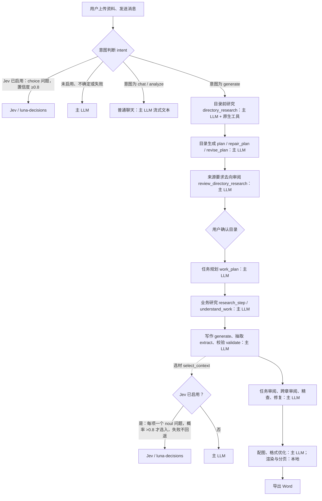
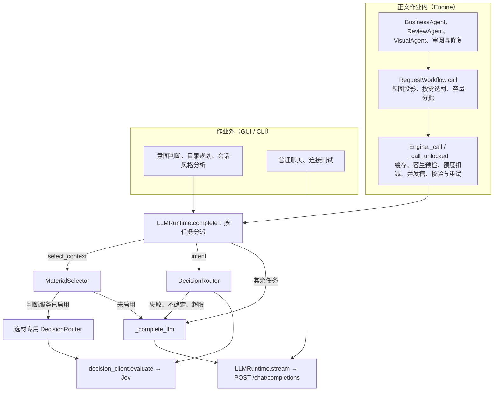
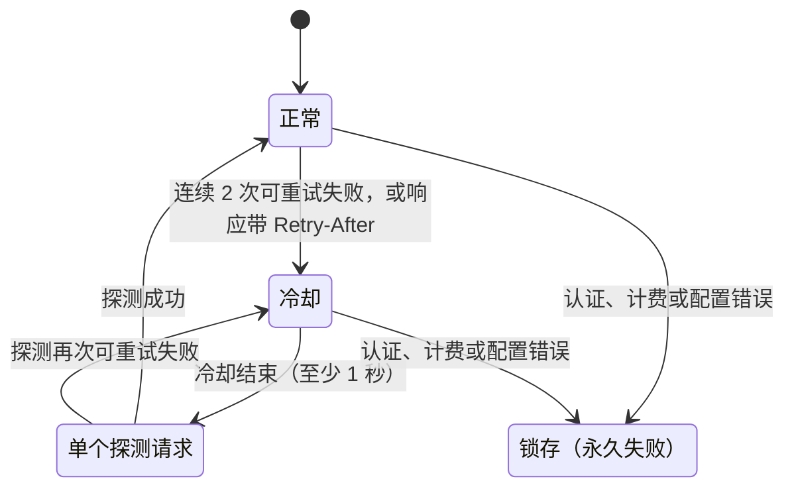
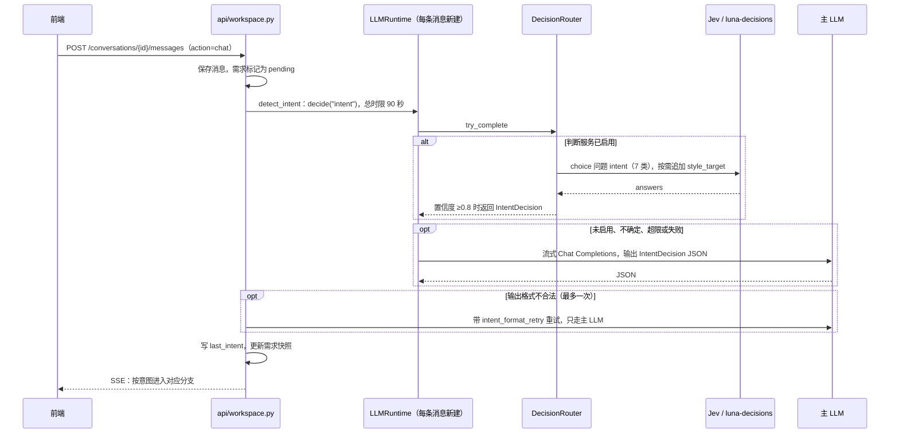
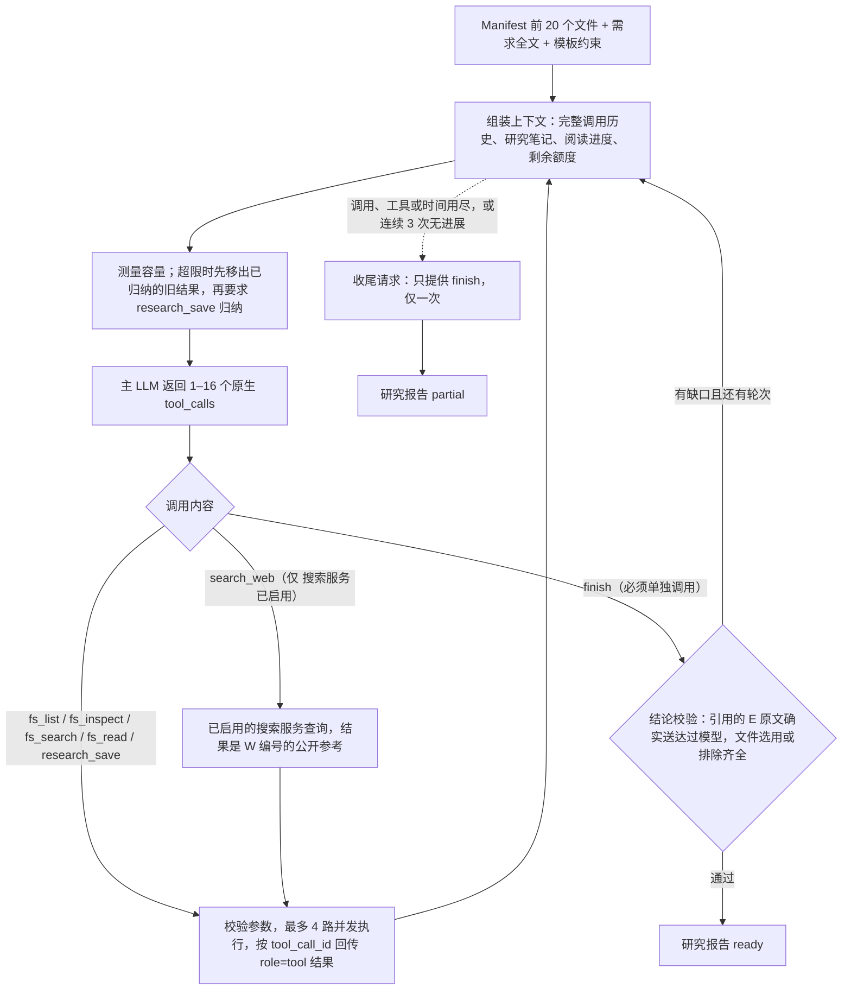
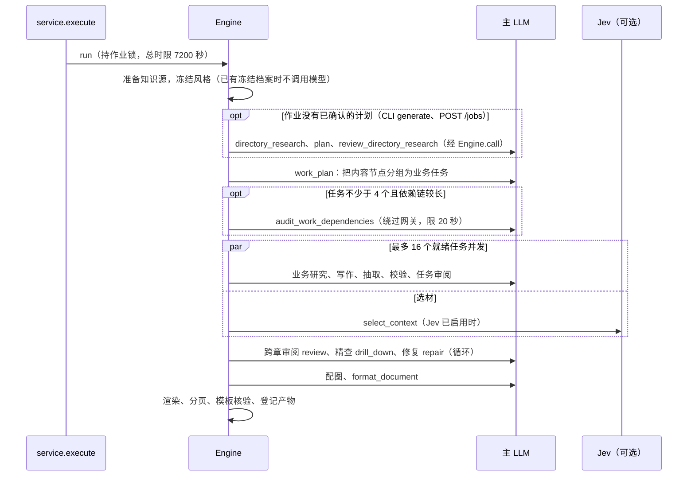
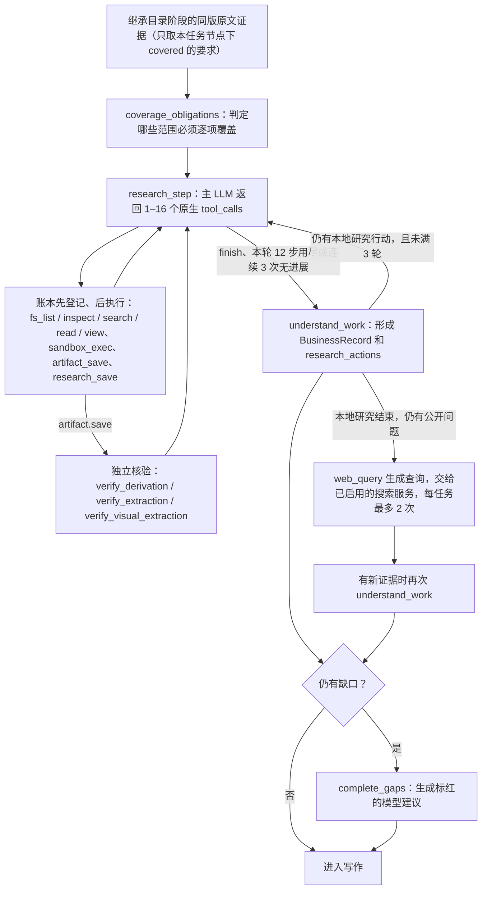
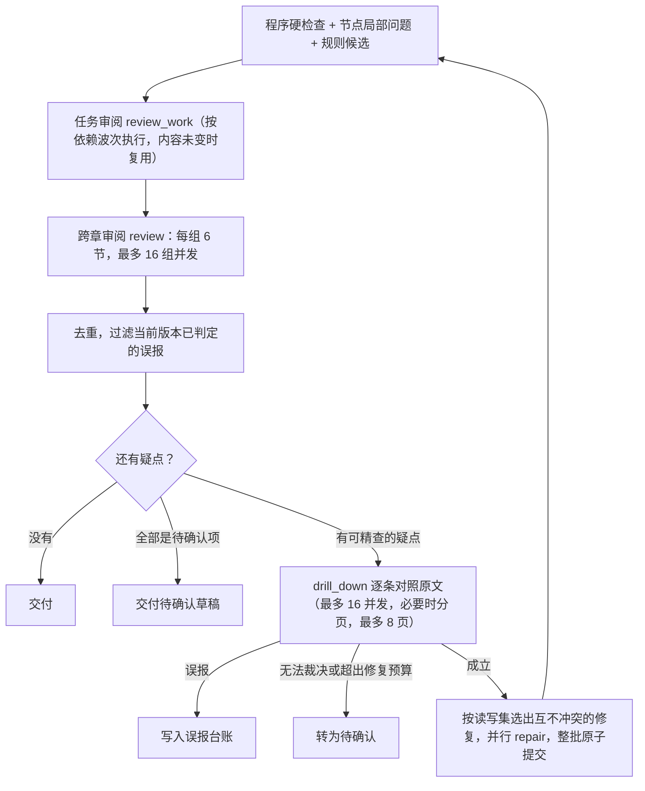

# LLM 与 Jev 交互流程

> English version: [English version](model-interactions.md)

本文对照当前代码说明从对话到 Word 交付的模型调用、协议、额度与并发。设计原则见 [Folio 技术架构](architecture.zh-CN.md)。代码链接以文件及函数名定位。

## 1. 先看结论

- **主 LLM 承担几乎全部模型工作**：目录前研究、目录规划与审阅、任务规划、业务研究、写作、抽取、校验、审阅、精查、修复、配图、格式优化、风格分析和普通聊天。全部走 OpenAI 兼容的流式 Chat Completions，唯一 HTTP 出口是 [llm.py](../src/folio/runtime/llm.py)。
- **Jev 只做有界的类型化判断**。只有两类任务会交给它（`ROUTABLE_TASKS = {"intent", "select_context"}`，[routing.py](../src/folio/decisions/routing.py)）：
  - `intent`：对话入口的意图分类。Jev 不确定、超限或失败时**回退主 LLM**。
  - `select_context`：正文作业内的资料相关性筛选。启用后**只用 Jev，失败直接报错，不回退主 LLM**；相关概率必须**严格大于 0.8** 才选入。
- Jev 是**可选服务**：必须在模型设置中用当前配置测试成功、勾选并保存；运行时还要校验配置指纹。未启用时，上述两类判断也由主 LLM 完成。
- 判断 HTTP 出口为 `decision_client.py`：普通 Base URL 追加 `/chat/completions`；显式 `/systemone` 地址使用 Jev 原生 `state` 和 `questions`，地址不变。
- `next_action`、目录研究、业务研究等动作选择**不经过 Jev**，由主 LLM 的原生 tool_calls 决定。Jev 逐页美观评分 `score_layout` 的代码仍在，但**生产流程中已经没有调用方**。



选材不只发生在写作阶段：依赖整理、缺口补写、精查和按问题审阅也会触发，见 [4.5](#45-资料筛选-select_context)。

## 2. 外部服务与出口

| 服务 | 代码出口 | 协议 | 使用场景 | 是否计入作业调用额度 |
| --- | --- | --- | --- | --- |
| 主 LLM | [llm.py](../src/folio/runtime/llm.py) `_stream_http` | `POST {base_url}/chat/completions`，SSE 流式 | 所有生成、研究、审阅任务；普通聊天；连接测试 | 是，按每次 HTTP 计（仅作业内） |
| LLM 辅助接口 | [capacity.py](../src/folio/runtime/capacity.py) | `GET {base_url}/models`、`POST {base}/tokenize` | 请求前测量 Token 容量 | 否 |
| Jev / 判断服务 | [decision_client.py](../src/folio/decision_client.py) `evaluate` | OpenAI 兼容 Chat Completions；完整 `/systemone` 地址使用原生 `{model, state, questions[, assets]}` 协议 | `intent`、`select_context`、设置测试；已退役的 `score_layout` | 是，按每次 HTTP 计（仅作业内） |
| Tavily | [tavily.py](../src/folio/knowledge/tavily.py) | `POST https://api.tavily.com/search`，`search_depth=advanced` | 目录前研究的 `search_web`、业务研究联网补证、设置测试 | 否 |
| DeepSeek Search | [search.py](../src/folio/knowledge/search.py) | `POST https://api.deepseek.com/v1/tools/search`, `query`, `count`, `need_content` | 目录及业务研究、设置测试 | 否 |
| RAGFlow | [ragflow.py](../src/folio/knowledge/ragflow.py) | MCP 工具 `ragflow_retrieval` | 仅 CLI / 作业 API 显式配置时 | 否 |

搜索服务限制：DeepSeek Search 每条查询接受 1～128 个 Unicode 字符、1～50 条结果；超长查询明确拒绝，不静默截断。这是搜索接口限制，与模型上下文预算无关。

## 3. 调用分层：从业务代码到 HTTP



- **作业内**的调用几乎都经过 `Engine._call`，获得持久缓存、两级调用额度、并发槽和统一重试。唯一例外是 `audit_work_dependencies`，它直接调用 `runtime.complete`（[dependency_audit.py](../src/folio/orchestration/dependency_audit.py)）。
- **作业外**的调用直接使用 `LLMRuntime`。目录规划和会话风格分析用 `DirectoryRuntimeBudget` 在内存中计数（[prepare.py](../src/folio/document/prepare.py)）。这些调用都不在 `interaction_scope` 内，不写 `provider_started` / `provider_completed` 事件，也不占用任何作业的调用额度。
- 作业没有已确认计划时（CLI `generate`、`POST /jobs`），作业内的目录规划经 `JobPlanningRuntime` 接回 `Engine.call`（[directory_planning.py](../src/folio/orchestration/directory_planning.py)）；需要现场分析风格时经 `JobStyleRuntime` 接回（[style_processing.py](../src/folio/orchestration/style_processing.py)）。

### 3.1 `LLMRuntime.complete` 的分派

[llm.py](../src/folio/runtime/llm.py)

| 顺序 | 条件 | 去向 | 失败时 |
| --- | --- | --- | --- |
| 1 | `task == "score_layout"` | Jev 图片评分（首次先做图片能力探针） | 报错，不回退。生产流程已不调用 |
| 2 | `task == "select_context"` | `MaterialSelector.complete`，判断服务与主 LLM 二选一 | 判断服务路径直接报错，不回退 |
| 3 | `task` 属于 `NATIVE_TOOL_TASKS` | 主 LLM + 原生 tools | — |
| 4 | `intent` 且带 `intent_format_retry` | 主 LLM（格式修正不再问 Jev） | — |
| 5 | 其他 | `DecisionRouter.try_complete`，仅对 `intent` 且判断服务已启用时生效 | 返回 `(None, 原因)`，转主 LLM，原因写入 `usage.decision_fallback` |

`NATIVE_TOOL_TASKS = {directory_research, research_step, next_action, query, web_query, coverage_obligations}`（[native_tools.py](../src/folio/research/native_tools.py)）。

另有一个容易混淆的集合 `DECISION_TASKS`（[decisions/__init__.py](../src/folio/decisions/__init__.py)）：`plan`、`work_plan`、`next_action`、`understand_work`、`review_work`、`validate`、`review`、`drill_down`、`intent`、`select_context`。它只表示结果会另写一份到 `decisions` 表，**不表示走 Jev**。这些任务经 `LLMDecisionProvider.decide` 仍调用同一个 `runtime.complete`，真正能到达 Jev 的只有 `intent` 和 `select_context`。

### 3.2 主 LLM 请求如何组装

`request_parts`（[llm.py](../src/folio/runtime/llm.py)）按任务族生成 messages：

| 任务族 | system | user | 输出约束 |
| --- | --- | --- | --- |
| 原生工具任务 | 研究组件说明 + 任务指令 + 批量调用规则 + 语言规则（[transport.py](../src/folio/research/transport.py)） | Markdown 渲染的研究上下文；历史批次以 `assistant.tool_calls` 加逐条 `role=tool`（按 `tool_call_id` 配对）回放 | `tools` + `tool_choice="required"`；仅 `directory_research`、`research_step` 允许并行调用，一批最多 16 个，其余必须恰好 1 个 |
| 规划任务 `plan`、`repair_plan`、`revise_plan` | 规划指令 + 语言规则 + 写作指南 + 示例 + 紧凑 Schema（[base.py](../src/folio/runtime/base.py)） | 紧凑 JSON 的 `planning_payload` | JSON；`repair_plan` 使用类型化的稀疏修复格式 |
| `style_analysis` | 风格分析指令 + 语言规则（[style_profile.py](../src/folio/document/style_profile.py)） | Markdown 原文批次 | JSON |
| 其他结构化任务 | `prompt_for(task, {}, schema)`：框架 + `INSTRUCTIONS[task]` + 语言规则 + JSON Schema（[base.py](../src/folio/runtime/base.py)） | 紧凑 JSON 上下文，按需压缩：长 ID 换成 `sfrefN`，同构数组打包为 `$columns/$rows`，WorkPlan 节点换成 `n1..nN`，抽取字段用短键 | JSON |

请求体（[llm.py](../src/folio/runtime/llm.py)）包含 `model`、`messages`、`max_tokens`、`temperature`、`stream=true`、`stream_options.include_usage=true`，以及按提供方附加的参数（[provider_parameters.py](../src/folio/runtime/provider_parameters.py)）。有工具时加 `tools`、`tool_choice`、`parallel_tool_calls`；没有工具且 `structured_output="json_schema"` 时加严格的 `response_format`。默认 `"prompt"` 模式不发 `response_format`，只把 Schema 写进系统提示。需要看图的任务（`verify_extraction`、`verify_visual_extraction`，以及带页面图的 `research_step`、`style_analysis`）把 PNG 转成 `image_url` data URI，每次最多 2 张（[image_inputs.py](../src/folio/runtime/image_inputs.py)）。

提示词统一用英文。正文输出语言跟随用户的原始要求或显式语言指定；`ui_language` 控制任务标题、步骤说明和状态文案，不改变正文语言（[language.py](../src/folio/runtime/language.py)）。

原生工具请求若收到明确拒绝强制 `tool_choice` 的 HTTP 400，会仅重试一次 `tool_choice="auto"`，并在本 Runtime 复用探测结果；仍必须收到有效原生调用。程序不强制开启或关闭思考：显式 `enable_thinking` 才透传，否则沿用服务端默认。连接测试与正式执行共用此路径。

### 3.3 流式接收与校验

`_stream_http`（[llm.py](../src/folio/runtime/llm.py)）：

- 响应必须是 `text/event-stream`。逐行解析 `data:`，遇 `[DONE]` 结束；旧版 `function_call`、结束后又出现文本或工具片段、JSON 不合法，都判为协议错误。
- `tool_calls` 增量由 `ToolCallStream` 按 index 拼接，结束时要求 `finish_reason="tool_calls"`、ID 唯一、函数名在本次提供的列表中、参数是 JSON 对象（[tool_calls.py](../src/folio/runtime/tool_calls.py)）。
- 文本任务要求 `finish_reason="stop"` 且内容非空；`length` 判为 `length_limit`。
- 普通界面不展示 `reasoning_content`；原生工具请求会在私有响应及研究检查点中保留该字段，后续以 assistant 历史回传，满足服务的工具续接协议。普通文本流的诊断只保存计数。
- `generate` / `repair` 在流中检测重复段落；结构化输出的尾部空白达到 512 字符时，如果已是完整、合法的 JSON 就提前结束，否则判为 `stalled_output`（[llm.py](../src/folio/runtime/llm.py)）。
- 运行时只做传输层解码，例如还原短引用、短键、WorkPlan 别名和主表（[llm.py](../src/folio/runtime/llm.py)）。`parse_json`、pydantic 校验和业务校验 `check_result` 由调用方完成。

### 3.4 重试由谁负责

这一点最容易误解：**LLM 客户端本身几乎不重试**，重试分布在不同层。

| 层 | 重试什么 | 次数与方式 |
| --- | --- | --- |
| `LLMRuntime.stream`（[llm.py](../src/folio/runtime/llm.py)） | 只处理上下文超限（HTTP 400 `context_length_exceeded`） | 容量调整最多 3 轮；强制工具兼容重试可能额外产生 HTTP，不能将 3 轮当作所有请求的 HTTP 总上限。每次重发时降低 `max_tokens`，取原值的 3/4 与剩余窗口两者中的较小值，且不低于 512（[errors.py](../src/folio/runtime/errors.py)）。`select_context` 和补充整合类任务关闭此项 |
| `Capacity.request`（[capacity.py](../src/folio/runtime/capacity.py)） | `/models`、`/tokenize` 的 429、5xx（不含 501）及连接、读取等 HTTP 客户端错误 | 最多 4 次，间隔 2/4/8 秒，总计 30 秒；仍失败报 `capacity_unavailable` |
| `Engine._call_unlocked`（[engine.py](../src/folio/orchestration/engine.py)） | 校验失败、协议错误、超时、429/5xx 等 | 默认 `call_attempts=2`；`work_plan` 3 次；`format_document` 和补充冲突核对 1 次。重试时带 `format_feedback`，原生任务用 `native_retry_context` 回填失败的 tool 结果，**没有退避**。认证、计费、配置、Schema 不支持和 `context_limit` 不重试 |
| `RequestWorkflow.call_bounded`（[requests.py](../src/folio/orchestration/requests.py)） | 输入超容量或输出截断 | 不重发同一请求，而是改变请求边界：证据或缺口二分、事实与正文分页、审阅两两配对、精查分页；最小单元仍放不下时明确失败 |
| `DecisionRouter`（[routing.py](../src/folio/decisions/routing.py)） | Jev 的 429、408/425/5xx、超时、连接错误 | 每页最多 3 次 HTTP，整次判断限 20 秒，带熔断（见 [4.3](#43-decisionrouter有界恢复与熔断)） |

作业外的调用（意图、聊天、GUI 目录规划）没有 `Engine` 这一层，主 LLM 返回 429 或 5xx 会直接让这次操作失败。目录前研究的外层等待超时会保存 `partial` 研究报告，仍可生成带缺口提示的目录草稿；用户可从中断处继续研究，见 [5.3.1](#531-目录研究超时后如何继续)。意图判断另有一次"格式修正"重试，但只针对输出格式。

### 3.5 容量测量

缓存未命中的请求在发送前按完整请求测量（[capacity.py](../src/folio/runtime/capacity.py)）：

```text
输入 tokens（含工具定义） ≤ max_input_tokens（默认 600,000）
输入 tokens + 本次输出预留 + 512 ≤ 模型上下文窗口
```

- 每个 `LLMRuntime` 首次测量时 `GET /models` 读取 `max_model_len`，与配置的 `context_window` 取较小值；窗口已知后用 `POST /tokenize` 计数，服务不支持时用本地 tiktoken（默认 `o200k_base`）估算。
- `max_tokens` 默认 128,000。`generate`、`repair`、`validate`、`review_work`、`review` 可按剩余窗口缩小输出额度，其中 `generate` / `repair` 至少保留 4096，其余至少 2048（[capacity.py](../src/folio/runtime/capacity.py)）。
- `max_prompt_chars` 等字符上限只对没有 Token 计量的运行时（例如 Demo）生效。

## 4. OpenAI 兼容与 Jev 原生判断服务

### 4.1 配置

判断模型独立配置 `decision_base_url`、`decision_api_key`、`decision_model`，普通基础地址追加 `/chat/completions`；显式 `/systemone` 地址原样使用 Jev 原生协议。模型名由服务商提供，不设别名白名单，不假设与生成服务共享密钥。测试通过后方可启用，每批最多 24 个问题、最多 16 个并发请求。

### 4.2 请求和响应

请求使用标准 `messages`、`tools`、`tool_choice`，要求返回一次 `submit_decisions` 函数调用。工具 Schema 明确定义每道问题的选择、评分或概率。程序读取 `choices[0].message.tool_calls`，解析参数后验证所有判断；Token 来自标准 `usage` 字段。普通文本和缺失判断视为协议错误；认证、超时和重试处理仍明确保留。

Jev 原生请求使用 `{model, state, questions}`，直接读取 `answers` 中的类型化结果。两种协议共用完整答案校验与 HTTP 调用计数。

### 4.3 `DecisionRouter`：有界恢复与熔断

`try_complete`（[routing.py](../src/folio/decisions/routing.py)）的流程：

1. 任务不在 `ROUTABLE_TASKS`，或判断服务未启用：返回 `(None, None)`，调用方直接用主 LLM。
2. `state` 或 `{state, questions}` 序列化后超过 600,000 字符：返回 `(None, "decision_context_too_large")`（[batching.py](../src/folio/decisions/batching.py)）。
3. 构造问题并按每页上限分页；整次判断包在 `asyncio.timeout(20)` 内，逐页调用 `_evaluate_page`。
4. 用 `build(answers)` 还原为业务结果，并按目标 Schema 校验。
5. 任何异常都转成 `(None, 原因)`。只有作业调用额度耗尽（`ModelCallBudgetExceeded`）会原样抛出，避免借回退绕过额度。

`_evaluate_page`（[routing.py](../src/folio/decisions/routing.py)）每页最多 3 次 HTTP，同一 router 实例的所有调用共享一个熔断器：



- 冷却剩余不超过 2 秒时原地等待；超过 2 秒（包括较长的 `Retry-After`）直接失败，不发 HTTP。
- 冷却结束后只放行一个探测请求，其他调用等待探测结果。
- 只有 HTTP 层失败计入熔断；置信度不足、答案不合法等语义失败不计入。
- **锁存**在该 router 实例的整个生命周期内有效，之后每次判断都直接失败。作业内选材使用作业 runtime 上 `MaterialSelector` 自带的 router（与意图用的 router 相互独立），因此一旦锁存，整个作业执行期内的选材都会失败。
- 最坏情况：Engine 外层 2 次尝试 × 每页 3 次 HTTP，共 6 次 HTTP、约 40 秒。

### 4.4 意图分类 `intent`



- 入口：[workspace.py](../src/folio/api/workspace.py) 调用 `detect_intent`（[workspace.py](../src/folio/api/workspace.py)）。
- `state` 包含最新用户消息、全部有效历史，以及精简后的工作区状态：文件、目录状态、下一步、写作指南、风格分析是否可用、活动作业。
- 候选意图共 7 类（[routing.py](../src/folio/decisions/routing.py)）：`generate`、`resume_generation`、`requirements`、`analyze`、`analyze_style`、`clarify`、`chat`。有风格示例时追加 `style_target` 选择题，用来选出要分析的文件。
- Jev 的 `choice` 置信度必须 **≥0.8**（[routing.py](../src/folio/decisions/routing.py)），否则转主 LLM。注意它与选材的阈值不同，选材要求**严格大于** 0.8。结果还要经 `validate_style_intent` 核对文件 ID 和用途。
- 意图结果用于更新需求快照（[requirements.py](../src/folio/requirements.py)）：`generate`、`requirements` 记为正式要求 `active`；`clarify` 记为 `clarification`；`resume_generation` 记为 `command`；其余记为 `discussion`。判断失败时消息保持 `pending`，会阻止生成目录、确认目录和续跑，直到重发并判断成功。
- 意图判断发生在作业之外：不占用任何作业的调用额度，也不写 provider 事件。Jev 返回的 `usage` 和 HTTP 尝试记录会被 `detect_intent` 丢弃。由于每条消息都新建 `LLMRuntime`，熔断状态不会跨消息保留。

### 4.5 资料筛选 `select_context`

**何时触发**：正文作业内，需要从候选资料中挑出与当前动作相关的部分时，入口为 `select_reads`（[requests.py](../src/folio/orchestration/requests.py)）：

| 调用方 | 场景 |
| --- | --- |
| `select_writing_materials` | 每次 `generate` / `repair` 都先按节点选材，与上下文能否放下无关 |
| `prepare_context` | 上下文投影后放不下时，筛选上游依赖的事实、建议和风险 |
| `select_gap_materials` | `complete_gaps` 的上下文放不下时 |
| `select_evidence` | `call_bounded` 在最后一步按相关性筛选证据 |
| `prepare_issue_context` | `drill_down` 的完整材料放不下时 |
| `review_focus` | 任务审阅超容量后，按检查点逐一选材 |

必读材料不送去筛选，而是直接保留，例如本节已引用的原文、`required_project_evidence_ids`、选中事实所引用的原文、精查中被点名的证据（[requests.py](../src/folio/orchestration/requests.py)、[focused_review.py](../src/folio/orchestration/focused_review.py)）。

**怎么问 Jev**（[routing.py](../src/folio/decisions/routing.py)）：候选清单中的每一项对应一个 `noul` 问题，询问它与当前目的是否直接相关。程序只接受概率**严格大于 0.8** 的项，等于 0.8 不选。选中的风险类条目会把原文拼成 `risk_summary`，超过 1200 字符时改用原文标签。返回结果为 `ContextSelection{selected_refs, risk_refs, risk_summary}`。

**分页**（[selection.py](../src/folio/decisions/selection.py)、[batching.py](../src/folio/decisions/batching.py)）：

- 判断服务路径：每页的 `{state, questions}` 不超过 600,000 字符，所有判断模型每页最多 24 项。超长的单项会被无损切成多个分片，任一分片相关就保留完整原文。
- 主 LLM 路径：按完整请求的 Token 容量分页，不限项数；服务端拒绝时二分重读，最深 3 层，每页最多 15 次。

**路由互斥**（[selection.py](../src/folio/decisions/selection.py)）：判断服务启用时只用它。`try_complete` 一旦返回 `None`，就抛出 `ModelCallFailed`（错误码为 `decision_unavailable` 或安全错误码）。**不会改用主 LLM，也不会把失败当作"不相关"。**

**并发与计数**：同一次 `select_reads` 最多 4 页并行。判断服务启用时，选材只占独立的判断服务槽（所有判断模型统一 16 路），不占主模型名额。每次逻辑尝试计入 `jobs.calls`，每次 HTTP 再计入 HTTP 级额度。结果写入 `tasks.usage`（含每一项的相关概率 `decision_relevance`）和 `decisions` 表。

### 4.6 已退役：Jev 页面评分

`runtime.complete("score_layout")` 分支仍然保留（[llm.py](../src/folio/runtime/llm.py)、[decisions/layout_scoring.py](../src/folio/decisions/layout_scoring.py)）：先用四色块图片探针确认 Jev 确实能看图，再发送单页 PNG 和一个 10 级 `score` 问题。但它唯一的调用者 `review_rendered_document`（[layout_review.py](../src/folio/orchestration/layout_review.py)）在 `src/` 中没有调用方，`Engine.finish` 已改为调用 `format_document`；模型设置会丢弃旧开关 `layout_review_enabled`（[model_settings.py](../src/folio/model_settings.py)）。独立诊断脚本的用法见 [Jev 图片能力本地测试](model-vision-checks.zh-CN.md)。

## 5. 端到端流程

### 5.1 模型设置与连接测试

| 测试 | 请求 | 通过条件 |
| --- | --- | --- |
| LLM（[model_settings.py](../src/folio/model_settings.py)） | 流式 Chat Completions + 单个工具 `confirm_connection`，`tool_choice=required`，45 秒 | 恰好返回一个 tool_call，参数为 `{ok: true}`，以此确认服务支持原生工具调用 |
| 判断服务（[model_settings.py](../src/folio/model_settings.py)） | 一个 `noul` 问题，45 秒 | 返回结构合法 |
| Tavily（[model_settings.py](../src/folio/model_settings.py)） | `search_depth=basic`、`max_results=1`，25 秒 | HTTP 200 且 `results` 为列表 |

### 5.2 一条消息怎样分流

`POST /conversations/{id}/messages`（[workspace.py](../src/folio/api/workspace.py)）先在会话锁内保存消息并做预检，然后返回 SSE 流。`action=chat` 时先做意图判断（[4.4](#44-意图分类-intent)），再按意图分支（[workspace.py](../src/folio/api/workspace.py)）：

| 意图 | 处理 | 模型调用 |
| --- | --- | --- |
| `chat` / `analyze` | 普通聊天（[workspace.py](../src/folio/api/workspace.py)） | 主 LLM 流式自由文本。系统提示包含资料摘录和工作区状态，不带工具和 Schema |
| `analyze_style` | 先做风格分析，再用普通聊天解释结果 | `style_analysis`（最多 128 次）+ 主 LLM 流式回复 |
| `requirements` | 记录要求，返回固定回复 | 无 |
| `clarify` | 返回固定的澄清回复 | 无 |
| `generate` | 进入目录规划（5.3、5.4） | 见下文 |
| `resume_generation` | 在同一 SSE 流中续跑失败的作业 | 作业内的调用 |

界面按钮发出的显式动作（`confirm_directory`、`regenerate_directory`、`revise_directory`、`resume_directory_research`）不再做意图判断。`resume_directory_research` 只恢复目录前研究；它与正文作业的 `resume_generation` 是两个独立入口。

### 5.3 目录前研究 `directory_research`

`research_for_directory`（[research/planning.py](../src/folio/research/planning.py)）是一个有界的主 LLM 工具循环：



- 额度（[planning.py](../src/folio/research/planning.py)）：最多 3 轮、每轮 12 步，共 36 次模型调用、120 次工具调用、600 秒。已有原文送达时，为收尾预留 1 次调用。
- 证据由程序编号：读到的原文为 `E1`、`E2`……，文件为 `F1`……。`finish.requirements` 只能引用实际送达过模型的 `E` 原文，程序会逐字核对送达记录（[planning.py](../src/folio/research/planning.py)）。
- 工具错误和格式错误不会原样重发，而是作为反馈并经 `native_retry_context` 带入下一步。模型超时会以 `partial` 结束；其他模型服务错误会让这次目录生成失败，GUI 路径没有外层重试。
- 全程只用主 LLM，不调用 Jev，也不使用 `select_context`。
- 每一步的请求、响应、送达记录和工具结果都落盘到 `directory-drafts/<revision>/research/events/`，并导出 `research.md`。

#### 5.3.1 目录研究超时后如何继续

目录草稿因 `model_timeout` 或 `time_limit` 未完成研究时，界面提供“从中断处继续研究”。该按钮发送 `resume_directory_research`，不会把按钮文案加入写作要求，也不会启动正文生成。

1. **先核对输入是否还是同一份。** 后端检查当前目录版本、文件清单与用途、写作指南和需求版本；回放器还核对研究使用的需求全文、模板约束和来源内容快照。不一致时拒绝续用，要求重新生成目录。调用或轮次额度耗尽、上下文超限、研究已完成等情形不使用这个超时续跑入口。
2. **恢复的是有记录的研究过程。** `DirectoryDrafts.create(resume_from=...)` 创建新草稿目录，保留旧草稿。`DirectoryResearchReplay` 按原顺序读取已保存的模型响应，再对冻结资料执行相同的本地工具，重新建立阅读记录、笔记、证据和工具历史。期间不把每条旧进度当作当前工作展示，也不把旧报告的 `ready` 状态直接复制为新结论。
3. **只有请求一致才复用模型结果。** 每一步比较已保存请求与重新构建的上下文；研究会话 ID 和剩余秒数不参与比较。首个缺少响应或上下文不同的请求改为真实模型调用，之后不再回放模型结果。已经保存且匹配的联网查询复用原搜索结果、时间和 `W` 引用，不重新搜索；缺失或不匹配的查询正常执行。旧版仅用于收尾的 `finish` 请求不参与回放。
4. **计数区分步骤与新请求。** 回放步骤仍占研究的轮次、36 次步骤和 120 次工具额度，不会因续跑获得一整套额外步骤；只有实际再次调用模型才消耗本轮 `DirectoryRuntimeBudget`。新执行重新开始计算 600 秒时限，本地恢复过程也包含在内。恢复后仍按原有规则检查研究结论，再生成并审阅目录。

新报告的 `resume` 记录来源目录、复用次数和开始真实续跑的请求；响应文件带 `replayed_from`，对应 `usage` 项带 `replayed: true`。统计新增 LLM 请求时应排除回放项，不能直接把研究步骤数当成本轮新发出的 HTTP 数。

实现入口：[planning_replay.py](../src/folio/research/planning_replay.py)、[DirectoryDrafts.create](../src/folio/directory_drafts.py)、[prepare_with_model](../src/folio/document/prepare.py)、[research_for_directory](../src/folio/research/planning.py)。

### 5.4 目录生成、修复、修订与去向审阅

由 `prepare_with_model`（[document/prepare.py](../src/folio/document/prepare.py)）编排：

1. **`plan`**：一次性发出完整的目录请求，不分批；超容量时直接报 `PlanningContextTooLarge`。输入是需求快照全文、只含元数据的资料清单、研究结论与已送达原文、模板约束、风格视图和写作指南。输出 `PlanProposal`，程序用 `build_plan` 检查节点唯一、层级不跳级、生成节点有写作说明、模板固定章节等（[planner.py](../src/folio/document/planner.py)）。
2. **`repair_plan`**：提案 Schema 合法但结构有误，且错误能定位到具体路径时，只修改出错的路径（JSON Pointer 替换）。
3. **`revise_plan`**：用户提交修改建议时，按稳定的节点 ID 输出 `move`、`update`、`insert`、`remove` 操作（[directory_revision.py](../src/folio/document/directory_revision.py)）。按当前代码，GUI 每次修订都会先重跑一遍完整的目录前研究（[prepare.py](../src/folio/document/prepare.py)）。
4. **`review_directory_research`**：把每项研究得出的要求、对应原文和整份目录对照，判定 `covered`、`not_applicable` 或 `missing`（[research_review.py](../src/folio/document/research_review.py)）。按容量动态分批，最多 12 批；出现 `missing` 且研究为 `ready` 时，带上被拒提案重做一次完整的 `plan`。

尝试次数为 `min(call_attempts, max_calls)`，默认 2 次；修复确实减少了错误时再追加 1 次。输出被截断时会放大 `planning_max_tokens` 后重试（[llm.py](../src/folio/runtime/llm.py)）。只有研究为 `ready`（或无普通资料时为 `no_sources`）且审阅通过，目录才能确认。这一阶段全部使用主 LLM。

### 5.5 确认目录、创建作业

`confirm_directory`（[workspace.py](../src/folio/api/workspace.py)）依次核对目录版本、文件与用途、写作指南、研究是否可确认以及需求版本，然后由 `Store.create` 冻结需求、资料、计划、研究证据和风格档案（[store.py](../src/folio/store.py)、[planning_handoff.py](../src/folio/research/planning_handoff.py)），默认启用 V2 研究（`research=ResearchConfig()`）。最后 `start_job` 在后台执行 `service.execute → Engine.run`（[service.py](../src/folio/service.py)）。这一步不调用模型。

### 5.6 作业启动与任务规划



- `work_plan`（[business.py](../src/folio/orchestration/business.py)）：输入是节点清单（写作说明截断到 600 字）、资料索引和执行预算，输出 `WorkPlan`。程序校验每个节点恰好有一个负责人、依赖无环、每个任务最多 8 个节点；最多尝试 3 次，覆盖不全时固定已有分组，只让模型补全缺失的节点。
- `audit_work_dependencies`（[dependency_audit.py](../src/folio/orchestration/dependency_audit.py)）：任务不少于 4 个、最长依赖链不少于 3 层、候选边 1 到 16 条时，让模型判断哪些依赖边可以删除；失败时保留原依赖图。它直接调用 `runtime.complete`，只计逻辑调用次数，不经过 HTTP 级额度检查，也不写 provider 事件。
- `BusinessCoordinator`（[agents.py](../src/folio/orchestration/agents.py)）按依赖就绪情况最多同时运行 16 个任务。遇到可恢复的模型失败时只停止派发新任务，已启动的任务继续执行完。

### 5.7 业务任务：V2 自主研究

GUI 作业默认走 V2（`JobInput.research.enabled`，[agents.py](../src/folio/orchestration/agents.py)），由 `research_business`（[research/workflow.py](../src/folio/research/workflow.py)）执行：



- 额度（[contracts.py](../src/folio/research/contracts.py)）：每轮 12 步、最多 3 轮。每个业务任务（每次续跑授权重新计算）最多 50 次工具调用、40 次研究模型调用，脚本累计 600 秒、单次 120 秒。`research_step`、`coverage_obligations` 和各类核验计入这 40 次；总额度剩余不足 40 次（默认值）时推迟研究请求，为正文和审阅保留调用。`understand_work`、`web_query`、`complete_gaps` 只计入整篇总额度。
- 工具结果以 `role=tool` 加 `tool_call_id` 回传。计算产物必须经过独立核验并签名后，才能作为证据使用（[artifacts.py](../src/folio/research/artifacts.py)）。
- 这一层不直接调用 Jev。只有 `understand_work`、`complete_gaps` 因上下文超容量进入选材时，才可能经 `select_context` 间接用到 Jev。
- 旧路径用于未启用 V2 的历史作业和 Demo，是 `understand_work → next_action → query → 知识库检索` 的循环：检索 3 次后仍有缺口，就用 `web_query` 加已启用的搜索服务补证（最多 2 次），仍然缺失则交给 `complete_gaps`（[agents.py](../src/folio/orchestration/agents.py)）。`next_action` 由主 LLM 在原生工具 `search`、`write`、`pending` 中三选一，**不交给 Jev**。

### 5.8 写作、抽取与局部校验

每个任务研究完成后，尚未保存的节点最多 8 路并发写作（[agents.py](../src/folio/orchestration/agents.py)）：

1. **`generate`**（[engine.py](../src/folio/orchestration/engine.py)）：先按节点选材（`select_context`），再写作，输出 `SectionContent`（正文块、待确认项、配图请求）。写作后若发现缺口（待确认项、空正文、无引用的块等），在任务锁内先回到研究补查；仍未解决的交给 `complete_gaps` 生成建议，再用 `integrate_supplement` 合入已有正文。超容量时改走 `check_supplement_conflicts` / `repair_supplement_conflicts`。
2. **`extract`**：从正文抽取事实声明，每次最多 12 条；超容量时按正文块二分。
3. **`validate`**：逐条核对声明是否有原文支持；超容量时拆成配图计划、声明（每页 24 条）、正文（每页 8 块）和逐项必需证据。
4. 抽取或校验因截断、超时等失败时，保留正文，并把该节点记为待确认（`incomplete_local_check`）。
5. 任务的全部节点完成后，由 **`review_work`** 做任务整体审阅；超容量时改用 `plan_review`、`review_focus`、`read_review_materials`。审阅通过后释放下游任务。

业务任务阶段主模型并发 32 路（[engine.py](../src/folio/orchestration/engine.py)），之后的审阅等阶段 16 路，全程都受 32 路总闸约束。

### 5.9 审阅、精查与修复循环

[engine.py](../src/folio/orchestration/engine.py)：



- 这一循环全部使用主 LLM；精查和修复过程中的选材可能用到 Jev。
- 每个节点最多修订 3 次（`max_repairs`）。
- 跨章审阅的分组依据包括相邻窗口、相同事实键、共同主体和依赖交接（[review.py](../src/folio/orchestration/review.py)）。

### 5.10 配图、格式优化与交付

`Engine.finish`（[engine.py](../src/folio/orchestration/engine.py)）按以下顺序执行：

1. **配图**：每节正文保存后，`VisualPrefetch` 已在后台预生成配图（2 路模型槽；软额度为 `min(120, max_calls/5)`，并为核心工作保留至少 1/4 总额度，默认 500 次）。这里汇合剩余的图。每张图的循环是：`design_ui` / `design_flowchart` 生成 HTML 或 Mermaid，本地 Chromium 渲染，`validate_visual` 审阅，程序用原文引文和真实图结构复核，必要时做语义或拓扑复核，然后修订，最多 3 轮。材料超容量时，先用 `read_visual_materials` 分页提炼约束（[visuals/workflow.py](../src/folio/visuals/workflow.py)）。失败的图会在 Word 中标为"配图待确认"。
2. **初始渲染** Word，暂不分页。
3. **`format_document`**：按任务分组，向主 LLM 提供段落和表格的局部版式对象；模型只能返回白名单内的格式补丁（对齐、±1pt 字号、段距、分页约束）。最多 4 组并行，每组最多 3 次调用、25 秒，整个阶段 120 秒；失败时恢复原版式（[formatting.py](../src/folio/orchestration/formatting.py)）。
4. LibreOffice 分页，模板核验，最后登记为 `published`、`draft` 或 `needs_confirmation`。

当前流程不再执行 Jev 页面评分。

### 5.11 降级交付与待确认续跑

- **降级**（[engine.py](../src/folio/orchestration/engine.py)）：调用额度耗尽、模型服务失败、重试耗尽或超时时，如果全部节点都已保存，就停止新增模型调用（配图只复用已校验过的图，跳过格式优化），导出 `needs_confirmation` 草稿。其他异常，包括跨章审阅或任务审阅在最后一次尝试时仍校验失败（`ValueError`），会让作业直接失败，而不是降级。
- **续跑**（[confirmations.py](../src/folio/confirmations.py)）：用户在待确认面板提交答复和本轮额度（默认 200，范围 1 到 10000）后，新的调用上限为已用次数加本轮额度。作业从审阅阶段继续，`apply_pending_confirmations` 把答复作为用户依据，驱动 `research_work`、`repair`、`extract` 和 `validate`（[confirmations.py](../src/folio/confirmations.py)）。

## 6. 模型任务总表

`INSTRUCTIONS` 共有 42 个任务提示词（[runtime/base.py](../src/folio/runtime/base.py)）。另有普通聊天和 LLM 连接测试两种不经 `complete` 的流式调用。

"调用路径"一列中：**直接**指作业外直接调用 `LLMRuntime`；**网关**指作业内经 `Engine.call`；**两者**指 GUI/CLI 预览时直接调用，作业内（作业没有已确认计划或冻结档案时）经网关。

| 任务 | 阶段 | 服务 | 协议 | 主要输出 | 调用路径 |
| --- | --- | --- | --- | --- | --- |
| `intent` | 对话入口 | Jev，失败回退主 LLM | choice 问题 / JSON | `IntentDecision` | 直接 |
| （普通聊天） | 对话 | 主 LLM | 流式文本 | 回复文本 | 直接 |
| `style_analysis` | 对话 / 目录前 / 作业启动 | 主 LLM | JSON，可带页面图 | 分批观察与综合核对 | 两者 |
| `directory_research` | 目录前 | 主 LLM | 原生工具，可并行 | 工具调用批次 / `finish` | 两者 |
| `plan` | 目录 | 主 LLM | JSON | `PlanProposal` | 两者 |
| `repair_plan` / `revise_plan` | 目录 | 主 LLM | JSON | 稀疏修复 / 目录操作 | 直接 |
| `review_directory_research` | 目录 | 主 LLM | JSON | 要求去向检查 | 两者 |
| `work_plan` | 作业启动 | 主 LLM | JSON | `WorkPlan` | 网关 |
| `audit_work_dependencies` | 作业启动 | 主 LLM | JSON | 依赖边判定 | **绕过网关** |
| `coverage_obligations` | V2 研究 | 主 LLM | 原生工具，单个调用 | 覆盖义务 | 网关 |
| `research_step` | V2 研究 | 主 LLM | 原生工具，可并行 | 工具调用批次 | 网关 |
| `verify_derivation` | V2 研究 | 主 LLM | JSON | 计算产物核验 | 网关 |
| `verify_extraction` / `verify_visual_extraction` | V2 研究 | 主 LLM | JSON + 原页图 | OCR / 读图核验 | 网关 |
| `review_coverage_exclusion` | V2 研究 | 主 LLM | JSON | 不适用声明审核 | 网关 |
| `understand_work` | 研究评估 | 主 LLM | JSON | `BusinessRecord` | 网关 |
| `next_action` / `query` | 旧研究路径 | 主 LLM | 原生工具，单个调用 | 下一步动作 / 检索词 | 网关 |
| `web_query` | 联网补证 | 主 LLM | 原生工具，单个调用 | 公开检索词 | 网关 |
| `select_context` | 选材 | 启用时只用 Jev（不回退），否则主 LLM | noul 问题 / JSON | `ContextSelection` | 网关 |
| `complete_gaps` / `read_gap_materials` | 缺口补写 | 主 LLM | JSON | 模型建议 / 材料约束 | 网关 |
| `generate` / `repair` | 写作 / 修复 | 主 LLM | JSON | `SectionContent` | 网关 |
| `integrate_supplement` / `check_supplement_conflicts` / `repair_supplement_conflicts` | 补充整合 | 主 LLM | JSON | 正文补丁 / 冲突结论 / 修正方案 | 网关 |
| `extract` / `validate` | 节点校验 | 主 LLM | JSON | 事实声明 / 逐条核验 | 网关 |
| `review_work` | 任务审阅 | 主 LLM | JSON | `Review` | 网关 |
| `plan_review` / `review_focus` / `read_review_materials` | 任务审阅超容量时 | 主 LLM | JSON | 检查点 / 审阅结果 / 阅读笔记 | 网关 |
| `review_unused_artifact` | 任务审阅 | 主 LLM | JSON | 未使用产物的处置 | 网关 |
| `review` | 跨章审阅 | 主 LLM | JSON | `Review` | 网关 |
| `drill_down` | 精查 | 主 LLM | JSON | `DrillDown` | 网关 |
| `read_visual_materials` / `design_ui` / `design_flowchart` / `validate_visual` | 配图 | 主 LLM | JSON | 约束 / 源码 / 审阅结果 | 网关 |
| `format_document` | 交付 | 主 LLM | JSON | 白名单格式补丁 | 网关 |
| `review_layout` / `score_layout` | 已退役 | 主 LLM 看图 / Jev | — | — | 无生产调用 |

## 7. 额度、并发与超时

### 7.1 调用额度

| 额度 | 默认值 | 计数口径 | 位置 |
| --- | --- | --- | --- |
| 作业逻辑调用 `jobs.calls` | 2000（范围 1 到 100000） | 每次 `Engine._call` 尝试，在等待并发槽之前原子扣减；缓存命中不计 | [store.py](../src/folio/store.py) |
| 作业 HTTP 调用 | 同为 2000 | 每次主 LLM 或 Jev 的 HTTP 尝试（`provider_started` 事件数），包括流内重试和 Jev 重试 | [store.py](../src/folio/store.py) |
| 目录前研究 | 36 次研究步骤、120 次工具、600 秒 | 初次运行每个研究步骤调用模型；超时续跑中的已保存响应复用仍占步骤额度，但不发新请求 | [planning.py](../src/folio/research/planning.py)、[planning_replay.py](../src/folio/research/planning_replay.py) |
| GUI 目录规划合计 | 2000 | `DirectoryRuntimeBudget` 内存计数，研究、风格、规划、审阅共用 | [prepare.py](../src/folio/document/prepare.py) |
| V2 研究（每个任务） | 40 次模型、50 次工具、600 秒脚本 | 软额度桶；总额度剩余不足预留值（默认 40）时推迟 | [contracts.py](../src/folio/research/contracts.py) |
| 配图预生成 | `min(120, max_calls/5)` | 软额度桶，为核心工作保留 `max(12, ⌈max_calls/4⌉)` | [call_budget.py](../src/folio/runtime/call_budget.py) |
| 风格分析 | 128 次请求，每次 90 秒 | 分批请求 | [style_contracts.py](../src/folio/document/style_contracts.py) |
| 联网补证 | 每任务 2 次联网搜索 | 请求前持久登记，失败也占用 | [web_research.py](../src/folio/orchestration/web_research.py) |
| 续跑本轮额度 | 默认 200（范围 1 到 10000，累计不超过 100000） | 新上限 = 已用次数 + 本轮额度 | [confirmations.py](../src/folio/confirmations.py) |

### 7.2 并发

| 并发闸 | 上限 | 说明 |
| --- | --- | --- |
| 主模型（业务任务阶段） | 32 | `_generation_model_slots` |
| 主模型（其余阶段） | 16 | `_model_slots` |
| 主服务总闸 | 32 | `_provider_model_slots`，与上面两道闸叠加 |
| 配图预生成 | 2 | `_prefetch_model_slots`，同时占用总闸 |
| 判断服务选材 | 16（所有判断模型） | `_decision_model_slots`，不占主模型闸 |
| 业务任务 / 每任务写作者 | 16 / 8 | `max_parallel_tasks` / [agents.py](../src/folio/orchestration/agents.py) |
| 审阅组、精查、修复 | 16 | `max_parallel_reviews` |
| 选材页 / 目录研究工具 | 4 / 4 | [requests.py](../src/folio/orchestration/requests.py)、[planning.py](../src/folio/research/planning.py) |

主模型、配图和判断服务的并发槽由**每个作业**各自创建（[engine.py](../src/folio/orchestration/engine.py)），不同作业之间没有全局上限。目录研究工具的 4 路限制属于每次研究批次；GUI 目录研究发生在正文作业之外。

### 7.3 超时

| 项 | 默认值 |
| --- | --- |
| 单次模型调用 | 900 秒（作业内取 `call_timeout_seconds`）；流式读取不设空闲超时，只受这个总时限约束 |
| 目录前研究 | 每次等待默认 180 秒，且不超过本次研究剩余时间；整次默认 600 秒 |
| 整次作业执行 | 7200 秒 |
| 意图判断（含一次格式修正） | 90 秒 |
| Jev 单次 HTTP / 单次判断合计 | 30 秒 / 20 秒 |
| `/models` / `/tokenize` | 10 秒 / 15 秒，合计 30 秒 |
| Tavily | 30 秒（外层 35 秒） |
| 依赖审计 | 20 秒 |
| 格式优化 | 每组 25 秒，整个阶段 120 秒 |

## 8. 调用记录在哪里看

- SQLite 数据库 `.folio/folio.sqlite3`（[store.py](../src/folio/store.py)）：
  - `tasks`：每个请求身份的结果、用量、尝试次数和错误，同时充当请求缓存。
  - `decisions`：`DECISION_TASKS` 的上下文与结果。`select_context` 的 `usage` 中有每项的相关概率和 Jev 的 HTTP 尝试记录。
  - `events`：`task_started`、`task_completed`、`task_failed`、`task_cache_hit`、`provider_started`、`provider_completed` 等。provider 事件记录服务、模型、状态码、首包时间、Token 数、耗时和结果。
  - `call_budgets`：各软额度桶的计数。
- 作业目录 `jobs/<id>/contexts/`：`requests`（实际请求上下文和容量测量）、`native_responses`（原始 tool_calls）、`rejected`、`failed_outputs`（失败时的部分输出）等。
- 目录草稿 `directory-drafts/<revision>/`：`research/events/` 下有每一步的请求、响应、送达和工具结果；另有 `planning-attempts.json`、`research-review-attempt-N.json`。
- 会话风格分析：`conversation-styles/<revision>/style/audit/`。
- **不会**产生 provider 事件的调用：意图判断、普通聊天、GUI 目录规划、会话风格分析、作业内的 `audit_work_dependencies`，以及目录研究中的联网搜索。它们只记录在会话数据、目录草稿目录和服务日志中。这些记录不保存认证请求头、密钥或上游错误正文。原生工具的 `reasoning_content` 可保存在私有响应及研究检查点中用于协议续接，不展示到普通日志和界面。

## 9. 代码索引

| 查什么 | 代码 |
| --- | --- |
| 主 LLM 客户端、任务分派、流式解析 | [runtime/llm.py](../src/folio/runtime/llm.py) |
| 提示词与消息组装 | [runtime/base.py](../src/folio/runtime/base.py)、[research/transport.py](../src/folio/research/transport.py)、[document/planning_transport.py](../src/folio/document/planning_transport.py) |
| 线上压缩编码 | [business_transport.py](../src/folio/runtime/business_transport.py)、[work_plan_transport.py](../src/folio/runtime/work_plan_transport.py)、[extraction_transport.py](../src/folio/runtime/extraction_transport.py)、[writing_transport.py](../src/folio/runtime/writing_transport.py)、[plan_repair_transport.py](../src/folio/runtime/plan_repair_transport.py) |
| 原生工具定义与解析 | [research/native_tools.py](../src/folio/research/native_tools.py)、[runtime/tool_calls.py](../src/folio/runtime/tool_calls.py) |
| 容量测量 | [runtime/capacity.py](../src/folio/runtime/capacity.py)、[runtime/token_estimate.py](../src/folio/runtime/token_estimate.py) |
| 错误分类与对外文案 | [runtime/errors.py](../src/folio/runtime/errors.py)、[runtime/diagnostics.py](../src/folio/runtime/diagnostics.py) |
| 调用审计与进度状态 | [runtime/interaction_audit.py](../src/folio/runtime/interaction_audit.py)、[runtime/activity.py](../src/folio/runtime/activity.py) |
| Jev HTTP 出口 | [decision_client.py](../src/folio/decision_client.py) |
| 判断路由、熔断、意图与选材问题 | [decisions/routing.py](../src/folio/decisions/routing.py) |
| 选材分页与路由 | [decisions/selection.py](../src/folio/decisions/selection.py)、[decisions/batching.py](../src/folio/decisions/batching.py) |
| 模型设置、连接测试、启用指纹 | [model_settings.py](../src/folio/model_settings.py) |
| 作业网关：缓存、额度、并发、重试 | [orchestration/engine.py](../src/folio/orchestration/engine.py)、[orchestration/requests.py](../src/folio/orchestration/requests.py)、[store.py](../src/folio/store.py)、[runtime/call_budget.py](../src/folio/runtime/call_budget.py) |
| 对话入口与意图分支 | [api/workspace.py](../src/folio/api/workspace.py)、[requirements.py](../src/folio/requirements.py) |
| 目录前研究、超时续跑与目录规划 | [research/planning.py](../src/folio/research/planning.py)、[research/planning_replay.py](../src/folio/research/planning_replay.py)、[research/planning_web.py](../src/folio/research/planning_web.py)、[document/prepare.py](../src/folio/document/prepare.py)、[document/research_review.py](../src/folio/document/research_review.py) |
| 业务任务与 V2 研究 | [orchestration/agents.py](../src/folio/orchestration/agents.py)、[orchestration/business.py](../src/folio/orchestration/business.py)、[research/workflow.py](../src/folio/research/workflow.py) |
| 审阅、精查、修复 | [orchestration/review.py](../src/folio/orchestration/review.py)、[orchestration/focused_review.py](../src/folio/orchestration/focused_review.py)、[orchestration/repair_batch.py](../src/folio/orchestration/repair_batch.py)、[orchestration/supplement_integration.py](../src/folio/orchestration/supplement_integration.py) |
| 配图、格式优化、风格分析 | [visuals/workflow.py](../src/folio/visuals/workflow.py)、[orchestration/visual_prefetch.py](../src/folio/orchestration/visual_prefetch.py)、[orchestration/formatting.py](../src/folio/orchestration/formatting.py)、[document/style_profile.py](../src/folio/document/style_profile.py) |
| 待确认续跑 | [confirmations.py](../src/folio/confirmations.py)、[api/confirmations.py](../src/folio/api/confirmations.py) |
