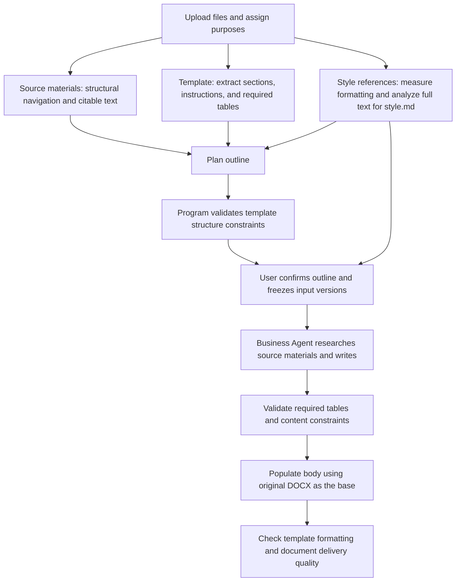

# User Template Design

> 中文版: [中文版](templates.zh-CN.md)

Folio supports uploading a template and completing a document based on other materials, while retaining an autonomous planning workflow that does not use a template. A template is an optional output constraint file, not a source of business facts.

## File Purposes and Usage

The library explicitly distinguishes three file purposes:

| Purpose | Role | Current Support |
| --- | --- | --- |
| Source material `source` | Provides evidence such as business rules, data, interfaces, and meeting notes | All file formats supported by the workbench |
| Document template `template` | Specifies fixed sections, completion instructions, required tables, and Word formatting | At most one DOCX per session |
| Style reference `style_reference` | Captures writing style and appearance without prescribing business facts or fixed sections | Supported source formats; formatting parameters are primarily extracted reliably from DOCX |

Uploaded files default to source material. Users select “Document Template” on a DOCX file row in the library, without re-uploading the file or selecting an additional outline. A filename containing the Chinese word for “template” does not automatically change its purpose. Assigned purposes are saved and restored with the session.

To replace a template, first remove the old one. If the old file should genuinely serve as business evidence, users can explicitly change it to source material instead. The system rejects selection of a second template and does not automatically convert the old template into a factual source. Changing file purposes or adding or removing files invalidates the outline awaiting confirmation. Inputs for the current session cannot be changed while a task is generating or paused.

Style references are frozen separately under `style-references/` in the outline version and do not enter `sources/`. The program uses full-file hashes to prevent the same template or reference from entering the factual sources again under a different name. Confirming the outline also freezes `style/profile.json` and the human-readable `style/style.md`. Body-generation jobs validate the reference hashes and reuse this style rather than reanalyzing the sample for each section. The outline review interface provides a download link for the style description.

Users can also study a sample independently first: after setting its purpose, they can ask in chat to “analyze this style reference” or ask about its writing style, structural organization, and formatting. A dedicated route freezes the selected files, performs bounded analysis, and returns `style.md`, without requiring an outline to be generated first. If multiple files are present, users can specify filenames explicitly. If an explicitly specified file does not exist or the reference is ambiguous, the system asks the user to verify it and does not automatically change file purposes. Standalone analysis and outline analysis share a cache keyed by content hash. Follow-up questions read only style summaries whose versions still match. Completing text analysis does not mean every page has received visual review, nor does it add style consultation to the document requirements.

The style description covers document structure, tone, content organization, level of detail, headings, charts and tables, typography, page layout, visual design, and professional expression. Each conclusion distinguishes its scope, source coverage, and unconfirmed items. Programmatically measured formatting parameters are used for Word generation. Writing conventions summarized by the LLM cannot create project facts or turn the sample’s section count, monetary amounts, or company names into constraints for the current document. When a template specifies fixed formatting, that formatting remains in place and cannot be overridden by style.

## Preparing a Template

1. Use actual Word heading styles such as “Heading 1” and “Heading 2,” starting at level one, without skipping levels, up to six levels. Simply enlarging or bolding text does not make it a section heading.
2. Arrange fixed sections in their final order. The system preserves heading text, levels, parent-child relationships, and order, without deleting, merging, or renaming them on its own.
3. Include explicit instructions within sections, such as “Completion instructions: List the user roles and permissions for this system” or “Complete the field definitions based on the interface materials.” These instructions guide writing and are not reproduced verbatim in the body.
4. No sections are added by default. If a section allows additional subsections, state “Subsections may be added as business needs require.” This permission applies only to that section and its permitted new subordinate structure; it does not allow other top-level sections to be inserted.
5. Place required tables in the corresponding sections and provide clear headers. The system identifies the required data from the headers, preserves table formatting, and checks headers, table counts, and data-row requirements.

For example:

```text
1 Project Overview                  ← Heading 1
Completion instructions: Describe the project background, objectives, and boundaries.

2 Functional Requirements           ← Heading 1
Subsections may be added as business needs require.

3 Interface Requirements            ← Heading 1
Complete the following interface list.
| Interface Name | Caller | Input | Output | Exception Handling |
|                |        |       |        |                    |
```

After this template and the business materials are uploaded, the generated outline must retain the three fixed sections. Functions may be broken down under “Functional Requirements,” and the specified table under “Interface Requirements” must have corresponding output. Fields with insufficient supporting material must be explicitly marked as pending confirmation; template example values must not be used as confirmed facts.

## Processing Workflow and Isolation



Original materials are still parsed through the unified preprocessing cache. The material directory used for business research contains only source materials. The original template is frozen separately, with its content hash, file purpose, and extracted constraints recorded. The template does not appear in the directory read for factual research and does not directly enter the global facts. Chat context provides only template sections, completion instructions, and table headers, not example business text, example table data rows, or old project cover values from the template.

Outline confirmation also checks the file list, file purposes, requirements version, and writing guidelines. The original template must also match its frozen hash. After a file purpose changes, the previous outline can no longer be used to start generation. An old outline without a file-purpose snapshot may only be restored using its original treatment of all files as source materials; it cannot use a template designated later.

Template constraints are saved with the confirmed document plan. The model may propose a section-writing plan, but template bindings and required-table requirements are written by the program from trusted template parsing results. The model is not allowed to remove these constraints on its own. The outline-planning correction workflow receives specific structural errors. Body generation continues to use the existing research, global facts, review, supplementary research, and repair workflows.

## Layout Preservation and Checks

When a template is present, generation uses the original DOCX as its base rather than creating a new document with default formatting:

- Preserve the template’s style definitions, fixed heading formatting and numbering, page settings, sections, headers, and footers.
- Preserve fixed cover content and graphics. `{{document_title}}` or `{document_title}` on the cover can be replaced with the current document title.
- Format new body text based on the body formatting of the corresponding section. Required tables retain the template’s headers, column layout, and data-row formatting.
- Remove completion prompts and example body text from sections before inserting the newly generated content. Example data rows are replaced with actual data or explicit items pending confirmation.
- Use default formatting rules for new content not defined by the template. Layout review must not normalize prescribed template formatting to built-in formatting.

During generation and layout checks, the program verifies fixed headings, styles, page and section settings, headers and footers, required tables, and their header layouts. When required content is missing, an empty template is not treated as a completed formal document. A draft pending confirmation may be delivered, with outstanding questions retained.

## Current Support Boundaries

- Templates support DOCX only. PDFs, images, and Excel files can still serve as source materials, but not as output templates that preserve Word structure and formatting.
- A recognizable Word heading structure is required. Images in the body, text boxes, content controls, unresolved tracked changes, nested tables, and merged data cells that cannot be safely populated are outside the current scope of support. These structures are reported as issues rather than silently switching to free-form generation. Cover images, headers, and footers can be preserved.
- The same template cannot also be uploaded as source material. Duplicate attachments must be removed before planning. Chat also does not read example business text from duplicate files.
- Body tables require explicit headers. Multi-row headers should be correctly configured as repeating header rows in Word. Blank headers whose column names cannot be determined should be filled in first.
- Cover content before the first section is preserved as a fixed layout, with only explicitly supported placeholders replaced. Old project documents containing fixed company names, dates, or other old values should first be converted into proper templates. The system does not guess what every old value should be replaced with.
- Preserving Word structure and formatting does not imply pixel-level consistency across all Office versions and font environments. Pagination previews still depend on the existing Office environment and font configuration.
- Upload and purpose-selection controls for this feature are located in the workbench. This does not restore the legacy mandatory-template workflow or removed outline parameters.
