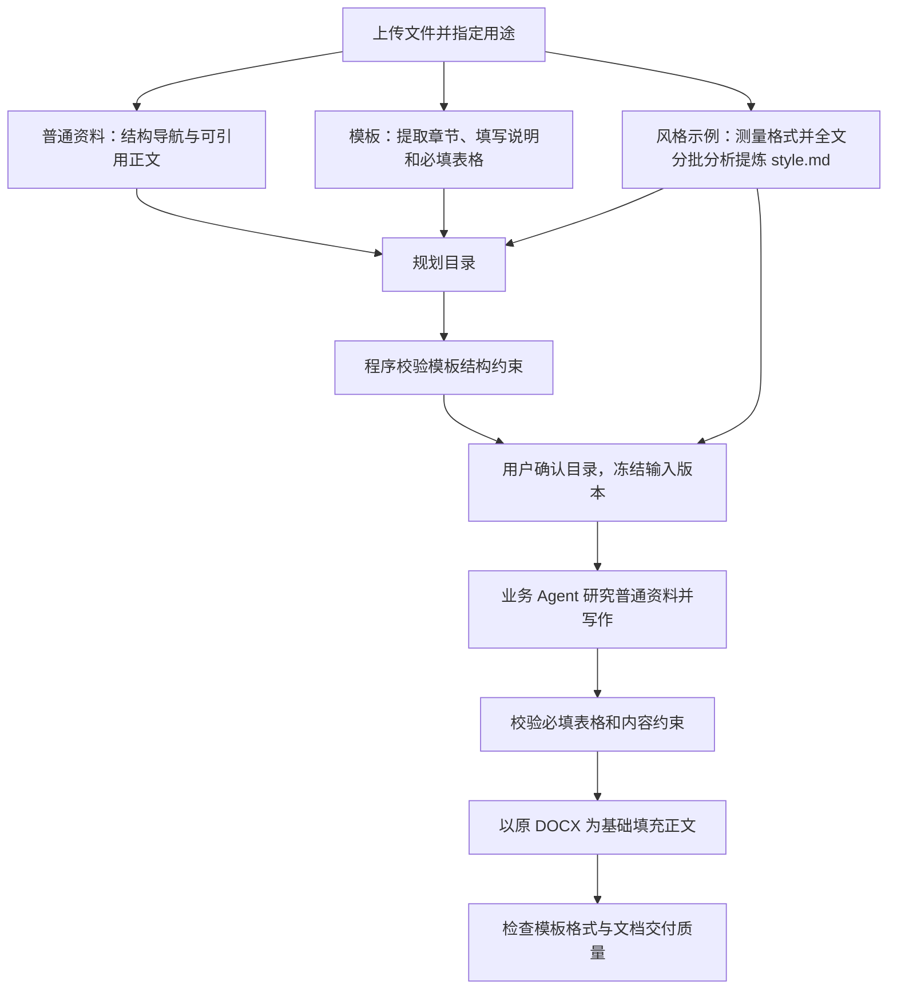

# 用户模板设计

> English version: [English version](templates.md)

Folio 支持“上传模板，依据其他资料完成文档”，也保留不使用模板的自主规划流程。模板是一份可选的输出约束文件，不是业务事实资料。

## 文件用途与使用方式

资料库明确区分三种文件用途：

| 用途 | 作用 | 当前支持 |
| --- | --- | --- |
| 普通资料 `source` | 提供业务规则、数据、接口、会议记录等依据 | 工作台支持的全部文件格式 |
| 文档模板 `template` | 规定固定章节、填写要求、必填表格和 Word 格式 | 每会话最多一份 DOCX |
| 风格示例 `style_reference` | 提炼写法与外观，不规定业务事实或固定章节 | 支持的资料格式；排版参数主要从 DOCX 可靠提取 |

上传文件默认是普通资料。用户在资料库的 DOCX 文件行选择“文档模板”，无需重新上传，也不需要额外选择大纲。文件名含“模板”不自动改变用途，已有用途会随会话保存与恢复。

更换模板时，先移除旧模板；如果旧文件确实应作为业务依据，也可以明确将其改为普通资料。系统拒绝同时选择第二份模板，不会自动将旧模板转成事实来源。改用途、增删文件都会使待确认目录失效；正在生成或暂停的任务不允许修改本会话输入。

风格示例在目录版本的 `style-references/` 独立冻结，不进入 `sources/`。程序按完整文件哈希拦截同一模板或示例以另一个名字重复进入事实资料。目录确认同时冻结 `style/profile.json` 和供人阅读的 `style/style.md`；正文作业校验示例哈希并复用这份风格，不在每章重新分析范文。目录审阅界面提供风格说明下载入口。

也可以先单独研究范文：设置用途后，在聊天中提出“分析这个风格示例”或询问范文的写法、结构组织和排版。独立路由会冻结选中文件、执行有界分析并返回 `style.md`，无需先生成目录。多份文件可明确指出文件名；明确指定的文件不存在或指向不清时提示核对，不自动改变用途。单独分析与目录分析共享按内容哈希绑定的缓存；后续追问只读取版本仍匹配的风格摘要。文字分析完成不代表已检查范文所有页面的视觉效果，也不会把风格咨询写入文档要求。

风格说明描述文档结构、写作语气、内容组织、详细程度、标题、图表、字体排版、页面布局、视觉设计和专业表达。每个结论区分适用范围、全文分批分析依据和未确认项。程序测量的排版参数用于 Word 生成；LLM 归纳的写法不能生成项目事实，也不能把示例的章节数量、金额或公司名称变成本次约束。模板有固定格式时继续保留模板，风格不能覆盖它。

## 模板怎么准备

1. 使用 Word 的“标题 1”“标题 2”等真实标题样式，从一级开始，不跳级，最多六级。仅把文字放大、加粗不等于章节标题。
2. 将固定章节按最终顺序排列。系统保留标题文字、层级、父子关系和顺序，不自行删除、合并或改名。
3. 在章节中用明确文字说明如何填写，例如“填写说明：列出本系统的用户角色及权限”，或“请根据接口资料填写字段定义”。这些说明指导写作，不原样输出为正文。
4. 默认不增加章节。如果该节允许增加子章节，写明“可按业务需要增加子章节”。权限只作用于该节及允许的新增下级结构，不允许插入其他顶层章节。
5. 将必填表格放在对应章节中，提供清晰的表头。系统根据表头识别所需数据，保留表格格式，并检查表头、表格数量及数据行要求。

例如：

```text
1 项目概述                  ← 标题 1
填写说明：描述项目背景、目标和边界。

2 功能需求                  ← 标题 1
可按业务需要增加子章节。

3 接口要求                  ← 标题 1
请填写以下接口清单。
| 接口名称 | 调用方 | 输入 | 输出 | 异常处理 |
|          |        |      |      |          |
```

上传此模板与业务材料后，生成目录必须保留三个固定章节，可以在“功能需求”下细分功能；“接口要求”中的指定表格必须有对应输出。资料不足的字段明确标注待确认，不能把模板示例值补成已确认事实。

## 处理流程与隔离



原始资料仍通过统一的预处理缓存解析。用于业务研究的资料目录只包含普通资料；模板原件单独冻结，记录内容哈希、文件用途和提取后的约束。模板不会出现在供事实研究读取的目录中，也不会直接进入全局事实。聊天上下文只提供模板章节、填写说明和表头，不提供模板中的示例业务正文、示例表格数据行或旧项目封面值。

目录确认同时核对文件列表、文件用途、需求版本和写作指南；模板原件也必须与冻结哈希一致。修改文件用途后，之前的目录不能继续启动生成。旧目录若没有文件用途快照，只允许按原有全部普通资料的方式恢复，不能套用后来指定的模板。

模板约束随已确认的文档计划保存。模型可以提出章节写作方案，但模板绑定和必填表格要求由程序从可信模板解析结果写入，不接受模型自行删除这些约束。目录规划的纠错流程会收到具体结构错误；正文沿用现有研究、全局事实、审阅、补查和修复流程。

## 版式保留与检查

有模板时，以原 DOCX 为基础生成，不重新创建一份默认排版文档：

- 保留模板的样式定义、固定标题格式及编号、页面设置、分节、页眉页脚。
- 保留封面固定内容与图案；封面中的 `{{document_title}}` 或 `{document_title}` 可以替换成当前文档标题。
- 新正文参考相应章节的正文格式；必填表格沿用模板的表头、列布局和数据行格式。
- 清除章节内的填写提示和示例正文，再写入本次生成内容。示例数据行会被实际数据或明确的待确认项替换。
- 模板没有定义的新增内容使用默认排版规则；版式审校不能把已规定的模板格式统一改成内置格式。

程序在生成和版式检查中核对固定标题、样式、页面与分节设置、页眉页脚、必填表格及其表头布局。缺少必填内容时，不把空模板视为已经完成的正式文档；可交付待确认草稿，并保留需补充的问题。

## 当前支持边界

- 模板只支持 DOCX。PDF、图片和 Excel 仍可作为普通资料，不作为保留 Word 结构与格式的输出模板。
- 需要可识别的 Word 标题结构。正文中的图片、文本框、内容控件、未处理修订、嵌套表格以及无法安全填充的合并数据单元格不属于当前支持范围，遇到这类结构会报出问题，不静默转成自由生成；封面图片和页眉页脚可以保留。
- 同一模板不能再以普通资料重复上传。规划前会要求移除重复附件；聊天也不会读取重复文件中的示例业务正文。
- 正文表格需要明确表头。多行表头应在 Word 中正确设置重复标题行；无法确定列名的空表头应先补充。
- 第一章节之前的封面内容作为固定布局保留，仅替换明确支持的占位符。旧项目文档若含固定的公司名称、日期或其他旧值，应先整理成真正模板；系统不会猜测所有旧值应该替换成什么。
- 保留 Word 结构和格式不意味着在所有 Office 版本、字体环境下像素级一致。分页预览仍依赖原有 Office 环境和字体配置。
- 本功能的上传与用途选择入口位于工作台；不恢复旧版强制模板流程或已删除的大纲参数。
